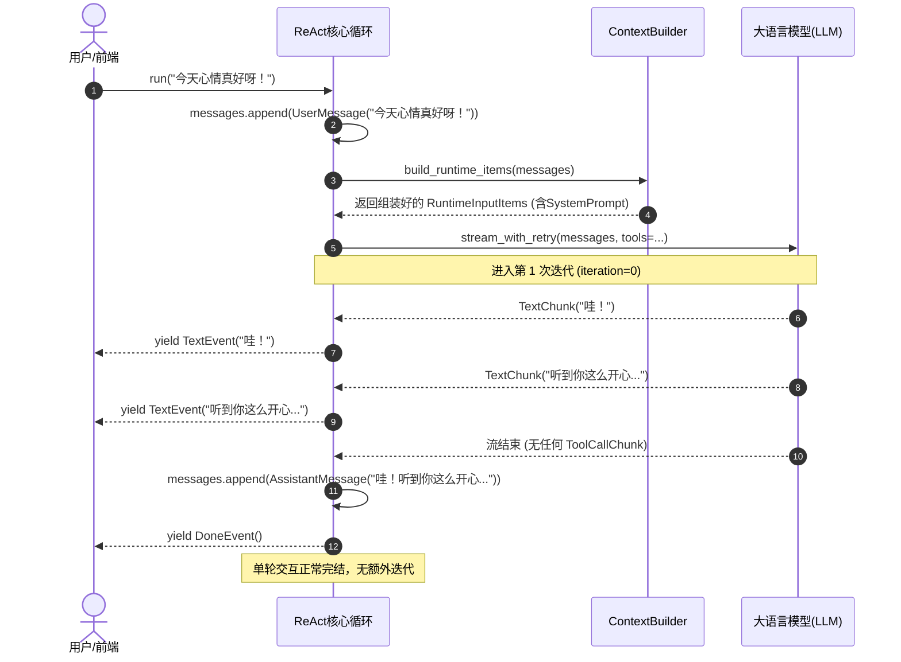
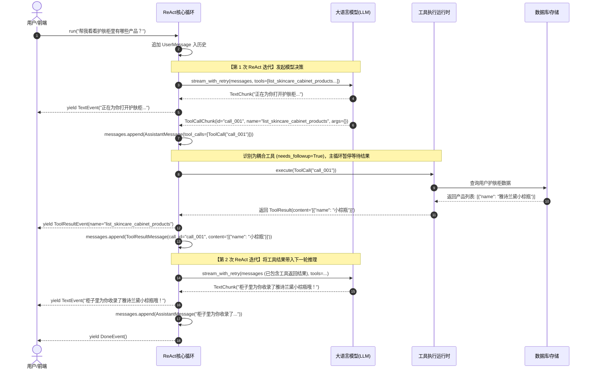
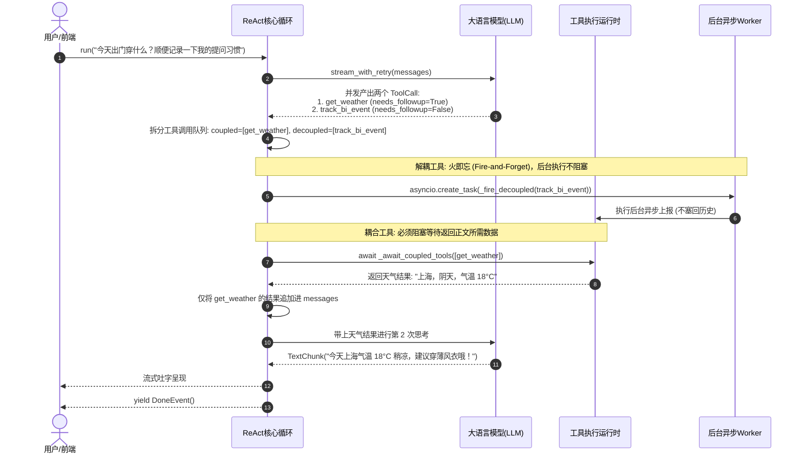
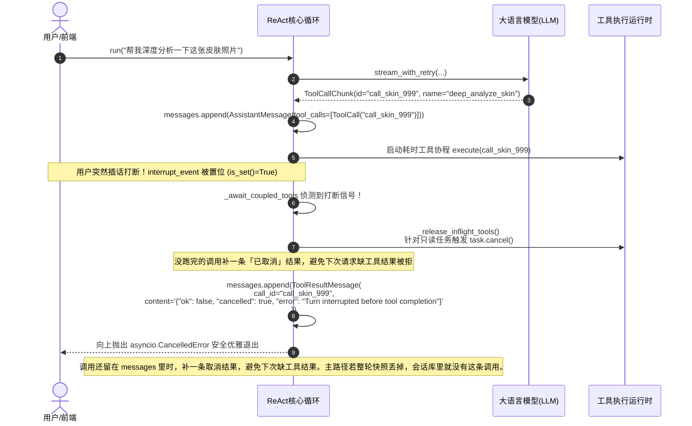
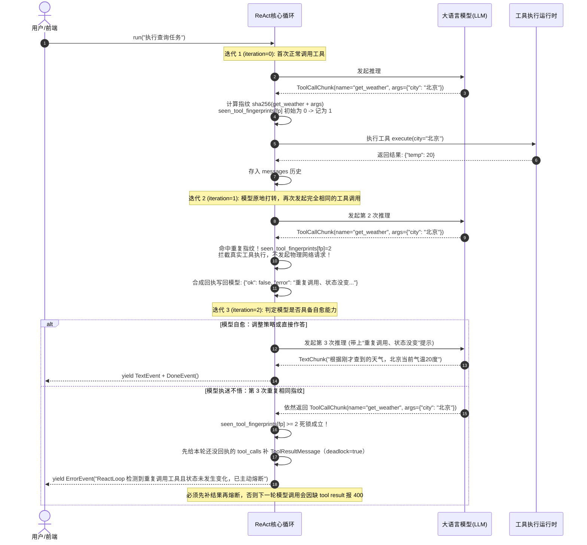
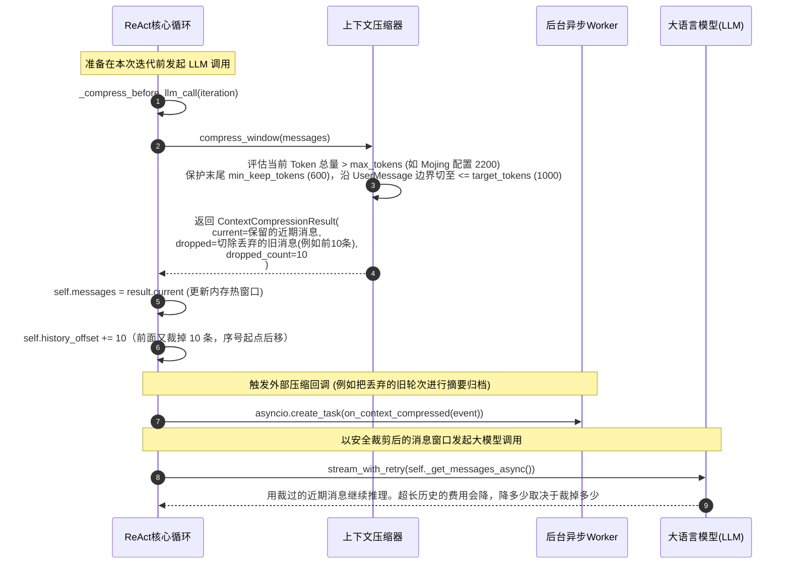

# 01_core：智能体核心执行引擎 (`ReactLoop`) 全景剖析

> **文件归属**：`simpleclaw/core/loop.py`、`messages.py`、`events.py`、`timing.py` 
> **模块定位**：SimpleClaw 智能体内核的“心脏与神经中枢”，驱动整个 ReAct（Reasoning + Acting）推理循环。 
> **推荐阅读顺序**：**第 1 篇**（必读基石）

---

## 一、架构定位与选型考量：为什么自研轻量引擎，而不是引入 LangGraph？

在设计智能硬件的前台执行引擎时，我们曾深度评估过 LangGraph。LangGraph 核心解决的是**有向图（DAG）流转**与**长周期跨天的人机协作（Human-in-the-loop 挂起唤醒）**。

端侧主路径收敛在 `TurnRunner + ReactLoop`。面试数字以第 13 篇为准，不要用第 12 篇里的 500 毫秒和凌晨 3 点。

### 1. 业务形态与计算模型不匹配（While 循环 vs 图拓扑）
- 前台主交互本质上是一个标准的单轮 ReAct（Thought -> Action -> Observation）**While 循环**；
- 业务主路径并不包含复杂的图分支跳转与节点扇出聚合，使用 200~300 行干净的 Python 异步协程即可完全掌控；强套基于 Pregel 理论的重型图引擎属于过度设计，会徒增几十层调用栈。

### 2. 多智能体架构范式异构（分布式异构网格 vs 内存单图）
- LangGraph 的多智能体适合单进程/同一图状态机内的节点间消息传递；
- 后台长任务走发件箱再发 Kafka，不堵在这一轮的 `ReactLoop` 里。做梦是空闲整理，默认成功间隔 30 分钟，不是凌晨 3 点的排期。首字延迟没有测成 500 毫秒。这些数字以第 13 篇为准。

### 3. 厂商专有显存缓存的深层入侵（火山方舟 Responses API）
- 火山前缀缓存存的是 `previous_response_id`。命中后请求不再重传稳定前缀和工具 Schema。这不是本机显存，也没有把首字做成 500 毫秒。关闭 HTTP 流不会释放方舟侧的缓存。
- 通用框架的高度封装将请求管道固化，魔改其底层的代价远大于直接写轻量协程循环。

### 4. 硬件端全双工与数据审计对齐
- 打断时 `aclose()` 停掉发往方舟的这次流。停的是这一轮的 HTTP 流，不是方舟侧的显存。
- **全局绝对序号对齐**：滑动窗口裁剪旧轮次时精准累加 `history_offset`，为长期因果账本（`MemoryLedger`）提供准确的源头追溯依据。

---

### 附：主路径状态管理与两级打断机制全景

| 回滚层级 | 对应源码位置 | 具体机制与回滚动作 |
| :--- | :--- | :--- |
| **第一层：单轮内存三指针快照还原**<br/>（`TurnRunner` 整轮可丢弃主路径） | [`Mojing/api/turn_runner.py`](file:///home/yang/mojing/mojing_agent/Mojing/api/turn_runner.py)<br/>`_restore_loop_snapshot` | 进 Turn 前拷贝 `messages`、`history_offset`、`consolidated_from`。打断时把这三份内存恢复到进场前，这一轮没写进 `agent_messages` 的半截对话不会留下。工具如果已经写了业务库，这一步不会把它改回去。 |
| **第二层：只覆盖进了缓冲区的副作用** | [`simpleclaw/runtime/side_effects.py`](file:///home/yang/mojing/mojing_agent/simpleclaw/runtime/side_effects.py)<br/>`SideEffectBuffer` | `stage()` 把 `commit_fn` 留到 `commit_all()`。打断时 `abort_all()` 只处理这份列表。生产入柜没有 `stage()`，打断也撤不回已经 `mark_in_cabinet` 的记录。`sync_write` 的打断策略是 `detach`：前台停等，写入继续。 |
| **第三层：在途工具 cancel/detach 与底座协议兜底**<br/>（协程管理 + 独立 Loop 兜底） | [`simpleclaw/core/loop.py`](file:///home/yang/mojing/mojing_agent/simpleclaw/core/loop.py#L348-L430)<br/>`_release_inflight_tools` | 工具在途打断时：只读工具（`cancel`）取消协程；后台长任务（`detach`）放后台跑完。若脱离 `TurnRunner` 独立作为 Python SDK 运行 `ReactLoop`（此时无外层整轮快照抹除），Loop 内部会自动补齐 `ToolResultMessage(cancelled=True)`，防止大模型 API 因工具结果不配对报 400。 |
| **第四层：终态增量 Diff 落库 + 记忆因果账本回滚**<br/>（持久化与长期记忆回滚） | [`Mojing/storage/session_store.py`](file:///home/yang/mojing/mojing_agent/Mojing/storage/session_store.py#L408-L461)<br/>[`simpleclaw/memory/ledger.py`](file:///home/yang/mojing/mojing_agent/simpleclaw/memory/ledger.py) | 整轮正常走完后，`save_turn` 只把 `[messages_before:]` 新增切片一次性 `append_messages` 追加进 PostgreSQL 并校验 `messages_persisted`。后台记忆提炼则记录 `MemoryLedgerRecord`（含 `memory_before`、`memory_actions`、`memory_after` 快照与原文 `source_chunk`），支持对错误提取做反向补丁回滚。 |

### 循环本身的核心职责
1. 不关心底下是火山、OpenAI 还是别的模型，也不关心某个工具内部怎么实现。输入是消息，流式增量是 chunk，对外只抛出事件。
2. 当前还在内存里的热态消息放在 `self.messages`。前面裁掉多少条，记在 `history_offset`。同一条消息的全局绝对序号不会因为裁剪而错位。

---

## 二、核心类与数据模型（Data Models）

### 1. 核心执行引擎：`ReactLoop`
智能体 ReAct 模式运转的总控制器，管理消息窗口、驱动大模型流式推理、并发派发工具并收集结果。

### 2. 消息模型（定义于 `simpleclaw/core/messages.py`）
- **`UserMessage`**: 用户输入消息，支持多模态内容（纯文本或带图片的字典列表）。
- **`AssistantMessage`**: 模型生成的助手消息，包含模型输出的文字 `content` 和发出的工具调用列表 `tool_calls`。
- **`ToolCall`**: 大模型发出的单次工具调用意图对象，包含 `id`（火山生成的 call_id）、`name`（工具名称）和 `arguments`（已修复的入参字典）。
- **`ToolResultMessage`**: 工具执行完毕后的返回结果消息，包含对应的 `call_id`、执行结果文本 `content` 及可选多模态资产 `media`。

### 3. 事件模型（定义于 `simpleclaw/core/events.py`）
`ReactLoop` 对外只吐出事件，前端或外层 HTTP 网关通过 `async for event in loop.run(...)` 消费：
- **`TextEvent(token)`**: 实时产出的增量文本片段，驱动前端打字机效果。
- **`ToolResultEvent(tool_name, result)`**: 工具执行完成通知，供前端展示卡片或执行状态。
- **`DoneEvent()`**: 当前 Turn 推理正常终结信号。
- **`ErrorEvent(message)`**: 发生未恢复异常或循环超限时的终结信号。

---

## 三、`ReactLoop` 类属性与核心方法详解

### 1. 属性字典全景说明

```python
class ReactLoop:
    def __init__(...):
        self.llm = llm                           # 大语言模型驱动接口 (LLMProvider)
        self.tool_registry = tool_registry       # 工具注册表 (ToolRegistry)
        self.max_iterations = max_iterations     # 单轮最大循环步数 (默认 20，防死循环)
        self.system_prompt = system_prompt       # 静态兜底系统提示词
        self.context_builder = context_builder   # 高级上下文构建器 (ContextBuilder)
        self.compressor = compressor             # 上下文滑动压缩器 (ContextCompressor)
        self.on_context_compressed = ...         # 压缩事件外部通知回调钩子
        self.messages: list = []                 # 当前内存热态消息窗口 (list[Message])
        self.history_offset: int = 0             # 内存首条消息在全局会话中的绝对序号偏移量
        self.consolidated_from: int = 0          # 兼容字段：待裁剪的历史消息前缀
        
        # 运行时单轮动态上下文跟踪
        self._current_query: str = ""            # 本轮意图检索 query (传给记忆/证据召回)
        self._current_user_input: str = ""       # 本轮用户原话文本
        self._current_model_media: list = None   # 仅本轮模型可见的临时图片 (如历史对比图)
        self._current_dynamic_context_sections   # 本轮动态拼装的背景片段 (如用户肤质画像)
        self._current_attention_packets          # 本轮高优先级注意力包 (如业务强约束)
        self._current_context_metadata           # 租户与硬件等业务透传元数据
        self._background_tasks: set = set()      # 强引用集合，防 asyncio 后台任务被 GC 误杀
```

### 2. 关键方法及其内部算法

#### (1) `run(user_input, ...)`
- **定位**：外部调用的总入口。
- **参数防线**：
  - `persist_user_input: bool`：默认为 True。如果开启了首字预热代理（`FirstTokenAgent`），首字代理已经把 `UserMessage` 提前存入了会话，此处传 `False`，防止同一句用户提问被重复存入历史两次！
  - `model_media: list[str] | None`：只给这一轮模型看的图片，例如拿 7 天前的照片做对比。不写入会持久化的 `UserMessage`。

#### (2) `_react(interrupt_event)`
- **定位**：ReAct 核心循环中枢，包含 7 个步骤：
  1. **压缩前置检查**：调用 `_compress_before_llm_call`，如果历史 Token 超标，在调 LLM 前切除超额旧轮次。
  2. **协作流式推理**：调用 `self.llm.stream_with_retry`，通过 `_stream_until_interrupted` 实现可随时打断的流式吐字。
  3. **模型输出归盘**：将拼接出的 `text_buffer` 和累积的 `tool_calls` 打包成 `AssistantMessage` 追加到 `self.messages`。
  4. **终结研判**：若无任何工具调用，说明大模型已完成回答，直接 `yield DoneEvent()` 退出。
  5. **快慢工具分流**：
     - 若 `tool_registry.needs_followup(call) == False`（解耦工具，如发送异步统计）：通过 `_fire_decoupled` 扔进后台 Task 执行，不等待、不阻塞主循环；
     - 若 `tool_registry.needs_followup(call) == True`（耦合工具，如查询护肤品）：必须原地等待执行结果并塞入历史。
  6. **并发执行耦合工具**：调用 `_await_coupled_tools` 并发执行所有耦合工具。
  7. **回填结果并自旋**：将每个工具的执行结果封装为 `ToolResultMessage` 存入 `self.messages`，回到步骤 1 开启下一轮迭代。
  8. **防死循环熔断**：如果循环次数达到 `self.max_iterations`，强制 `yield ErrorEvent(...)` 退出。

#### (3) `_stream_until_interrupted(stream, interrupt_event)`
- **定位**：异步生成器级的协作式打断包装器。
- **并发控制**：`asyncio.wait` 同时等下一个 chunk 和打断信号。打断后 `aclose()` 停掉这条到方舟的 HTTP 流。显存在方舟那边，客户端关连接不等于释放对方的 GPU。

#### (4) `_await_coupled_tools(coupled, interrupt_event)`
- **定位**：耦合工具并行等待与打断仲裁器。
- **打断时工具怎么处理（`_release_inflight_tools`）**：
  - 只读（`cancel`）：取消这个任务。
  - 写操作、已经入库的长任务（`detach`）：不取消。这一轮不再等，任务在后台继续跑完。历史里补的是「这轮不等了」，不是把数据库改回去。

#### (5) 裁掉旧消息以后，序号怎么对上
内存里的 `messages` 只留最近一段。前面裁掉的条数记在 `history_offset`。

举例：一共来过 150 条，前面 100 条已经裁掉，`history_offset = 100`，内存里还剩 50 条。别的模块记的「第 105 条」，在当前列表里的位置是 `105 - 100 = 5`。

如果拿一条已经被裁掉的序号来查，相减会是负数。代码用 `max(0, 序号 - history_offset)` 收成 0。不然 Python 会把负数下标当成「从末尾往前数」，取错消息。

裁的时候只允许切在一条新的用户消息上，所以同一轮里的助手回复和工具结果不会被从中间切开。token 数是按字数粗算的（中文大约按 0.7，其他非空字符大约按 0.5），不是模型官方分词器，只用来决定要不要裁。

---

## 四、全景场景时序图与示例

### 场景 1：纯文本单轮直出（最快主路径，无工具调用）
> **案例**：用户提问：“今天心情真好呀！”，大模型直接以闺蜜人设回复问候，无需任何工具调用。



---

### 场景 2：单轮单工具调用与结果回显（Coupled Tool）
> **案例**：用户提问：“帮我看看我柜子里现在有哪些护肤品？”，大模型需要调用 `list_skincare_cabinet_products` 工具，获取返回值后结合库存做综合回答。



---

### 场景 3：并行多工具调用与快慢解耦（Parallel Tool + Decoupled Background Task）
> **案例**：大模型同时决定调用两个工具：
> 1. `get_weather`（耦合工具，查出温度需要立刻在正文中回复给用户，`needs_followup=True`）；
> 2. `track_bi_event`（解耦工具，纯后台埋点，无需向用户汇报，`needs_followup=False`）。



---

### 场景 4：用户插话打断，并补上没完成的工具结果
> **案例**：模型已经发出工具调用 `deep_analyze_skin`，工具还在跑，用户突然又说话或点了停止。如果这时候只抛错退出，历史里会留下「助手声明了工具调用，后面没有结果」。下次请求容易被 OpenAI / 火山拒掉。循环会给没写完的调用补一条取消结果。



#### 架构深挖：打断时的「在途工具二分治理」与「流式断连 Token 止损」

在真实大模型生产环境中，打断（Interrupt / Cancellation）绝不能一刀切强行 kill，必须区分**只读查询**与**持久写操作**，并对齐网络断连生命周期：

1. **在途任务二分策略（`cancel` vs `detach`）**（详见 [`simpleclaw/tools/interrupt.py`](file:///home/yang/mojing_agent/simpleclaw/tools/interrupt.py)）：
   - **`cancel`（只读放弃等待）**：针对 `sync_read` 纯查询工具（如查天气、搜知识库）。用户插话后立即取消协程，主循环立刻脱身去回答新问题。
   - **`detach`（脱钩后台续跑）**：`durable` 长任务和 `sync_write`（入柜就是这种）。前台不再等它，已经发出的写入或外部任务继续做完。用户事后说「别加了」，这一步不会自动删掉已经入柜的记录。
     - 再问「报告好了没」仍要走一轮模型，通常再查一次任务状态。不是 0 token。报告耗时以外部服务为准，文档里不写死 10 分钟或 15 分钟。

2. **浏览器/客户端关闭（SSE 断连）全链路生命周期**：
   - **网络感知**：用户关闭网页/小程序，TCP 触发 RST/FIN，FastAPI 的 `StreamingResponse` 迭代器在 `finally` 块执行 `await ingress.cancel()`，将 `interrupt_event` 置位。
   - **断流**：`_stream_until_interrupted` 里 `aclose()` 停掉发往方舟的 HTTP 流。还没吐出的字不再往下收。账单以方舟为准。
   - **消息留存与大模型协议对齐**：
     - **未完正文**：在 [`Mojing/api/turn_runner.py`](file:///home/yang/mojing_agent/Mojing/api/turn_runner.py#L460-L466) 中触发 `_restore_loop_snapshot` 事务快照回滚，丢弃断头残句，防止半拉子废话污染下次提问的上下文；
     - **在途工具调用**：若断连瞬间模型已吐出 `ToolCall`，底座强制自动补齐 `ToolResultMessage(cancelled=True)`，**严格遵循大模型 API 成对闭合铁律，杜绝下次请求抛出 HTTP 400（Missing tool call result）**。

---

### 场景 5：工具指纹去重、反思引导与死循环主动熔断（Tool Call Fingerprint Dedupe & Circuit Breaker）
> **设计痛点**：传统 ReAct 循环仅靠 `max_iterations=20` 兜底，在大模型遇到工具报错或状态不更新时，往往会用完全相同的参数原地打转，白白消耗 20 次模型推理费用与大量时间。
> **SimpleClaw 解决方案**：
> 1. **工具调用指纹算法**：每轮循环对 `(tool_name, 规范化排序的 JSON 参数)` 计算 SHA-256 唯一指纹；
> 2. **第 1 次重复（温和纠偏）**：拦截底层工具的物理执行，自动合成结构化警示回执 `{"ok": false, "repeated_call": true, "error": "重复调用、状态没变..."}` 写回模型历史，给大模型一次分析反思、调整参数或直接回答的机会；
> 3. **第 2 次重复（死循环硬熔断）**：若模型执迷不悟在后续迭代中再次发出相同指纹，立即触发断路器熔断退出（`ErrorEvent`），将死循环拦截在第 2~3 步，杜绝 20 步空转；
> 4. **超长工具输出截断保全**：当工具输出大于 2000 字符时，送入大模型上下文的副本被安全截断并附带提示，而持久化历史与数据库中保留 100% 原始全文。



---

### 场景 6：大模型调用前滑动窗口上下文压缩（Context Window Boundary Sliding Compression）
> **案例**：多轮对话累积后，动态消息窗口估算 Token 超过 `max_tokens`（`SimpleClaw` 默认 `6000`；`Mojing` 在 `Mojing/api/composition/sessions.py` 中配置为 `max_tokens=2200, target_tokens=1000, min_keep_tokens=600`）。`_compress_before_llm_call` 自动触发轮次边界保护性裁剪，并将裁掉的旧轮次异步交给外部回调做记忆提取。



---

## 五、面试怎么答

### 1. 为什么不用 LangGraph 的状态机和 Checkpointer？你们是怎么做状态管理和回滚的？

面试口径以第 13 篇为准。第 12 篇里的 500 毫秒和凌晨 3 点不要背。

> “我们在选型初期深度评估过 LangGraph。LangGraph 核心解决的是复杂有向图（DAG）流转与跨天人机长审批（Pause/Resume）。但在我们的端侧智能硬件场景中，不采用它有四个核心工程现实：
>
> 1. **业务形态是 While 循环而非图**：前台主路径本质是标准的单轮 ReAct While 循环，没有复杂的图分支；用 300 行异步协程就能完全掌控，强套基于 Pregel 理论的重型图引擎徒增调用栈深度与排障黑盒。
> 2. **长任务不堵在这一轮循环里**：深度报告走发件箱再发 Kafka。做梦是空闲整理，默认间隔 30 分钟，不是凌晨 3 点。没有测过首字小于 500 毫秒。
> 3. **前缀缓存**：稳定前缀换成 `previous_response_id` 之后不再重传。命中看 `cached_tokens > 0`。命中不等于首字变快。缓存 id 在进程字典和 Postgres，不在 Redis。
> 4. **打断和窗口**：`aclose()` 停这次模型流。`history_offset` 记被裁掉的消息序号。已入柜的记录不会因为打断自动删除。
>
> 至于状态管理与回滚：对话消息通过单轮进场内存指针快照（`messages_snapshot`）管理，打断则整轮丢弃；写操作在交互层先确认再调用，调用后以数据库为准，流式播报被打断也不撤回已点头的写入。”

### 2. 对方如果追问「工具正在跑的时候被打断，循环内部怎么处理？『整轮抹掉』和『补 cancelled ToolResult』会不会冲突？」

这里一定要把**主路径与独立 SDK 调用的两级边界**拆开说清楚：

> 不会冲突，因为它们属于两个不同的使用边界：
> 1. **魔镜硬件主路径（`TurnRunner` 管控）**：优先走 `_restore_loop_snapshot` 整轮内存回滚 + `SideEffectBuffer.abort_all()`。本轮追加的垫话、模型输出和半截 `tool_calls` 被整段从内存抹掉，回到轮前状态，会话库压根不存这轮，所以**完全不需要、也不应该留 `cancelled` 消息**。
> 2. **独立 SDK 调用模式（开发者在单测或离线脚本中直接 `import ReactLoop`）**：此时外部没有 `TurnRunner` 帮它做整轮内存指针回滚，大模型发出的 `tool_calls` 已经留在了内存消息列表里。为了防止下次调用大模型时因工具调用未闭合而报 `HTTP 400`，才由 `ReactLoop` 内部自动补齐一条 `ToolResultMessage(cancelled=True)` 保证协议成对闭合。

### 3. 对方如果追问「后台工具不写回结果，下一轮会不会 400？」

要主动把边界说清楚，不要说成协议已经没有洞：

> `needs_followup=False` 时，代码把工具丢到后台，结果不写入 `messages`。如果这条助手消息里还带着这次工具调用，下一次按 OpenAI / 火山的规则回放整段历史，仍然可能 400。
>
> 所以两件事要分开讲。需要模型接着看的工具，结果一定写回。纯副作用不阻塞主回答；回放时不能留下「只有调用、没有结果」。更稳的做法是补一条很短的「已接收」，或者回放时不要把这类调用原样送回去。现在的循环是不回写。

### 4. 对方如果追问「序号是干什么的？」

> 内存里只留最近一段消息。别人记的是「从头数的第几条」，列表裁过以后，下标 5 可能已经不是原来那条。
>
> `history_offset` 就是前面裁掉的条数。第 105 条、前面已经裁了 100 条，当前列表里就是第 5 条。裁剪只切在用户新开的一轮，避免把工具调用和结果切散。

### 5. 对方如果追问「你们是怎么防死循环和振荡的？仅靠 max_iterations 会不会浪费 Token？存在误判吗？」

不要吹“零误判、三种循环全灭”，而是**主动把误判边界、指纹熔断机制与工程取舍讲清楚**，这最显资深与工程实战深度：

> 我们采用了**「工具调用指纹防重（Fingerprint Dedupe） + 反思引导回执 + 2步死循环熔断断路器」**的三级防护机制，彻底解决了米哈游面试常考的“步数上限分不清合理重试和原地打转”的痛点：
> 
> 1. **工具调用指纹计算与原地打转拦截**：
>    在 `ReactLoop` 中，对每个工具调用计算 `SHA-256(tool_name + 规范化排序的 JSON 参数)` 生成调用指纹。
>    - **首次重复（count=1 -> 2）**：拦截真实物理执行，不发起无意义的网络请求，向模型历史注入结构化回执：`{"ok": false, "repeated_call": true, "error": "重复调用、状态没变: 工具在当前轮次已使用相同参数执行过，执行结果未发生变化。请勿重复调用相同工具，请分析已有结果并调整参数或直接回答用户。"}`，引导大模型分析报错或切换策略。
>    - **二次重复（count>=2）**：若模型在收到明确警告后依然执迷不悟发起相同调用，判定为死循环死锁，`ReactLoop` 立即主动触发断路器熔断退出（`ErrorEvent`），将死循环拦截在第 2~3 步，彻底终结 20 次空转烧 Token。
> 2. **区分瞬时网络重试与参数校验拦截**：
>    在 `ToolExecutionRuntime` 中：
>    - **瞬时网络异常**（如 `TimeoutError`, `ConnectionError`）：针对只读工具（`sync_read`）允许退避 0.5s 并重试 1 次；写操作工具（`sync_write`）严禁自动重试，防止副作用重放。
>    - **参数 Schema 与校验错误**：严禁原样重试，直接在错误提示中附带 `[参数不合法，必须修改参数后重试，禁止原样重复调用]`，促使大模型修正参数结构。
> 3. **模型视界超长输出截断与底座全量持久化**：
>    工具返回超过 2000 字符时，`truncate_tool_output_for_llm` 对送入大模型的上下文副本做截断并附带提示，防止上下文窗口被单次工具撑爆；而持久化数据库（`agent_messages` 和 `tool_invocations`）中始终完整保存 100% 原始全文。

### 6. 对方如果追问「执行外部耗时服务时用户说取消，结果直接扔吗？算不算浪费 Token？流式输出中用户关掉网页怎么办？消息怎么留？」

这道题直接考核你对**“分布式长事务状态机”**与**“SSE 协议断连全链路”**的深层理解。建议按三层结构权威作答：

> 这个问题我们在底座（[`simpleclaw/tools/interrupt.py`](file:///home/yang/mojing_agent/simpleclaw/tools/interrupt.py)）和网关（[`turn_runner.py`](file:///home/yang/mojing_agent/Mojing/api/turn_runner.py)）做了严格的二分与生命周期管理：
>
> **1. 只读和写入分开。** 查天气用 `cancel`，不再等。`durable` 和 `sync_write` 用 `detach`：前台不再等，已经提交的外部任务或入柜写入会做完。用户改口「别加了」不会自动删柜。
> **2. 关掉页面。** `interrupt_event` 置位后，`aclose()` 停掉发往方舟的这条流。还没生成的字不再往下收。计费以方舟账单为准，不要说成客户端释放了显存。
> **3. 消息留不留。** 魔镜主路径用快照丢掉这一轮还没落库的半截回复。若循环里已经留下了 `tool_calls`、外面又没有整轮快照，才补 `cancelled` 的工具结果，避免下一次请求缺结果。两套不要说成同一次打断既整轮抹掉、又必须把 cancelled 写入会话库。

