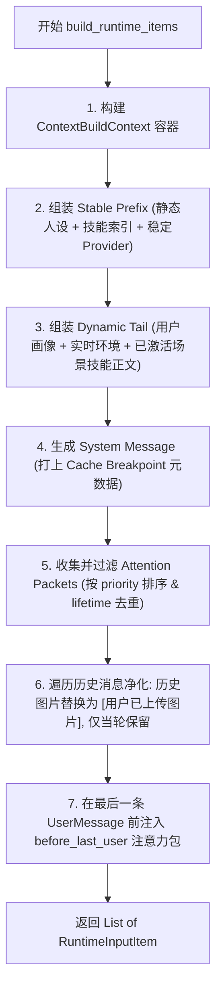
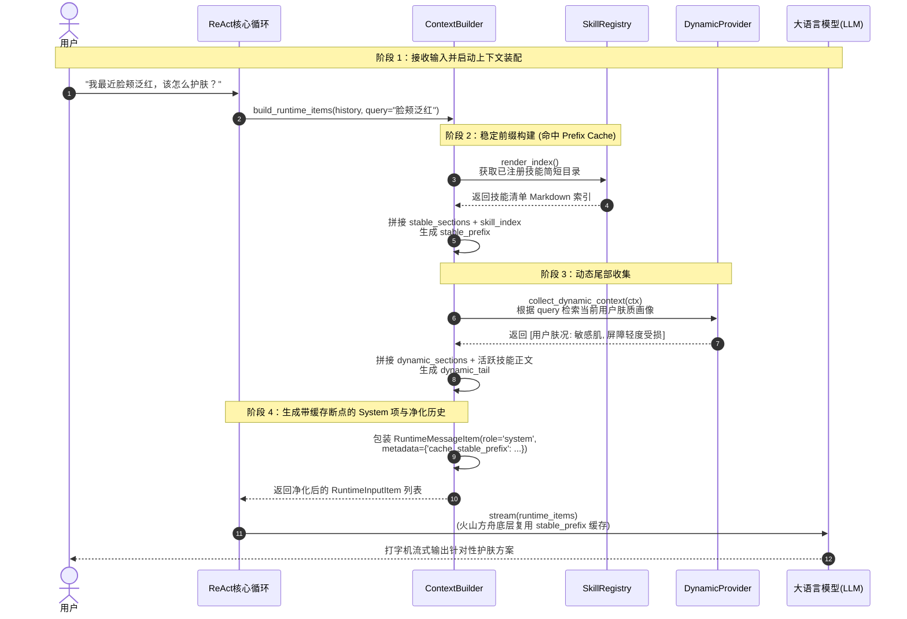
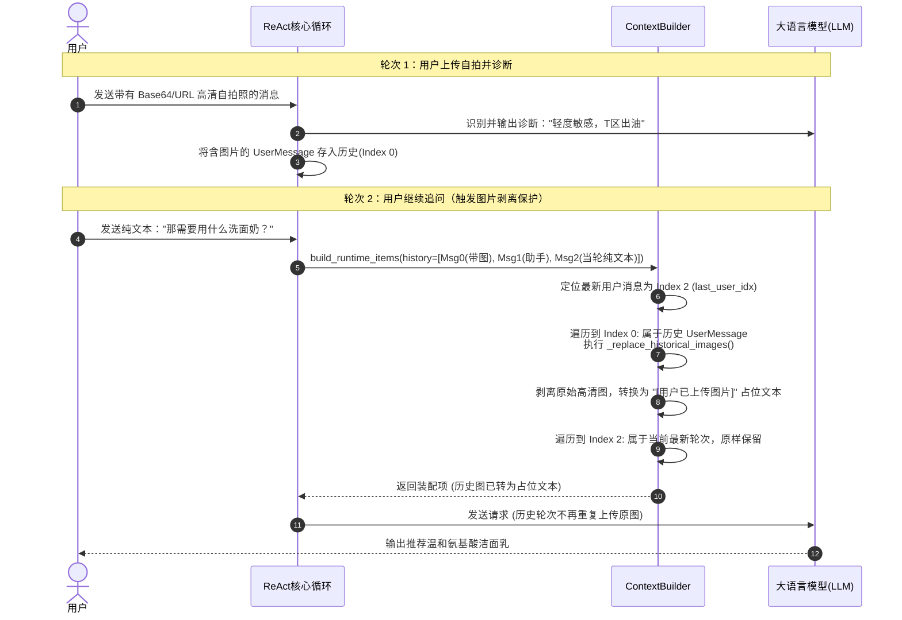
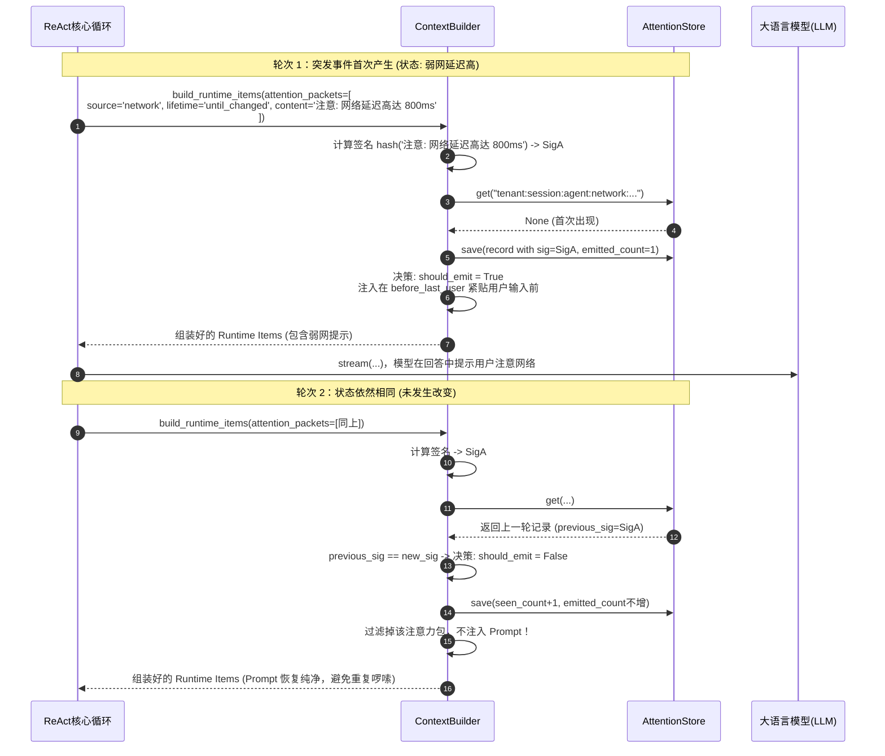
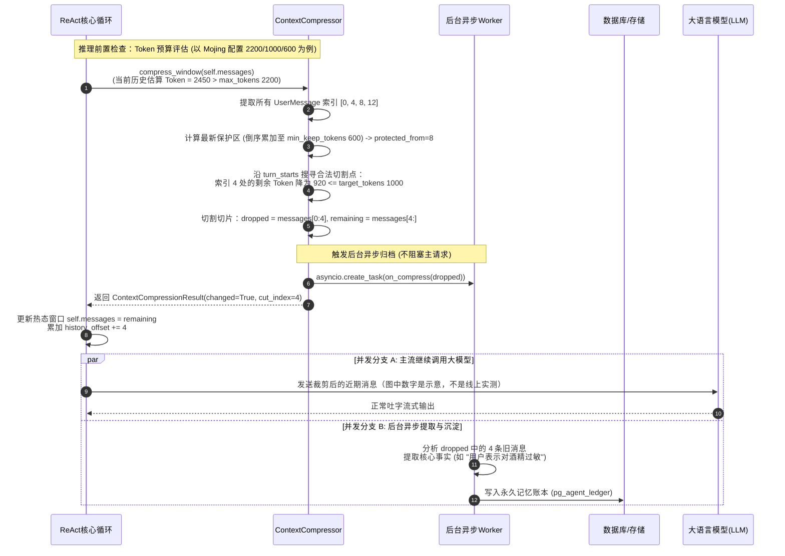
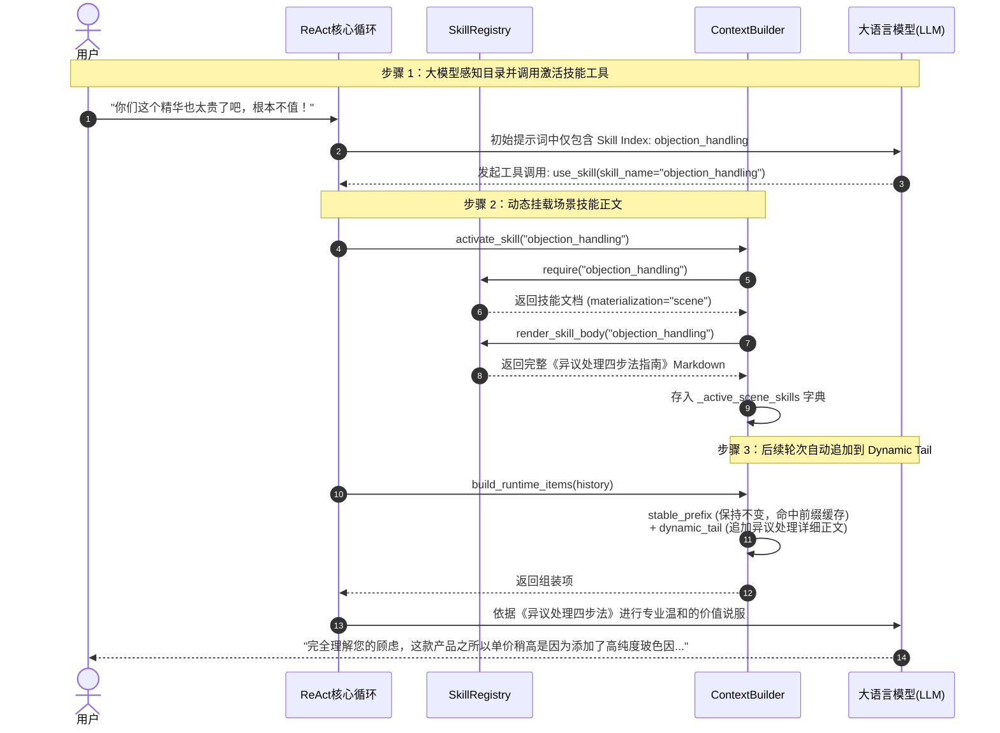

# 02_context：上下文装配与滑动窗口压缩

> **文件归属**：[`simpleclaw/context/builder.py`](file:///home/yang/mojing/mojing_agent/simpleclaw/context/builder.py)、[`compressor.py`](file:///home/yang/mojing/mojing_agent/simpleclaw/context/compressor.py)、[`providers.py`](file:///home/yang/mojing/mojing_agent/simpleclaw/context/providers.py)、[`emission.py`](file:///home/yang/mojing/mojing_agent/simpleclaw/context/emission.py) 
> **模块定位**：SimpleClaw 智能体内核的“信息调度与装配中枢”，负责提示词冷热分离、多模态资产净化、高优先级注意力包调度以及轮次保护性滑动压缩。 
> **推荐阅读顺序**：**第 2 篇**（在理解核心循环后，剖析传给 LLM 的上下文是如何精细化生成的）

---

## 一、上下文为什么要拆开装

把人设、当前时间、用户资料、历史图片拼成一整段字符串，原型能跑。多轮以后会碰到三件具体的事：前缀老在变，缓存用不上；旧图片每一轮都重发，token 涨得很快；该提醒的约束要么每轮都念，要么被历史淹没。

这些不是某个框架独有的缺陷。LangChain 现在可以对 Anthropic 打缓存标记，OpenAI 也有自动前缀缓存，以及 `prompt_cache_key`、显式缓存断点。`trim_messages` 也可以把「工具调用 + 工具结果」当成一整段来裁。我们自己写，是因为稳定前缀、历史图片、提醒频率要和这条护肤会话的装配绑在一起。

前缀不变、服务端缓存还没过期时才会命中。改一个字、换一套工具、或者缓存过期，都会重新算。不要说成 100% 命中。

| 要解决的事 | 我们的默认做法 |
| :--- | :--- |
| 不变的人设和老在变的内容混在一起，前缀缓存用不上 | 不变的放稳定前缀，本轮才有的放动态尾巴。前缀的字节不变，才有机会命中。 |
| 历史里的旧图片每一轮都重发 | 只有最新一轮用户消息保留原图。更早的图换成文字 `[用户已上传图片]`。 |
| 按字数硬切，容易把工具调用和结果切散 | 只在一条新的用户消息处下刀，并留住最近一段（`min_keep_tokens`）。切不出安全位置就整段保留。 |
| 有的提醒每轮都说会很吵，不说又会忘 | 注意力包按寿命发：变了才说、隔几轮说一次、只说一轮、或者每轮都说。游标可以存下来，换进程还认得上次发过没有。 |

### 面试时可以怎么说

> 上下文我拆成稳定前缀和动态尾巴。人设、工具定义尽量不动，时间、用户资料、本轮提醒放后面，这样前缀缓存才有机会命中。旧图片不每轮重发，只留一句「用户上传过图片」。历史太长时按整轮裁，不把工具调用和结果从中间切开。提醒做成数据包，变了才说，避免每轮重复念。框架里也能做缓存标记和合法裁剪，我们是把这些写成这条链路的默认装配。

---

## 二、核心类与数据协议全景

### 1. 数据模型与协议（定义于 [`providers.py`](file:///home/yang/mojing/mojing_agent/simpleclaw/context/providers.py) 与 [`emission.py`](file:///home/yang/mojing/mojing_agent/simpleclaw/context/emission.py)）

#### (1) `ContextBuildContext`（上下文构建环境容器）
贯穿上下文装配全流程的只读参数上下文：
```python
@dataclass(slots=True)
class ContextBuildContext:
    history: list[Any]                    # 当前会话的消息历史 (Message 列表)
    query: str = ""                       # 用户当前轮次的原始问题纯文本 (供 Provider 检索)
    tenant_key: str = "__default__"       # 多租户隔离唯一标识
    cache_lane: str = "agent"             # 缓存泳道 (如 "agent", "subagent")
    cache_session_key: str = ""           # 会话级缓存锚点
    metadata: dict[str, Any] = ...        # 业务附加元数据
    active_skills: list[str] = ...        # 当前会话已挂载激活的场景技能清单
```

#### (2) `AttentionPacket`（结构化注意力单元）
业务约束优先走这个数据包，由 `ContextBuilder` 按位置和寿命放进提示词：
- `content`: 文本或多模态消息内容。
- `source`: 来源标识（如 `"device_event"`, `"work_item_checklist"`, `"safety_guard"`）。
- `priority`: 整数，数值越小越优先（升序排序）。
- `lifetime`: 生命周期，决定发射策略：
  - `"one_turn"`: 单轮用完即焚。
  - `"until_changed"`: 状态哈希未变则抑制发射，一旦改变才再次提醒（防大模型唠叨）。
  - `"periodic"`: 按指定间隔轮次周期性提醒。
  - `"always"`: 每一轮对话始终强制提醒。
- `placement`: 注入位置：
  - `"before_last_user"`: 紧贴在最后一条用户提问的前方（**注意力最集中区**）。
  - `"after_history"`: 放在对话历史之后。
  - `"tail"`: 整个 Prompt 最末尾。

#### (3) `AttentionEmissionRecord`（注意力发射游标记录）
持久化存储中记录的状态记录，支持跨服务进程、跨请求去重：
- `key`: 全局唯一键（`tenant:session:lane:source:placement:role:subject`）。
- `signature`: 内容与元数据的 SHA-256 指纹。
- `seen_count`: 累计被扫描到的总次数。
- `emitted_count`: 真正发送给大模型的累计次数。
- `last_emitted_at_ms`: 最近一次真正发射的时间戳。

---

## 三、核心类与关键算法详解

### 1. `ContextBuilder`（上下文组装中枢）

```python
class ContextBuilder:
    def __init__(
        self,
        stable_sections: list[str],
        *,
        stable_prompt_providers: list[StablePromptProvider] | None = None,
        dynamic_context_providers: list[DynamicContextProvider] | None = None,
        attention_providers: list[AttentionProvider] | None = None,
        skill_registry: SkillRegistry | None = None,
        include_skill_index: bool = False,
        attention_emission_store: AttentionEmissionStore | None = None,
        tenant_key: str = "__default__",
        cache_lane: str = "agent",
        cache_session_key: str = "",
        prefix_cache_tenant_key: str | None = None,
        prefix_cache_session_key: str | None = None,
    )
```

#### 关键参数解析：
1. `stable_sections`: 绝对不变的核心人设、红线规则。所有用户与会话全局共享。
2. `include_skill_index`: 若为 True，会自动把 `SkillRegistry` 的简短索引目录（名称与使用场景）挂在稳定前缀末端，模型具备全局技能感知，但不会过早物化正文。
3. `prefix_cache_tenant_key`: 若配置，允许不同租户共享相同的底层云端前缀缓存（跨租户 Cache Pooling）。

#### 核心方法：`build_runtime_items(...)`


#### 关键算法 1：历史大图净化算法 (`_replace_historical_images`)
```python
def _replace_historical_images(content):
    if not isinstance(content, list):
        return content
    text_parts = []
    image_count = 0
    for item in content:
        # 检测 OpenAI / Anthropic 多模态字典格式
        if item.get("type") in {"image_url", "input_image"} or "image_url" in item:
            image_count += 1
            continue
        if item.get("type") in {"text", "input_text"}:
            text_parts.append(str(item.get("text") or "").strip())
    if image_count:
        text_parts.append("[用户已上传图片]" if image_count == 1 else f"[用户已上传图片] x{image_count}")
    return "\n".join(text_parts).strip() or "[用户已上传图片]"
```
旧图不再按原图重发，只留一句占位。能省多少 token 取决于图片大小和轮数，这里没有单独的压测数字。模型仍可能根据占位文字知道以前传过图。

---

### 2. `ContextCompressor`（滑动窗口压缩器）

```python
class ContextCompressor:
    def __init__(
        self,
        *,
        max_tokens: int = 6000,
        target_tokens: int = 3000,
        min_keep_tokens: int = 1500,
        token_counter: Callable[[list], int] | None = None,
        on_compress: Callable[[list], Awaitable[None]] | None = None,
    )
```

#### 关键参数防线：
- `max_tokens`: 触发压缩的上限阈值（`SimpleClaw` 默认 `6000`；`Mojing` 线上在 `Mojing/api/composition/sessions.py` 中配置为 `2200`）。
- `target_tokens`: 触发后目标压缩水位（`SimpleClaw` 默认 `3000`；`Mojing` 配置为 `1000`），必须 `< max_tokens`。
- `min_keep_tokens`: **近期消息防丢保护区**（`SimpleClaw` 默认 `1500`；`Mojing` 配置为 `600`），从末尾往前累加未达到此阈值的近期消息**不切入**，防止把刚聊的两句话裁掉。
- `_find_cut` 算法：
  1. 提取所有 `UserMessage` 的下标作为 `turn_starts`。
  2. 若有效轮次 `< 2`，放弃切割（不可把唯一的一轮裁掉）。
  3. 从后向前累加 Token，锁定 `protected_from` 保护区边界。
  4. 从旧到新沿 `turn_starts[1:]` 推进，找到第一个使得剩余 Token `<= target_tokens` 且不在保护区内的切割点。
  5. 丢弃的消息段 `dropped` 异步派发至 `on_compress` 回调，供记忆中枢（Memory/Dream）提取长期事实并存入数据库！

---

## 四、全场景实战时序图（Mermaid 8.14.0+ 规范）

> [!IMPORTANT]
> 严格遵循 Typora 兼容与全局规则：禁用所有保留字 ID，第二行开启 `autonumber`，消息换行使用 `<br/>`。

### 场景 1：标准多源上下文装配流程（稳定前缀与动态尾部分离）

展示当用户发起护肤咨询时，`ContextBuilder` 如何从各个 Provider 抽取数据，组装稳定前缀、动态尾部及净化历史：



---

### 场景 2：多模态历史大图剥离与当前轮保留流程

当历史轮次包含高清照片时，验证历史图片被剥离降级为占位符，唯独最新一轮保留原图：



---

### 场景 3：注意力包生命周期管理与跨轮去重（`until_changed`）

展示业务约束（例如“网络弱网提醒”或“待办任务进度”）如何通过签名哈希实现“变动才发射，未变则静默”：



---

### 场景 4：轮次保护性滑动压缩与后台记忆归档流程

展示当对话长达数万字导致 Token 超标时，`ContextCompressor` 如何在保护近期轮次的前提下安全切割，并将被丢弃消息异步提交后台存入数据库：



---

### 场景 5：场景技能动态激活与正文物化挂载（Progressive Disclosure）

展示如何实现“渐进式技能暴露”：平时仅在稳定前缀保留目录；触发特定场景后，动态将详细规则挂载到 `Dynamic Tail`：


