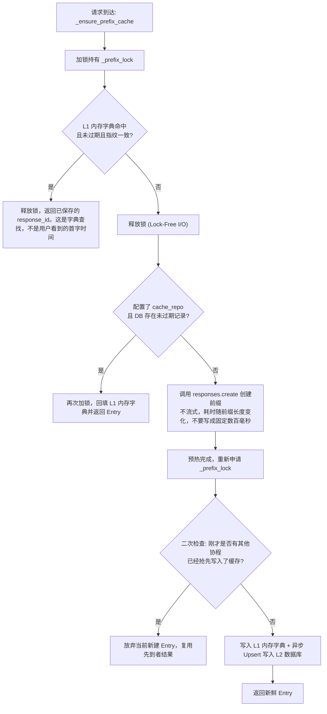
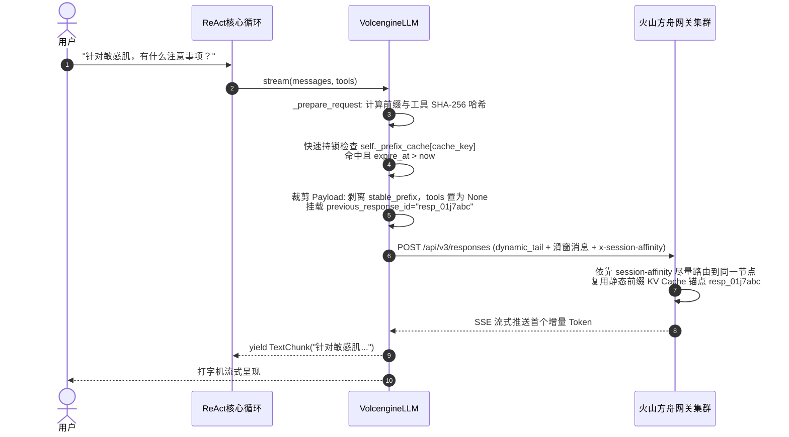
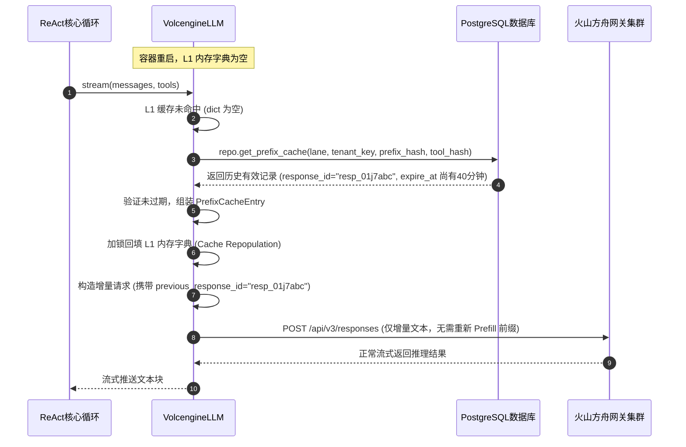
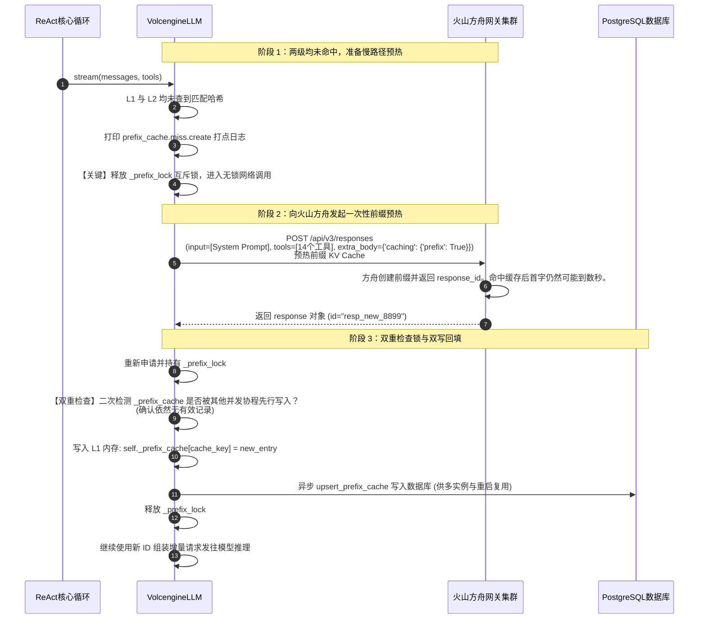
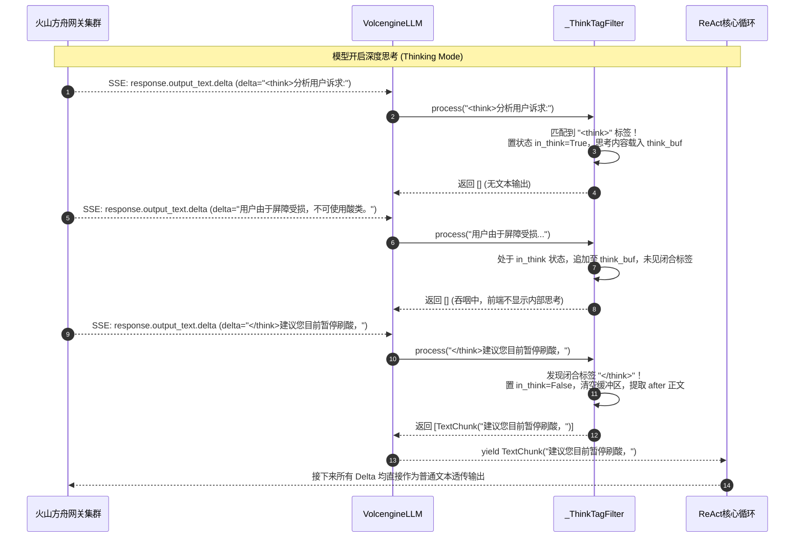
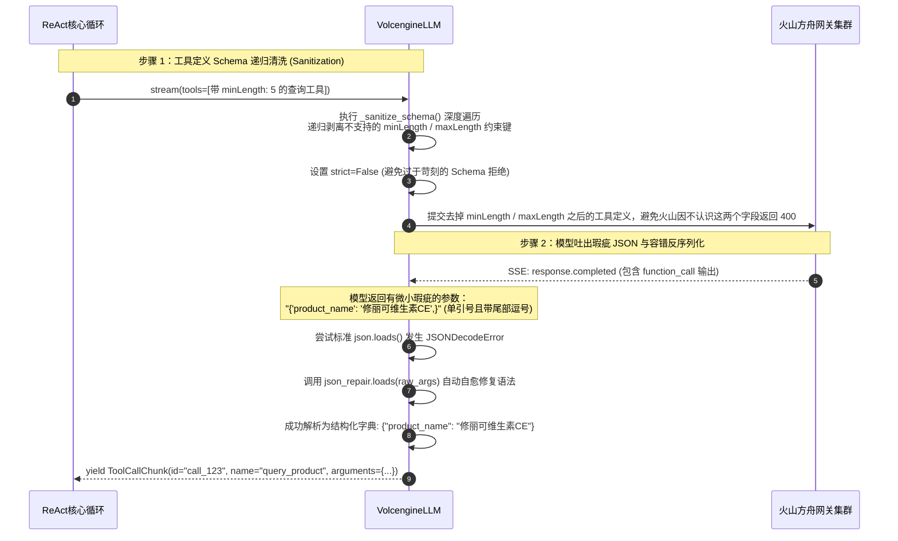

# 03_llm：大模型驱动与显式前缀缓存架构全景剖析

> **文件归属**：[`simpleclaw/llm/volcengine.py`](file:///home/yang/mojing/mojing_agent/simpleclaw/llm/volcengine.py)、[`base.py`](file:///home/yang/mojing/mojing_agent/simpleclaw/llm/base.py)、[`chunks.py`](file:///home/yang/mojing/mojing_agent/simpleclaw/llm/chunks.py)、[`config.py`](file:///home/yang/mojing/mojing_agent/simpleclaw/llm/config.py)、[`adapters/responses.py`](file:///home/yang/mojing/mojing_agent/simpleclaw/llm/adapters/responses.py)、[`adapters/chat.py`](file:///home/yang/mojing/mojing_agent/simpleclaw/llm/adapters/chat.py)  
> **模块定位**：SimpleClaw 体系与云端大语言模型推理集群（字节跳动火山方舟 / 豆包）的标准化协议桥梁与高性能接入网关。  
> **推荐阅读顺序**：**第 3 篇**（上下文组装完之后，看请求怎么交给火山，前缀 id 怎么复用）

---

## 一、前缀 id 用来少算重复内容

在企业级智能体运行中，System Prompt 通常包含庞大的静态内容：
1. 完整的智能体人设、性格特征、业务红线禁令（如严禁诊断处方药）；
2. 10~20 个工具的庞大 OpenAPI / JSON Schema 定义；
3. 动态加载的标准操作规程（SOP）与技能目录。

这些静态文本经常有几千 token。每一轮都原样重发，费用和首字时间都会上去。

我们接的是火山方舟 Responses API：先把稳定前缀交给服务端，拿到 `previous_response_id`，后面主要带新增的动态内容。这和 OpenAI 现在的自动前缀缓存不是同一条接口。LangChain 的 `ChatOpenAI` 也可以传 `prompt_cache_key`，支持显式缓存断点的模型还能自己标断点。不要说成「开源没有缓存、命中率不到 30%」，这个比例不是我们测出来的。

| 要解决的事 | 我们的默认做法 |
| :--- | :--- |
| 稳定前缀不想每次都让火山重新算 | 用 Responses API 的静态前缀锚点（`caching={"type": "enabled", "prefix": True}`），把预热拿到的 `entry.response_id` 作为后续请求的 `previous_response_id`，同时不再重传 `stable_prefix` 和 `tools`，只传 `dynamic_tail + 当前裁剪后的会话窗口`（注意：不是用上一轮对话的 response_id 串整条服务端历史，因为客户端会裁剪窗口和剥离旧图）。 |
| 希望相同前缀的请求走相近路由 | 请求体里的 `prompt_cache_key` 是方舟文档里的路由提示。文档写明扩缩容、发布或故障切换时可能换机器，不能保证命中。代码另外设置了请求头 `x-session-affinity`，这不是文档里的字段，不要把它说成官方的 GPU 黏住。 |
| 很多请求同时发现缓存没有，会重复预热 | 先短持锁查 L1 内存字典；未命中则释放锁查 L2 数据库并调用远程预热（等网络时不占着锁空转），预热完重新加锁二次检查（Double-Check）写回。 |
| 火山不接受 JSON Schema 里的 `minLength` / `maxLength` | 发出去之前把这两个字段剥掉，避免整次工具调用 400。参数不是合法 JSON 时，再用修复尽量读出来。 |
| 思考标签可能拆在两个流式包里 | 用一个小状态机跨包过滤 `<think>`，不把思考过程混进给用户看的正文。 |

### 面试时可以怎么说

> 火山 Responses API 有隐式缓存，也有显式的 Session 缓存和前缀缓存。我们用的是前缀缓存：`caching.prefix=true` 先创建固定前缀，后面用同一个 `previous_response_id`。历史仍由客户端发送，因为窗口会裁到 2200 token，还要去掉旧图。Session 缓存是把上一轮的响应 id 串起来，服务端记下增长的历史，和这套裁剪对不上。方舟写明前缀至少 256 token，是否命中看 `cached_tokens` 大于 0。命中可以省重复前缀的费用，首字不一定变快。OpenAI 有自动前缀缓存，Anthropic 用缓存断点，都是各自的接口。`prompt_cache_key` 只是路由提示。创建前缀那一次的耗时随长度变化，不要写成固定几百毫秒。方舟还建议连续请求之间留大约 100 毫秒，循环里没有单独插入这段等待。

---

## 二、核心类与数据模型（Data Models）

### 1. `PrefixCacheEntry`（前缀缓存的 response_id）
```python
@dataclass(slots=True)
class PrefixCacheEntry:
    response_id: str      # 创建前缀时方舟返回的 id，后续请求用 previous_response_id 续接
    created_at: float     # 本地创建时间戳 (UNIX 秒)
    expire_at: float      # 本地主动过期的绝对时间戳 (UNIX 秒，对齐服务端 TTL)
    prefix_hash: str      # 稳定前缀 + 工具 Schema 的确定性 SHA-256 指纹
```
- **`slots=True`**：少分配一个 `__dict__`，这种小对象多的时候更省内存。不要背具体百分比，这份代码没有做过这项压测。
- **两种失效**：
  - **时间**：本地记 `expire_at`。火山这边按 1 小时看，本地到点就当失效并重新预热，减少拿着过期 id 去请求。这不能保证服务端永远不返回 400。
  - **内容**：比对 `prefix_hash`。提示词或工具定义一变，旧 id 就不用，下一轮重新预热。

### 2. 流式响应单元（定义于 [`simpleclaw/llm/chunks.py`](file:///home/yang/mojing/mojing_agent/simpleclaw/llm/chunks.py)）
- **`TextChunk(token)`**: 增量纯文本流碎片，已过滤掉 `<think>` 思考标签，供前端打字机渲染。
- **`ToolCallChunk(id, name, arguments)`**: 完整的原子化工具调用意图块，包含经 `json_repair` 修复后的参数字典。
- **Token 用量与缓存命中统计**：不在 `Chunk` 流中抛出，而是在收到 `response.completed` 事件时由 `VolcengineLLM._log_completion(final_response)` 统一解析 `input_tokens`、`cached_tokens`、`output_tokens` 并打日志。

---

## 三、`VolcengineLLM` 核心架构与方法深度剖析

### 1. 类属性与架构常量

```python
class VolcengineLLM(LLMProvider):
    _CACHE_TTL_S = 60 * 60                    # 缓存绝对有效期 (1小时对齐火山方舟 LRU 淘汰窗)
    _UNSUPPORTED_STRING_SCHEMA_KEYS = frozenset({"minLength", "maxLength"})  # 火山方言不支持的校验键

    def __init__(
        self,
        config: VolcengineConfig,
        *,
        cache_repo: Any | None = None,       # 外部集中式数据库仓储 (如 PostgresLLMCacheRepo)
        prefix_cache_lane: str = "default",  # 缓存隔离泳道 (蓝绿发布、快慢通道隔离)
    ):
        ...
        self._prefix_cache: dict[str, PrefixCacheEntry] = {}  # L1 进程内存快速缓存表
        self._prefix_lock = asyncio.Lock()                    # 协程安全互斥锁 (防击穿雪崩)
```

### 2. 三级寻址与双重检查锁算法 (`_ensure_prefix_cache`)

这是整个 SimpleClaw LLM 驱动最核心的高并发算法，其联合键由 7 个维度构成：
`cache_key = f"{lane}::{tenant_key}::{session_key}::{model}::{prefix_hash}::{tool_hash}::{thinking}"`



#### 为什么采用“无锁网络 I/O + 双重检查锁”？
1. **等网络时放开锁**：预热要打到火山。如果等网络的整段时间都占着 `_prefix_lock`，同进程里别的请求会排队。
2. **加锁后再查一次**：慢路径上可能有几个协程同时发现没有缓存。锁内再查一遍，避免同一份前缀预热两次后互相覆盖。这只协调本进程。

### 3. 请求体极限瘦身机制 (`_prepare_request`)

当成功命中前缀缓存时，`VolcengineLLM` 会对发往火山引擎的 Payload 执行极致瘦身：
```python
# 命中缓存分支：
input_items = self._convert_runtime_items(
    runtime_tail_after_cache(messages, dynamic_tail)
)
return self._build_kwargs(
    input_items=input_items,
    tools=None,                          # 命中前缀 id 时，这次不再重复传工具定义
    max_tokens=max_tokens,
    temperature=temperature,
    tool_choice=None,                    # 【核心瘦身 2】：工具约束已固化，无需传
    previous_response_id=entry.response_id,  # 续接创建前缀时的 response_id。缓存命中不等于首字一定快。
), cache_debug
```
**作用**：命中静态前缀锚点后，请求不再重复上传 `stable_prefix` 和 `tools` Schema，服务端直接从该前缀锚点的 KV Cache 之后开始计算 `dynamic_tail` 与当前滑窗消息。

### 4. 思考流状态机过滤器 (`_ThinkTagFilter`)

火山引擎与 DeepSeek 推理模型会在输出中携带 `<think>思考过程</think>` 标签。
如果将状态记录在 Provider 单例中，并发协程会导致状态串扰。
`_ThinkTagFilter` 实现了**生成器调用栈隔离**的状态机：

```python
class _ThinkTagFilter:
    def __init__(self):
        self.in_think: bool = False   # 是否正处于思考吞咽状态
        self.think_buf: str = ""      # 思考文本缓冲区
```
- **跨 Chunk 边界标签拼接**：模型吐字可能把 `</think>` 拆成 `</th` 和 `ink>` 两个连续 chunk。过滤器在缓冲区中累积检测，只有检测到完整闭合标签后才切出正文。
- **瞬时闭合容错**：同一个超大 Chunk 同时包含 `<think>` 与 `</think>` 时，能瞬间切分出前置、思考、后置正文，只向用户输出真正的正文内容。

---

## 四、全场景实战时序图（Mermaid 8.14.0+ 规范）

### 场景 1：L1 内存快速路径命中（Fast Path）流程

同一进程里如果字典里还有没过期的 `response_id`，就直接拿来续接。这一步只省掉再次创建前缀，用户仍要等模型吐出第一个字。



---

### 场景 2：L2 集中式数据库重载命中（服务重启与多实例共享）

进程重启后内存字典空了，可以从库里读回上次的 `response_id`。方舟侧前缀若已过期或哈希变了，这个 id 不能用，还是要重新创建。库里的 id 不是服务端缓存本身。



---

### 场景 3：L3 未命中双重检查锁预热（Slow Path & Double-Checked Locking）

首次启动或提示词修改导致哈希改变时，安全预热并在服务端创建前缀缓存的完整生命周期：



---

### 场景 4：流式推理中的 `<think>` 标签状态机吞咽过滤流程

展示大模型输出思考流时，`_ThinkTagFilter` 如何精准吞掉内部推理逻辑，只将最终结果暴露给业务：



---

### 场景 5：工具方言递归清洗与 `json_repair` 容错解析流程

展示工具入参在提交前如何清洗掉火山不支持的 `minLength` 字段，以及模型输出格式有瑕疵时如何自愈：


