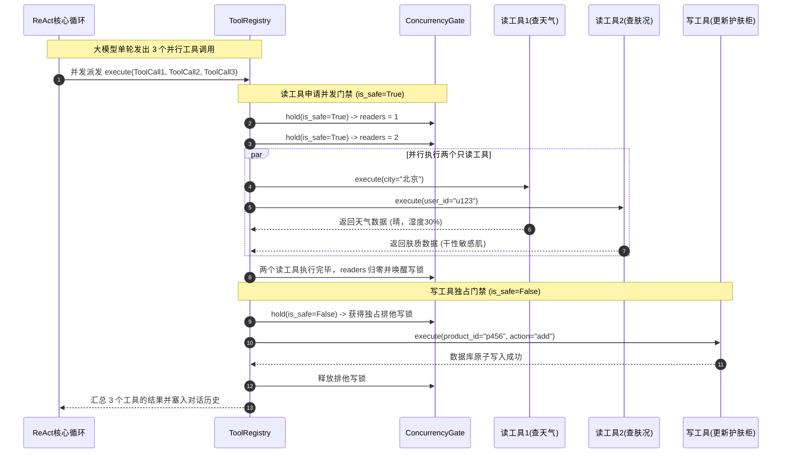
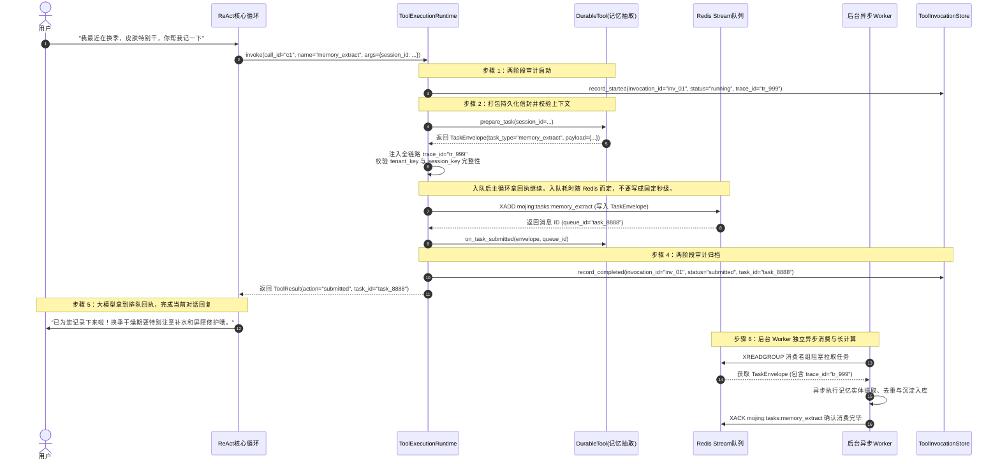
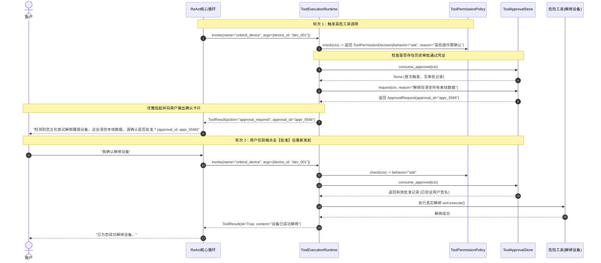
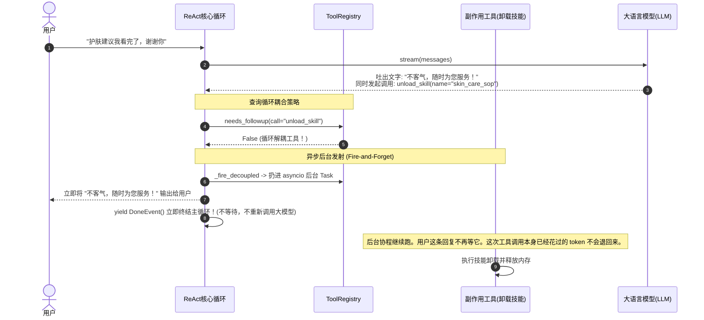
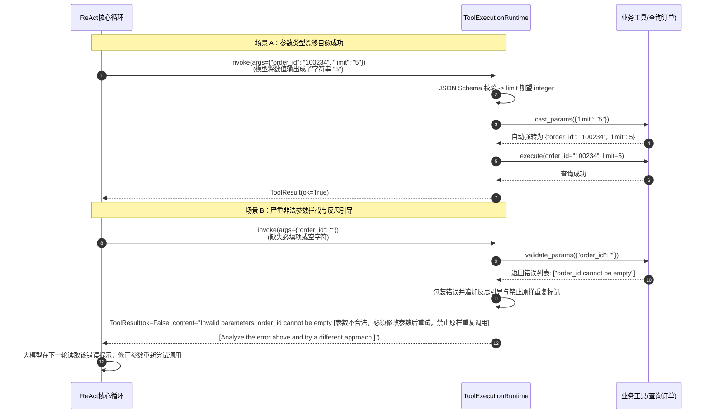
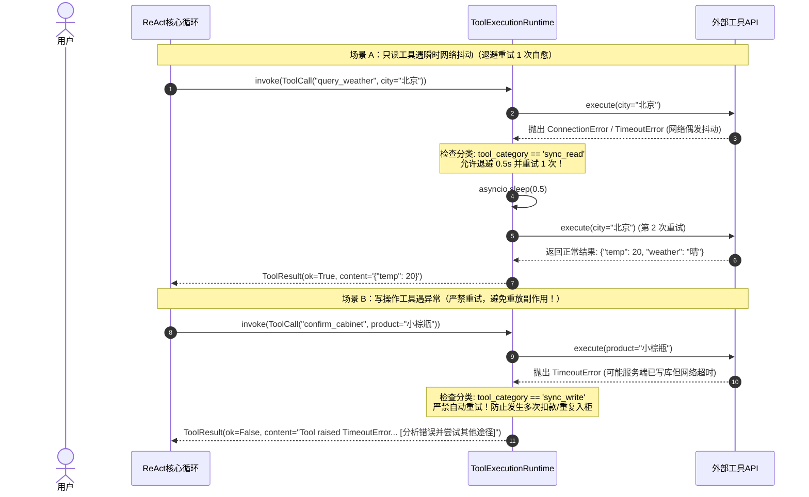
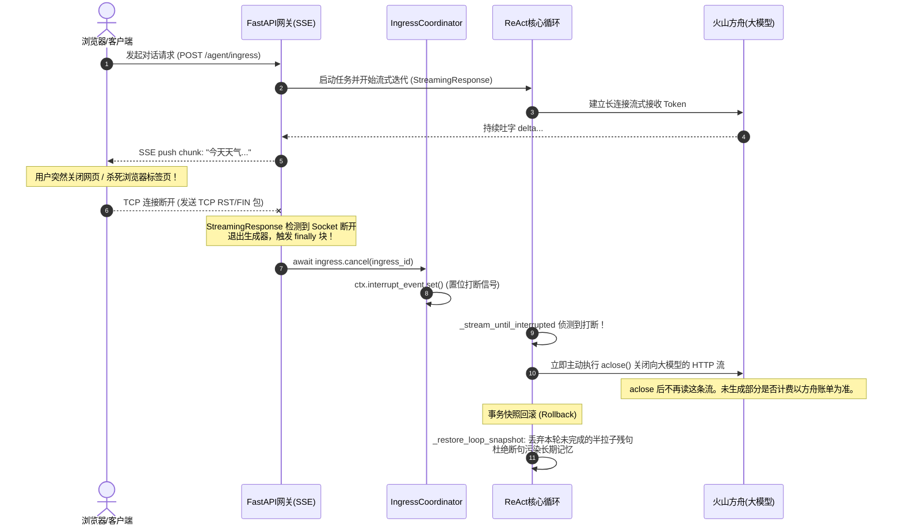
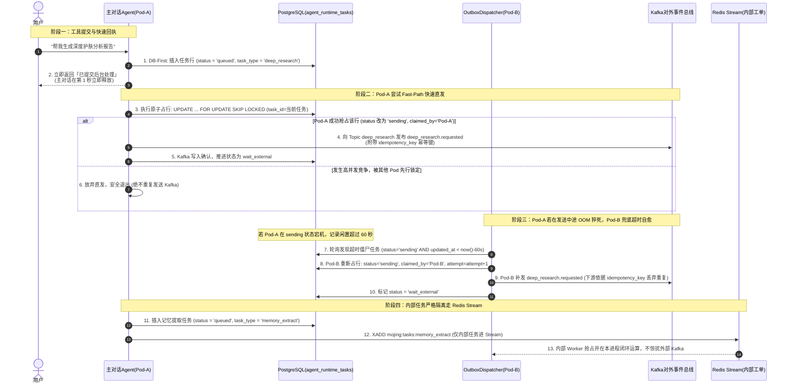

# 04_tools：工具治理、执行运行时与安全审批

> **文件归属**：[`simpleclaw/tools/execution_runtime.py`](file:///home/yang/mojing/mojing_agent/simpleclaw/tools/execution_runtime.py)、[`registry.py`](file:///home/yang/mojing/mojing_agent/simpleclaw/tools/registry.py)、[`catalog.py`](file:///home/yang/mojing/mojing_agent/simpleclaw/tools/catalog.py)、[`base.py`](file:///home/yang/mojing/mojing_agent/simpleclaw/tools/base.py)、[`invocation.py`](file:///home/yang/mojing/mojing_agent/simpleclaw/tools/invocation.py)、[`interrupt.py`](file:///home/yang/mojing/mojing_agent/simpleclaw/tools/interrupt.py) 
> **模块定位**：SimpleClaw 智能体内核的“手脚与安全保镖”，负责工具 Schema 动态暴露、参数强转自愈、并发读写门禁、高危审批拦截、两阶段数据库审计及异步持久化任务调度。 
> **推荐阅读顺序**：**第 4 篇**（在理解推理循环与模型通信后，搞懂大模型如何安全、可控、高并发地操作外部真实世界）

---

## 一、工具层要自己守住的几件事

模型可以一次返回好几个工具。查资料和清空柜子如果同时写库，会读到脏数据。人脸分析要跑很久，不能卡死这一轮回复。高危操作要能停下来等人点头。线上还要能查出这次调用的入参、耗时和状态。

这些框架也能做。LangGraph 可以并行执行工具；人工审批有 Human-in-the-loop 中间件，用检查点停住，再按批准、修改、拒绝继续。长任务也可以丢进队列。我们是把「在哪跑」和「主循环等不等」写成工具上的两个开关，所有调用走同一条执行管线。

| 要解决的事 | 我们的默认做法 |
| :--- | :--- |
| 有的工具秒回，有的要跑几分钟；有的结果要给模型看，有的不用 | 两个开关：`inline` 在进程里跑，`durable` 丢进任务队列并马上回执。`needs_followup=True` 把结果交回模型；`False` 后台做完，主循环可以结束。 |
| 同一轮里只读可以并行，写不能和读搅在一起 | `_ToolConcurrencyGate`：只读一起跑；有写操作时，等正在跑的读结束，再独占。写在排队时，新的读也先等，避免写一直排不上。 |
| 参数类型经常漂，例如把 `"123"` 当成字符串 | 先对 JSON Schema，再做类型转换，再做业务校验。错了把原因和可用工具回给模型，让它改一次，而不是把进程打崩。 |
| 解绑设备这类操作要等人确认 | 策略判定为询问时，先返回「需要审批」并记下审批单。人通过后，凭这张单再执行。LangGraph 是把图停住等人；我们是停在这条工具管线里。 |
| 出事时要能查到调用过程 | 调用前先记一条 `running` 并分配 `invocation_id`，结束后回填状态、耗时和 trace。 |

### 面试时可以怎么说

> 工具我拆成两个问题：在哪执行，以及结果要不要再喂给模型。查天气就地做完并写回历史；长分析丢进队列，先给用户一个回执；打点丢到后台，不为它再开一轮模型。同一轮里只读并行，写操作独占。高危操作先返回需要审批，人确认后再用凭证执行。LangGraph 也能并行工具、也能在工具前停下来等人，我们是把这些收进同一条执行和审计管线。

---

## 二、核心调度维度：四象限全景矩阵

工具上有两个独立开关（定义于 [`simpleclaw/tools/base.py`](file:///home/yang/mojing/mojing_agent/simpleclaw/tools/base.py)）：在进程里做还是丢进队列，以及结果要不要再交给模型。四种组合如下：

```
                    【执行模式 (execution_mode)】
                   inline (进程内同步执行)       durable (后台持久化队列)
               ┌───────────────────────────┬───────────────────────────┐
needs_followup │  【象限 I：经典同步查询】   │  【象限 III：异步派发报备】 │
    = True     │  查天气、读文件、查知识库   │  面部分析、生图、生成长报告 │
(结果需喂回模型)│  必须拿结果写最终答案     │  拿排队回执向用户交代进度 │
               ├───────────────────────────┼───────────────────────────┤
needs_followup │  【象限 II：本地纯副作用】 │  【象限 IV：纯后台打点】    │
    = False    │  unload_skill(清理技能)   │  离线数据归档、异步指标推送 │
(火即忘直接终结)│  第一轮已说完话，做完即退 │  首轮已说完告别语，无需多嘴 │
               └───────────────────────────┴───────────────────────────┘
```

### 收益：
- **Token 与轮次**：这一轮如果只有 `needs_followup=False` 的工具，主循环不等它们，直接 `yield DoneEvent()`，不为它们再开一轮模型。同一轮里只要还有要跟进的工具，循环仍会等那些结果再继续。省下的是「纯副作用那一轮」，不是所有场景都少一轮。
- **长任务先回执**：`durable` 工具先把任务放进队列并返回回执，主循环不在这里等几分钟的计算。入队本身要多久，以队列实现为准，不要背固定的 5 毫秒。

---

## 三、核心类与执行管线详解

### 1. `ToolExecutionRuntime`（工具执行运行时）

工具调用的统一执行中枢，严格执行十一步防御管线（位于 [`execution_runtime.py`](file:///home/yang/mojing/mojing_agent/simpleclaw/tools/execution_runtime.py)）：

```python
class ToolExecutionRuntime:
    _ERROR_HINT = "\n\n[Analyze the error above and try a different approach.]"
    
    async def invoke(
        self,
        call: ToolCall,
        tool: Tool | None,
        available_tools: list[str],
        *,
        interrupt_event: asyncio.Event | None = None,
    ) -> ToolResult:
```

#### 十一步执行防御管线（严格对应 `execution_runtime.invoke` 源码）：
1. **工具存在性检查**：判断调用的工具名称是否在注册表中，若不存在则列出可用工具辅助 LLM 纠错。
2. **前置中断检测**：检查是否在执行前已被外部事件打断（如用户插话打断），若是则快速退出。
3. **JSON Schema 强校验**：比对工具声明的参数 Schema，验证字段完整性与类型合法性。
4. **参数类型强转与纠偏**：调用 `tool.cast_params` 自愈轻度类型漂移（如字符串 `"123"` 自动转整型 `123`）。
5. **构建调用上下文并落盘审计**：生成唯一的 `invocation_id`，向数据库记录调用状态为 `running`。
6. **工具深度业务规则校验**：调用 `tool.validate_params` 进行深层业务条件判断。
7. **生命周期门禁拦截**：调用 `tool_lifecycle.before_tool` 判定是否允许放行。
8. **权限管控与审批拦截**：调用 `permission_policy.check`，若属高危操作则生成 `approval_id` 并挂起返回审批卡片。
9. **后置中断检测**：执行前最后一次检查中断信号，确保不执行已取消的操作。
10. **执行模式分流派发**：
    - `durable`（异步持久化）：注入 `trace_id`、租户及会话信息，交由 `runtime_services.submit_task` 持久化并排队派发；
    - `inline`（进程内执行）：直接异步调用 `tool.execute(**params)` 本地完成。
11. **审计归档与结果归一化**：将终态写回数据库并归一化为标准的 `ToolResult`。

---

### 2. `ToolRegistry` 与并发门禁 (`_ToolConcurrencyGate`)

```python
class _ToolConcurrencyGate:
    """读写锁模式变体：允许多个只读工具并发执行，遇写工具独占排他"""
    def __init__(self):
        self._lock = asyncio.Lock()
        self._readers: int = 0
        self._writer_active: bool = False
```
- `concurrency_safe` 默认是 `False`。仓库里标成 `True` 的是内置 `read` 和 `tool_search`。魔镜的业务工具用默认值，同一轮里按独占排队，不是默认并行。
- 只有这次请求带了 `tools`，`volcengine.py` 才会把 `parallel_tool_calls` 设为 `True`。前缀复用时不再重传 `tools`，请求体里没有这个字段。
- 两个都声明安全的读可以重叠。写会等到当前安全读结束再独占；已经有写在排队时，新的安全读也要等，避免写一直排不上。这不是「先把所有读跑完再写」的 DAG。锁只在本进程。`get_weather` 这个例子不是魔镜的工具名。

---

## 四、全场景实战时序图（Mermaid 8.14.0+ 规范）

### 场景 1：同步内联工具并发读写门禁执行流（并行读 + 独占写）

展示大模型一次性发出两个读工具和一个写工具时，`_ToolConcurrencyGate` 如何保障读并发与写互斥：



---

### 场景 2：内部持久化异步工具排队与全链路追踪流（Durable Execution -> Redis Stream）

展示 Agent 内部闭环长耗时任务（以长期记忆抽取 `memory_extract` 为例）如何通过 `TaskEnvelope` 写入 **Redis Stream 队列**快速返回回执，并挂载全链路 `trace_id` 由后台内部 Worker 异步消费（注：跨服务外发长任务如 `deep_research` / `image_analysis` 则走 Section 9 所述的 PostgreSQL Transactional Outbox 直发 Kafka）：



---

### 场景 3：高危工具审批拦截与挂起恢复流（Human-in-the-Loop）

展示高危操作（如解绑设备）如何被权限策略拦截，生成 `approval_id` 并挂起，待用户确认后放行：



---

### 场景 4：循环解耦工具火即忘流（`needs_followup=False`）

展示纯副作用工具如何实现“做完即走”，省去一整轮大模型推理开销：



---

### 场景 5：参数类型强转自愈与 JSON Schema 校验拦截流

展示大模型输出类型漂移时如何自愈，以及严重非法参数如何拦截并追加 `_ERROR_HINT`：



---

### 场景 6：瞬时网络抖动自愈重试 vs 写工具防重放保护（Transient Network Retry & Idempotency Protection）

在真实生产调用中，网络抖动、DNS 偶发超时在所难免。`ToolExecutionRuntime` 严格按工具类型实施差异化重试：
1. **只读工具（`sync_read`）**：遭遇 `TimeoutError`, `ConnectionError` 等瞬时错误时，执行 0.5 秒退避，自动重试 1 次。若恢复则无感放行，显著降低由于偶发网络抖动导致任务失败的概率；
2. **写操作工具（`sync_write` / `durable`）**：遭遇网络超时或异常时**坚决不自动重试**！因为在分布式环境中，超时往往是“服务端已经写入成功但回包网络断开”，客户端盲目重试会引发重复扣款、重复入柜或重复创建工单等严重事故。



---

## 六、高危写操作的双层防御：交互层确认与运行时回滚的职责边界

在面试或架构评审中，经常会被问到一个关键问题：  
*“既然加柜、删提醒这些写操作都要弹窗或让用户确认，用户确认之后再调工具不就行了？为什么底层还要搞 `SideEffectBuffer` 延迟提交和打断回滚？”*

交互确认和缓冲区解决的不是同一件事，而且入柜目前只用了第一件。

```
┌────────────────────────────────────────────────────────────────────────┐
│ 第一道防线：交互层确认（Human-in-the-loop & ToolGates 业务门禁）         │
│ • 目标：防止大模型“自作主张”、“听风就是雨”乱调写操作。                  │
│ • 机制：两阶段状态机（调研 -> 确认卡片 -> 落库），高危动作抛出审批拦截。  │
└───────────────────────────────────┬────────────────────────────────────┘
                                    │ 用户明确确认 / 点击卡片放行
                                    ▼
┌────────────────────────────────────────────────────────────────────────┐
│ 缓冲区：只对调用了 stage() 的意图生效                                         │
│ • 入柜没有走这里。confirm 在 execute 里直接 mark_in_cabinet。                │
│ • 打断策略对 sync_write 是 detach：前台停等，写入继续，abort 撤不回这一笔。   │
└────────────────────────────────────────────────────────────────────────┘
```

### 1. 第一道防线：交互层确认（业务合规，防止模型自嗨）
智能体绝对不能在未获得用户授权时私自执行写操作。代码通过两重机制拦截：
1. **两阶段交互契约（如护肤品入柜）**：
   - [`Mojing/tools/skincare_cabinet.py`](file:///home/yang/mojing/mojing_agent/Mojing/tools/skincare_cabinet.py)：用户表达意图后，首先调用 `research_skincare_product` 整理资料并推下卡片，处于 `needs_user_confirmation` 阶段；
   - 只有当用户点击卡片确认，或语音再次明确表达“确定加入”，才允许调用 `confirm_skincare_cabinet_record` 真正执行，Tool Prompt 中强硬约束严禁猜测参数和未授权调用。
2. **动态审批凭证（Approval Policy）**：
   - 对高危工具配置 `approval_policy="require_confirmation"`，工具管线直接阻断执行并返回审批单，必须带合法 `approval_token` 重新提交才能放行。

### 2. 缓冲区现在没有包住入柜

用户已经说「加入」再调用 `confirm_skincare_cabinet_record`，写入就是这次请求要做的事。播报到一半被打断，丢掉的是还没 `save_turn` 的那截对话，不是自动把柜子删掉。

`SideEffectBuffer.stage()` 可以晚提交。生产代码里没有任何工具调用它，只有测试在用。`abort_all()` 因此撤不回入柜。`sync_write` 被打断时走 `detach`，和「打断就不要写库」是相反的。

若产品要求「说了别加了就必须删掉」，要另做补偿，或者让入柜先 `stage`、整轮结束再 `commit`。不要写成现在已经这样。LangGraph 把待写入放进状态、确认节点再提交，效果相同。检查点本身不会造成幽灵入柜，也不会阻止它。

---

## 七、在途工具打断策略（`cancel` vs `detach`）与外部长任务生命周期

> **源码归属**：[`simpleclaw/tools/interrupt.py`](file:///home/yang/mojing/mojing_agent/simpleclaw/tools/interrupt.py)、[`registry.py`](file:///home/yang/mojing/mojing_agent/simpleclaw/tools/registry.py) 的 `interrupt_policy_for` 方法

在全双工语音或复杂 Agent 执行中，大模型发出工具调用后，工具还在跑，用户突然插话或点击“取消/停止生成”。此时面临核心抉择：**“外部任务马上要跑完了，是直接掐死丢弃吗？大模型消耗的 Token 算不算浪费？”**

SimpleClaw 在底座中引入了严谨的 **`cancel` vs `detach` 二分策略**：

```
                    ┌── 纯只读查询 (sync_read, 如查天气/查百科) ──────▶ 【cancel (放弃等待/取消协程)】
用户插话 / 取消 ───┤
                    └── 长耗时/写操作 (async_task/durable, 如深度报告) ──▶ 【detach (脱钩后台续跑)】
```

### 1. 策略判定规则 (`interrupt_policy_for`)
* **`cancel`（只读放弃等待）**：
  * **适用范围**：纯只读查询（`sync_read`）。
  * **动作**：对正在等待的本地 Task 发起 `task.cancel()`，主循环立刻从阻塞中脱身，转去响应用户的新输入。
* **`detach`（脱钩后台续跑）**：
  * **适用范围**：已投递到持久化任务队列的长任务（`durable`）、写操作工具（`sync_write`）或破坏性工具（`destructive`）。
  * **动作**：**主循环停止等待该工具，把前台控制权立刻交还给用户；但后台在途协程绝不杀死，让它在后台默默跑完并持久化落盘！**

### 2. 深度剖析：为什么长任务快跑完了不丢弃？Token 浪费吗？
**不仅没有浪费，反而实现了算力资产的最大化止损与复用！**

1. `detach` 表示前台不再等。深度报告的重活在外部服务，不在这个进程里算完。耗时不写死。
2. 用户再问「好了没」，主模型还要再跑一轮，通常再查任务状态。不是 0 token，也不是不耗时间。
3. 已经发给外部的请求，硬取消这个进程不会把它从对方那边撤掉。幂等键用来丢掉重复的 `requested`，不是用来撤销一份已经做完的报告。

---

## 八、浏览器断开（SSE Client Disconnect）全链路生命周期与消息留存

很多同学会好奇：*“这就像我打开浏览器和 AI 聊着天，模型正在流式打字输出，我突然把网页/浏览器标签页给关了，后端怎么知道？正在生成的字怎么处理？消息会存下来吗？”*

在 Mojing Agent 中，这一过程由端到端完整的断连探测与大模型协议保护链支撑：



### 1. 消息留存策略总结
1. **未完成的半截普通回复**：**做事务快照回滚（Rollback）丢弃**。若将只说到一半的话存入历史，下一次会话启动时，这段残缺断句会作为上下文喂给大模型，导致模型产生“上下文未完”的严重幻觉。
2. **已经留在消息里的工具调用。** 若下一次请求还会带上这条助手消息，OpenAI / 火山要求后面有对应的工具结果，缺了可能 400。魔镜主路径是整轮快照丢掉还没 `save_turn` 的消息，这种情况下会话库里没有这条调用，不必再写一条 `cancelled`。循环在没有外层快照、调用已经留在 `messages` 里时，才补取消结果。两套不要说成同一次打断既抹掉又必须落库。

---

## 九、对外发件箱和内部 Redis Stream

对外四类任务和内部工单分开，是因为前者做完要等外部服务回状态，后者在 Agent 进程里做完。Redis Stream 和 Kafka 都能做消费者组。这里对外用 Postgres 占行再发 Kafka，是少一次「进 Redis 只为了转发出去」。Kafka 仍然负责跨服务的事件。事务性发件箱是常见写法，不是这个项目发明的。

```
                              ┌── 对外跨服务请求 (deep_research, image_analysis 等) ──▶ 【PostgreSQL 事务性发件箱】──▶ Kafka (*.requested)
                              │
任务派发 (submit_task) ───────┼── 对内闭环自治工单 (postprocess, memory, dream 等) ──▶ 【Redis Stream 工作队列】──▶ 内部 Worker 抢占
                              │
                              └── 设备端实时字幕推流 (hardware_dialogue) ──────────────▶ 【直发 Kafka 总线】 (不经中间队列)
```

### 1. 架构核心原则（单一法定准数与职责纯粹化）

1. **Agent 这边的任务状态以 `agent.agent_runtime_tasks` 为准。** 外部服务有自己的任务状态。表是我们派单和等待回执的账，不是全公司唯一的事实来源。
2. **对外转发任务彻底切除 Redis Stream 蹦床跳板**：
   * `deep_research`、`image_analysis`、`skin_diary_generation`、`cabinet_product_research` 的重活在外部服务。耗时不写死，也不要说成跑在我们自己的 GPU 集群上。
   * 采用 **事务性发件箱（Transactional Outbox Pattern）**：工具在向 Postgres 写入 `queued` 记录后，不进 Redis Stream。由 Pod 实例通过原子行锁直接向 Kafka 投递。
3. **多 Pod 核心防撞锁（FOR UPDATE SKIP LOCKED）**：
   多个 Pod 副本均运行扫描循环时，必须执行带条件的原子更新。**只有成功将记录更新为 `sending` 且绑定本 Pod 的那个进程，才被准许向 Kafka 发送请求！**
   ```sql
   UPDATE agent.agent_runtime_tasks
   SET status = 'sending', claimed_by = $pod_name, attempt = attempt + 1, updated_at = now()
   WHERE task_id = (
     SELECT task_id FROM agent.agent_runtime_tasks
     WHERE (
       (status = 'queued' AND ($target_task_id::text IS NOT NULL AND task_id = $target_task_id OR updated_at < now() - interval '5 seconds'))
       OR
       (status = 'sending' AND updated_at < now() - interval '60 seconds')
     )
       AND task_type IN ('deep_research', 'image_analysis', 'skin_diary_generation', 'cabinet_product_research')
       AND attempt < max_attempts
       AND deleted = false
     ORDER BY created_at ASC
     FOR UPDATE SKIP LOCKED
     LIMIT 1
   )
   RETURNING *;
   ```
4. **内部闭环任务留存 Redis Stream**：
   `postprocess`（后处理）、`obligation_extract`（履约提取）、`memory_extract`（记忆抽取）、`dream`（睡梦演化）、`subagent_dispatch`（子 Agent 派发）、`cabinet_product_record`（本地写库）保留在 Redis Stream，利用消费者组并发争抢与 60s `xautoclaim` 容灾。
5. **Redis 职责清本正源**：
   Redis 在这里是内部消费者组（Redis Stream）、租户令牌桶限流的 Lua，以及后台工单的 `python-redis-lock`（TaskWorker 才拿）。提示词缓存的 `response_id` 在 Postgres。用户对话入口队列在各 Pod 内存里。`XAUTOCLAIM` 是超时再认领，慢任务可能被做两次。

---

### 2. 多 Pod 并发争抢、直发与超时自愈全景时序


