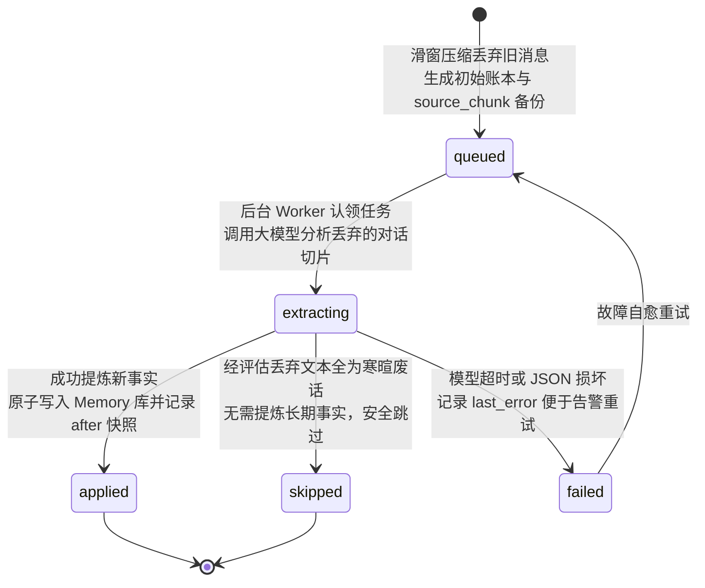
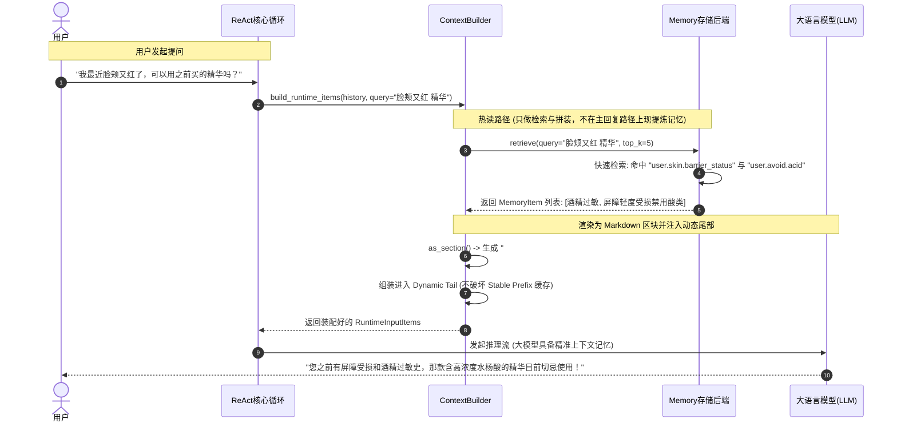
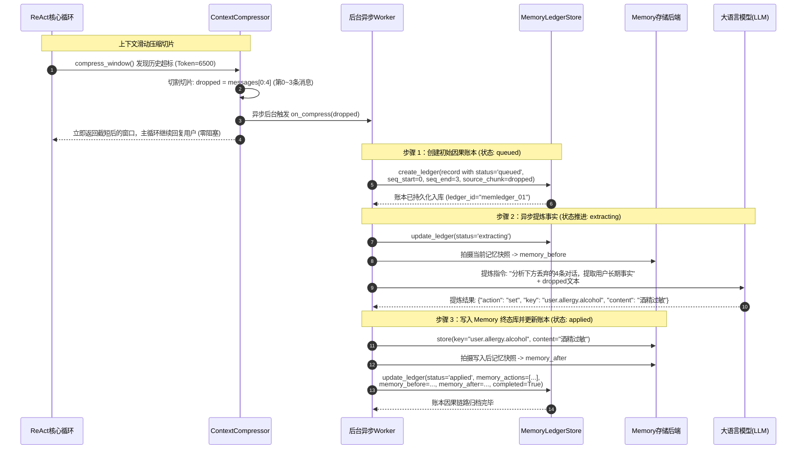
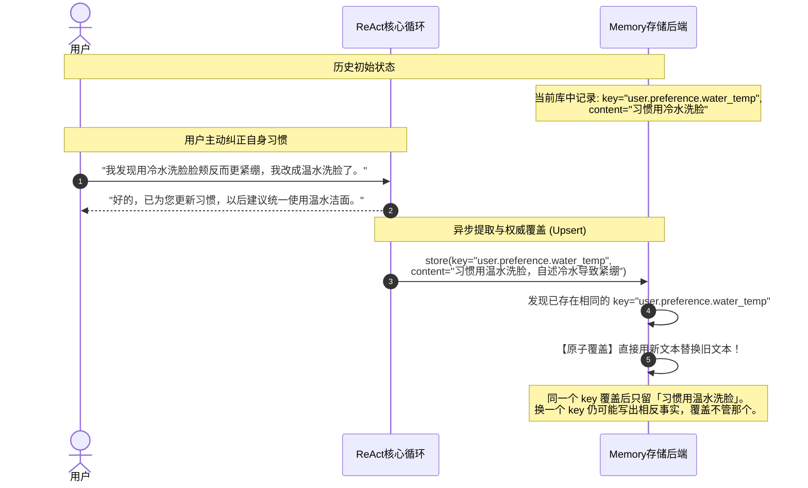
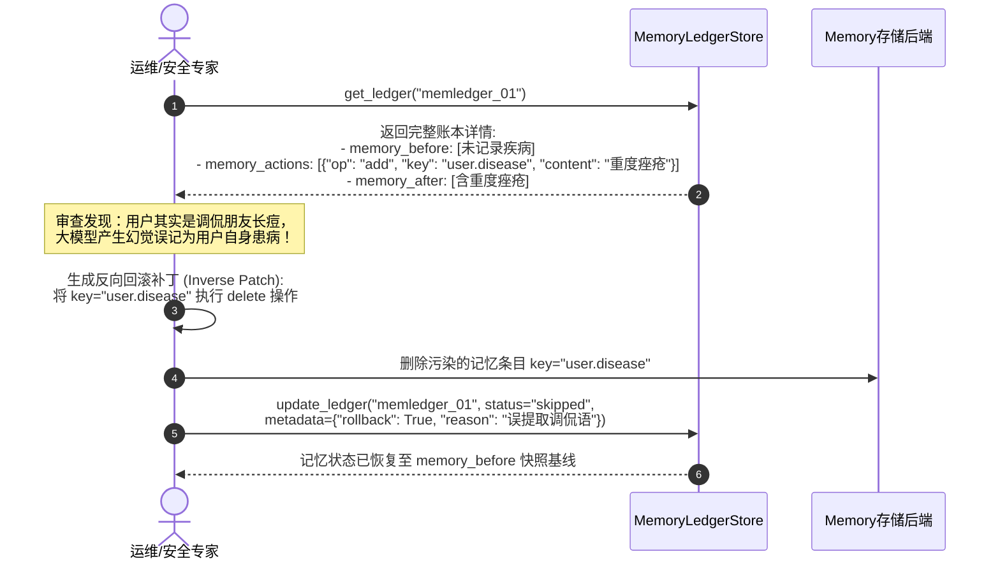
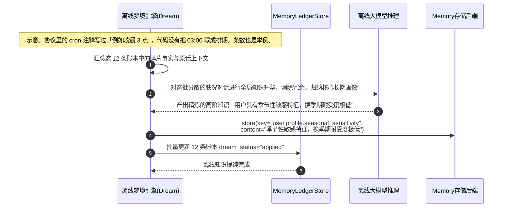

# 05_memory：状态机、因果账本与长效记忆架构全景剖析

> **文件归属**：[`simpleclaw/memory/base.py`](file:///home/yang/mojing/mojing_agent/simpleclaw/memory/base.py)、[`ledger.py`](file:///home/yang/mojing/mojing_agent/simpleclaw/memory/ledger.py)、[`ledger_store.py`](file:///home/yang/mojing/mojing_agent/simpleclaw/memory/ledger_store.py)、[`session.py`](file:///home/yang/mojing/mojing_agent/simpleclaw/memory/session.py) 
> **模块定位**：会话窗口和记忆账本。账本记下原文、消息序号、改前改后。这不是数据库 WAL，记录本身也可以被后续整理改掉。 
> **推荐阅读顺序**：**第 5 篇**（在掌握上下文与工具后，剖析智能体如何记住用户、管理状态并持久化因果链路）

---

## 一、记忆要能回答「这句话从哪来」

只把「用户容易长痘」存成一条文本，下次能召回，但改错了不知道是哪几轮对话推出来的。提炼记忆如果堵在用户等待回复的那条路上，体感会变慢。同一件事前后说法相反时，两条都塞进提示词，模型会打架。

LangChain 的记忆组件、向量库、LangGraph 检查点都可以留下对话和状态。检查点还能从某一步继续。账本多记的是：这段原文、消息序号、写入前和写入后。

记忆提炼不放在用户等待的那条回复里。检索不是零模型：`TextMemoryRetriever` 默认会再调一次模型，从索引里挑条目。`fast_hybrid_only` 为真时才只走关键词。证据检索还用了 BM25。不要说成每次都是向量检索，也不要说成热路径完全不调模型。没有 10 毫秒这种测量。

| 要解决的事 | 我们的默认做法 |
| :--- | :--- |
| 回复时不要等记忆提炼 | 写入和归并放到后面。检索证据时仍可能先调一次挑选模型。 |
| 记错了要能查来源 | 账本记下原文切片 `source_chunk`、消息序号 `message_seq_start` / `message_seq_end`，以及是谁触发的。序号用的就是循环里那个「从头数的第几条」。 |
| 改错了要能看改前改后 | 写入前拍 `memory_before`，写入后拍 `memory_after`，具体改动放在 `memory_actions`。 |
| 同一事实不要存成互相打架的好几条 | 用稳定的 key（如 `user.allergy.alcohol`）覆盖旧值。同名事实只留一份。 |
| 白天的流水还要以后再整理 | 账本上的睡梦状态从待处理走到候选，再走到已应用。整理规则在睡梦模块，不堵主回复。 |

### 面试时可以怎么说

> 回复前不在这条路上现写长记忆。要查「之前说过什么」时，检索器可能再调一次模型挑条目。每条账记下原文、消息序号、改前改后。同一 key 覆盖旧值。检查点和向量库也能存状态。产品证据检索当前是索引加 BM25，再按配置决定要不要让模型挑选，不是默认的向量库。

---

## 二、核心类与数据协议全景

### 1. 记忆实体与接口（定义于 [`simpleclaw/memory/base.py`](file:///home/yang/mojing/mojing_agent/simpleclaw/memory/base.py)）

#### (1) `MemoryItem`（长效记忆数据单元）
```python
@dataclass
class MemoryItem:
    key: str              # 唯一主题标识符 (例如 "user.skin.barrier_status", "user.allergy.alcohol")
    content: str          # 完整事实文本正文
    description: str = "" # 单行超短摘要 (用于在目录区简短展示)
    metadata: dict = ...  # 扩展元数据 (置信度、更新时间、来源seq等)
```

#### (2) `Memory`（抽象基类契约）
- `async def store(self, key: str, content: str, *, description="", metadata=None) -> None`:
  - 同一个 key 覆盖旧内容，避免同一个 key 下留两份相反事实。两个不同 key 仍可能描述相反的事，覆盖解决不了这个。
- `async def retrieve(self, query: str = "", top_k: int = 20) -> list[MemoryItem]`:
  - 魔镜证据检索是 `TextMemoryRetriever`：索引预览，默认再让模型选编号，也可以只走关键词。另有 BM25。不要写成毫秒级向量检索。
- `async def as_section(self, query: str = "", top_k: int = 20) -> str`:
  - 组装为结构化 Markdown 区块直接注入动态尾部；若无记忆安全返回空字符串，不产生多余占位符。

---

### 2. 因果账本模型（定义于 [`simpleclaw/memory/ledger.py`](file:///home/yang/mojing/mojing_agent/simpleclaw/memory/ledger.py)）

#### (1) `MemoryLedgerRecord`（因果账本核心记录）
记录一次记忆提取事件的前因后果全貌：
- `ledger_id`: 带有 `memledger_` 业务前缀的全局唯一主键。
- `trigger_type`: 触发原因（`"context_compression"`, `"in_turn_compression"`, `"manual"`, `"dream"`）。
- `status`: 账本流转状态（`"queued"` -> `"extracting"` -> `"applied"` / `"failed"` / `"skipped"`）。
- **因果与截断切片**：
  - `message_seq_start` / `message_seq_end`: 被丢弃消息在全局会话中的绝对序号区间。
  - `dropped_count`: 被丢弃的消息条数。
  - `source_chunk`: 提取时留下的原文切片。热窗口裁掉以后，还能从账本看到这段来源。它不是会话全量历史的永久备份。
- **快照与变更追踪（Diffability）**：
  - `memory_before`: 提取前的完整记忆快照（`MemorySnapshot`）。
  - `memory_actions`: 本次执行的原子操作列表（如 `[{"op": "add", "key": "...", "val": "..."}]`）。
  - `memory_after`: 提取并覆盖后的最新记忆快照。
- **离线治理**：
  - `dream_status`: 梦境处理状态（`"pending"`, `"candidate"`, `"reviewed"`, `"applied"`）。

---

## 三、核心流转状态机与存储契约

### 1. 记忆账本生命周期流转状态机



### 2. 存储协议与接口 (`MemoryLedgerStore`)
定义于 [`simpleclaw/memory/ledger_store.py`](file:///home/yang/mojing/mojing_agent/simpleclaw/memory/ledger_store.py)：
- `create_ledger(record)`: 初始入库（状态 `queued`）。
- `update_ledger(ledger_id, status, memory_actions, ...)`: 增量补丁更新状态与快照。
- `list_dream_pending(tenant_key, limit)`: 批量拉取 `dream_status == "pending"` 的候选记录供夜间离线反思。

---

## 四、全场景实战时序图（Mermaid 8.14.0+ 规范）

### 场景 1：热读路径：检索后注入动态尾巴

展示用户提问时，热路径只做检索，再把结果放进动态尾巴：



---

### 场景 2：冷写路径：滑窗压缩触发因果账本生成与异步记忆提取流

展示当历史消息超限被丢弃时，因果账本如何实现源头备份、异步提取与两阶段状态流转：



---

### 场景 3：记忆自愈与等值覆盖 (Upsert) 冲突消解流

展示用户修改自身习惯时，系统如何通过同一语义 Key 强覆盖消除认知自相矛盾：



---

### 场景 4：记忆快照比对与审计回滚流（Diff & Rollback）

展示当发现某次提取被恶意或错误污染时，如何依靠快照与原子动作执行反向回滚：



---

### 场景 5：梦境队列拉取与离线知识提纯流（`list_dream_pending`）

展示夜间闲时，离线梦境引擎如何批量拉取待处理账本进行全局去重与知识升华：


