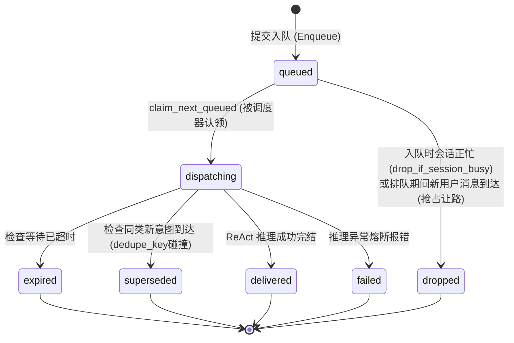
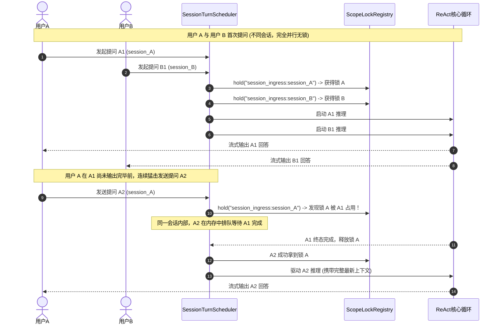
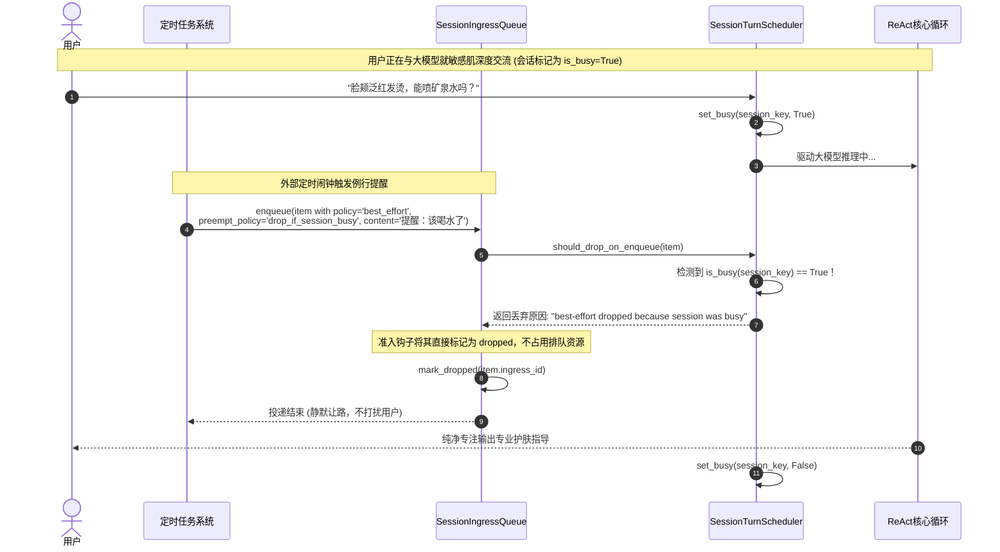
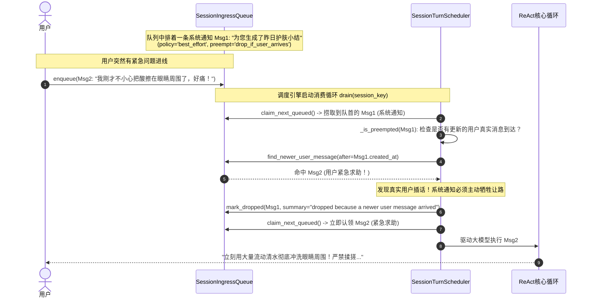
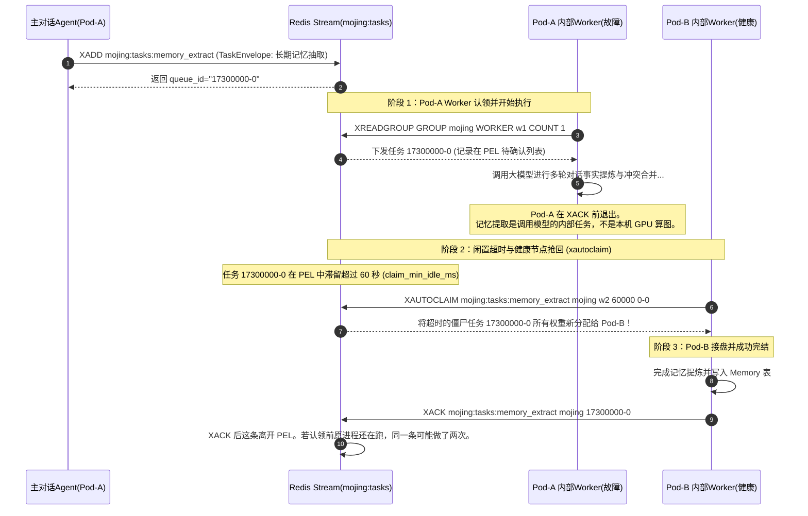
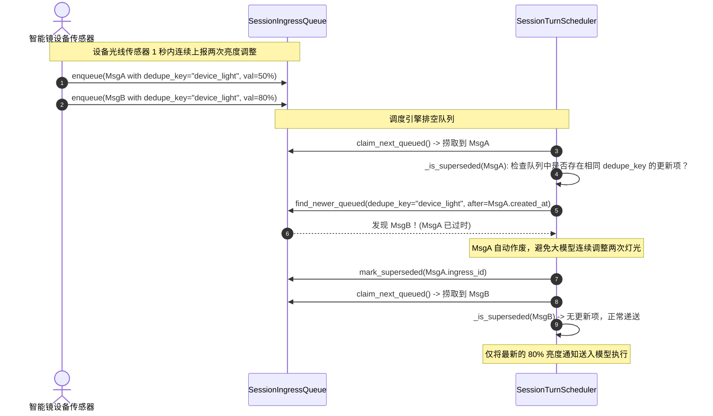
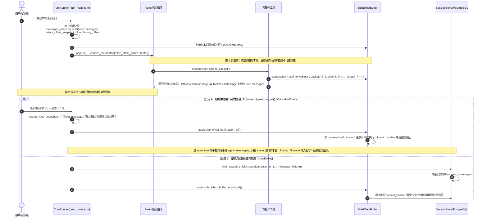
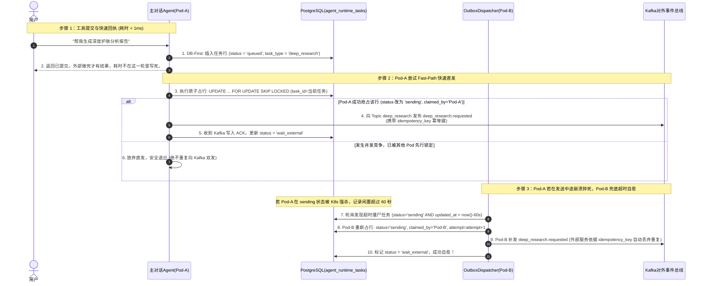

# 06_runtime：高并发任务调度、分区互斥锁与会话准入全景剖析

> **文件归属**：[`simpleclaw/runtime/scope_lock.py`](file:///home/yang/mojing/mojing_agent/simpleclaw/runtime/scope_lock.py)、[`side_effects.py`](file:///home/yang/mojing/mojing_agent/simpleclaw/runtime/side_effects.py)、[`task_queue.py`](file:///home/yang/mojing/mojing_agent/simpleclaw/runtime/task_queue.py)、[`session_ingress_scheduler.py`](file:///home/yang/mojing/mojing_agent/simpleclaw/runtime/session_ingress_scheduler.py)、[`session_ingress_queue.py`](file:///home/yang/mojing/mojing_agent/simpleclaw/runtime/session_ingress_queue.py)、[`session_ingress_protocol.py`](file:///home/yang/mojing/mojing_agent/simpleclaw/runtime/session_ingress_protocol.py)、[`services.py`](file:///home/yang/mojing/mojing_agent/simpleclaw/runtime/services.py)、[`Mojing/runtime/outbox.py`](file:///home/yang/mojing/mojing_agent/Mojing/runtime/outbox.py)、[`Mojing/storage/postgres_runtime_task_repo.py`](file:///home/yang/mojing/mojing_agent/Mojing/storage/postgres_runtime_task_repo.py)  
> **模块定位**：SimpleClaw 智能体内核的“中枢交警、事务缓冲与物流输送带”，负责多租户细粒度分区并发锁（ScopeLock）、单轮副作用暂存与逆序回滚（SideEffectBuffer）、会话级单消费者调度、高频消息防抖与让路丢弃、基于 Redis Streams 的内部自治任务工作队列、以及基于 PostgreSQL 事务性发件箱（Transactional Outbox）的跨微服务可靠派单调度。  
> **推荐阅读顺序**：**第 6 篇**（并发锁、内部 Redis 工单、对外发件箱。打断只能丢掉还没落库的对话，不能自动撤销已经入柜的记录。）

---

## 一、并发治理的核心思想：通俗理解三大设计取舍

分布式锁和统一队列都是正常做法。这里按锁的范围和任务的归属分开，不是因为那两种做法不能用。

### 1. 会话锁只锁“同一会话”，而且是在单个进程内存里锁
* **为什么不能加全局一把大锁？** 
  如果全局只用一把锁，用户张三正在让模型做 30 秒的深度分析，李四、王五的所有聊天就全部被活活堵死。
* **会话串行现在靠什么，为什么没有用 Redis `SETNX`？**
  `ScopeLockRegistry` 是进程里的 `asyncio.Lock`。它出现在两处：`SessionTurnScheduler` 排空某个会话的入口；`TaskWorker` 执行带 `scope_key` 的内部工单。同一进程里，不同 key 各用各的锁，同一个 key 的协程排队。没有测过这把锁的耗时。
  用户消息的入口队列是 `InMemorySessionIngressStore`，也在这个进程里。另一个 Pod 有自己的队列和自己的锁，看不见这边正在排的那一条。会话正文在 Postgres，`save_turn` 没有再拿一把跨 Pod 的锁。所以两个 Pod 同时处理同一会话时，内存锁不会挡住对方，两轮写入可能交错。
  内部工单队列在 Redis Stream 上是共享的。`TaskWorker` 执行前会再拿 `python-redis-lock`（默认 30 秒过期、自动续期）。拿不到锁不跑任务。用户这一轮对话仍然不走这把锁。
  这不是「Redis 锁不如内存锁」。`SETNX` 能让多个 Pod 抢同一把钥匙，是正常做法。当前没上，是因为入口队列本身不共享：只给调度器加 Redis 锁，另一台机器上的请求仍然进不了这台的内存队列。要跨 Pod 串行，得先让同一会话只进一个 Pod，或者让各 Pod 看见同一条队列，并且在读和写这份会话时都去拿同一把锁。
  热路径上常见的是网关按会话黏住同一个 Pod，黏住之后进程内这把锁就够。仓库里没有这份黏性配置，不能写成已经黏住。不能黏住时，可以用 Redis 锁，也可以用 Postgres 对会话行的锁；发 Kafka 已经用了行锁，会话保存还没有。Redis 锁要自己定过期时间，一轮里有工具等待时，过期太短会有两个持有者，进程死了则要等到过期别人才能进。Redis 不可用时还要决定这一轮是拒绝还是无锁继续。这些是分布式锁的成本，不是 Redis 不能用。

### 2. 队列切分两层：对内工作池走 Redis Stream，对外跨系统派单走 Postgres 发件箱
系统里的异步任务天然分为截然不同的两类：
* **第一类：Agent 内部自治工单（算力在 Agent 进程内消耗）** 
  包括：会话后处理（`postprocess`）、履约抽取（`obligation_extract`）、记忆抽取（`memory_extract`）、睡梦演化（`dream`）、子 Agent 派发（`subagent_dispatch`）、柜子本地写库（`cabinet_product_record`）。 
  **做法**：放进 **Redis Stream** 消费者组。`XREADGROUP` 把还没投递过的条目交给某个消费者，`XACK` 确认这一条。默认闲置 60 秒后，别的消费者可以用 `XAUTOCLAIM` 把待确认条目转走。Redis 文档写明：闲置只说明这条很久没被确认，不能证明原进程已经退出。慢任务可能和认领方各做一次，处理必须能重复执行。这不是按 CPU 空闲调度，也不是工作窃取调度器。Kafka 消费者组按分区分配，崩溃后从已提交偏移继续，同样是至少一次，再平衡时还可能短暂停一下。两边都要业务幂等。
* **第二类：交给外部服务的长任务（计算在对方进程里，不在这个 Agent 进程里）** 
  包括：深度护肤报告（`deep_research`）、图像人脸分析（`image_analysis`）、肌肤日记生成（`skin_diary_generation`）、柜子产品调研（`cabinet_product_research`）。 
  **为什么坚决不进 Redis Stream？** 
  这四类任务的重活在外部服务。先推进 Redis、再由 Worker 只为了发一条 Kafka，认领超时保护不了外部那一段。现在这四类在库里占行后直接发 Kafka。耗时不写死。 
  **做法**：彻底砍掉 Redis 中间跳步，采用 **PostgreSQL 事务性发件箱模式（Transactional Outbox）**。工具在写数据库时标记为 `queued`，各个 Pod 通过带行级排他锁的原子语句 `FOR UPDATE SKIP LOCKED` 争抢该行并改为 `sending`，**抢占成功的那个 Pod 直接将请求推入 Kafka**，成功后推进为 `wait_external`。

### 3. 用户心流第一：系统通知和定时提醒永远给正在说话的用户让路
* 用户正在镜子前焦急地询问：“脸颊突然发红刺痛怎么办？”此时外部定时系统恰好触发了一条“提醒：该喝水了”。
* 系统交警（`SessionTurnScheduler`）会在入队和消费两个关卡自动检查：若会话正忙（`is_busy=True`），或者用户新消息已经进线，低优先级的尽力而为（`best_effort`）通知会**静默丢弃（`drop_if_session_busy` / `drop_if_user_arrives`）**，绝不强行插入打断用户的对话心流。

---

## 二、核心类与数据协议全景解析

### 1. `ScopeLockRegistry`（细粒度作用域互斥锁注册表：两级混合锁架构）
定义于 [`simpleclaw/runtime/scope_lock.py`](file:///home/yang/mojing/mojing_agent/simpleclaw/runtime/scope_lock.py)：

#### 类属性与成员变量
* `_locks: dict[str, asyncio.Lock]`：本进程里按 `scope_key` 维系的本地协程互斥锁。
* `_registry_lock: asyncio.Lock`：保护 `_locks` 字典本身。
* `_sync_redis_client / _redis_url`：后台 TaskWorker 才配。会话入口默认不传，因此用户这一轮只走进程内锁。
* `_lease_ttl_s`：`python-redis-lock` 的 `expire`，默认 30 秒。`auto_renewal=True` 时大约每过期时间的三分之二续一次。
* `_acquire_timeout_s`：抢 Redis 锁最多等多少秒，默认 60。

#### 核心函数
* `get_lock(scope_key)`：本进程里按 key 拿 `asyncio.Lock`。
* `hold(scope_key)`：
  1. 先拿进程内锁。
  2. 配了同步 Redis 时，用 `python-redis-lock`（`expire` + `auto_renewal`）。拿不到或 Redis 报错都抛 `ScopeLockTimeout`，**不进入临界区**，也不退回「只跑本地」。
  3. 没配 Redis 时只靠进程内锁。这是会话入口的现状。
  4. 单测里仍可能走旧的异步 `SET NX PX` 路径，生产 TaskWorker 不走这条。

---

### 2. `SessionTurnScheduler`（单轮会话调度引擎）
定义于 [`simpleclaw/runtime/session_ingress_scheduler.py`](file:///home/yang/mojing/mojing_agent/simpleclaw/runtime/session_ingress_scheduler.py)：

#### 核心职责
作为智能体会话消息的“中央交警”，负责协调排空会话队列、维护会话忙碌标记、以及处理消息的防抖和让路淘汰。

#### 核心函数与参数详解
* `drain(session_key: str) -> AsyncIterator[SessionTurnResult]`： 
  调度引擎的核心消费循环。使用 `drain_locks.hold(session_key)` 确保同一个会话在同一时刻只有一个协程在推进执行。
* `is_busy(session_key: str) -> bool`： 
  检查目标会话当前是否正在进行大模型推理或工具执行。
* `set_busy(session_key: str, busy: bool) -> None`： 
  标记会话的忙碌状态。在进入 ReAct 循环前置为 `True`，整轮结束后置为 `False`。
* `should_drop_on_enqueue(item: SessionIngressItem) -> tuple[bool, str]`： 
  入队前置审查。如果当前会话正忙（`is_busy=True`），且新进入的消息策略配置为 `drop_if_session_busy`，则当场判定丢弃，不放入待执行队列。
* `_is_preempted(item: SessionIngressItem) -> bool`：
  出队审查。当准备从队列中拉出一条排队的系统通知时，检查排队期间是否有更新的用户真实消息到达。若有，则系统通知主动牺牲让路，标记为 `dropped`。
* `_is_superseded(item: SessionIngressItem) -> bool`： 
  防抖审查。检查队列后方是否存在带有相同 `dedupe_key` 的更新消息。若存在，旧消息标记为 `superseded`（作废）。

---

### 3. `SideEffectBuffer` 与 `StagedSideEffect`（单轮副作用暂存与逆序补偿回滚）
定义于 [`simpleclaw/runtime/side_effects.py`](file:///home/yang/mojing/mojing_agent/simpleclaw/runtime/side_effects.py)，与 [`Mojing/api/turn_runner.py`](file:///home/yang/mojing/mojing_agent/Mojing/api/turn_runner.py) 的进场快照配合使用：

#### 和检查点的关系
LangGraph 的检查点保存图的状态，方便以后从某一步继续。它不会在每一步自动把护肤品写入业务库，也不会在打断时自动删掉已经写入的行。待写入列表放在状态里、确认后再提交，图和 `SideEffectBuffer` 都能做。

当前入柜不经过 `stage()`。`abort_all()` 只处理缓冲区里的项。用户确认后当场 `mark_in_cabinet`，播报中途打断不会产生「对话没了、柜子却多一瓶」的自动回滚，柜子里就是多了这一瓶。这和检查点无关。

#### 核心类结构
```python
@dataclass(slots=True)
class StagedSideEffect:
    action_name: str                                                  # 动作名称 (如 "add_to_cabinet")
    payload: dict[str, Any]                                           # 执行所需的业务入参
    commit_handler: Callable[[dict[str, Any]], Awaitable[None]]       # 正常结束时的落盘函数
    rollback_handler: Callable[[dict[str, Any]], Awaitable[None]] | None = None  # 打断时的逆序补偿函数
```

#### 核心函数与参数详解
* `stage(action_name, payload, commit_handler, rollback_handler=None)`：  
  在工具执行时不直接写死数据库，而是将写操作包装为 `StagedSideEffect` 存入内存列表 `_staged` 中。
* `commit_all() -> None`：  
  整轮会话流式播报正常完成、且历史记录成功落盘后调用。按暂存顺序依次执行各个 `commit_handler`，完成外部数据库的物理写入。
* `abort_all() -> None`：  
  打断或异常时调用。按 `_staged` 的逆序跑 `rollback_handler`，然后清空列表。列表是空的时候，这一步什么业务数据都不会改。

---

### 4. `RuntimeServices`（任务派发全生命周期门面）
定义于 [`simpleclaw/runtime/services.py`](file:///home/yang/mojing/mojing_agent/simpleclaw/runtime/services.py)：

#### 类属性与成员变量
* `_task_queue: InMemoryTaskQueue | RedisTaskQueue`：底层任务队列驱动（生产环境为 `RedisTaskQueue`，单测为 `InMemoryTaskQueue`）。
* `_task_state_store: RuntimeTaskStore | None`：任务事实状态持久化仓库（通常为 PostgreSQL 的 `PostgresRuntimeTaskRepository`）。
* `_task_updater: RuntimeTaskUpdater`：负责将任务排队、运行、成功、失败等状态原子写入数据库。
* `_outbox_task_types: set[str]`：注册走事务性发件箱的任务类型集合（`deep_research`, `image_analysis`, `skin_diary_generation`, `cabinet_product_research`）。
* `_outbox_fast_path: Callable[[str], Awaitable[Any]] | None`：快速直发协程回调。

#### 核心函数：`submit_task(task: TaskEnvelope, tool_name=None, summary=None) -> str`
异步任务提交的统一入口：
1. **DB-First 预写**：首先在数据库中插入一条 `status = 'queued'` 的持久化记录。若数据库插入失败，绝不往下走，坚决杜绝“队列有消息但数据库没账本”的幽灵任务。
2. **发件箱分流（Outbox 分支）**：若 `task.task_type in _outbox_task_types`，**坚决不推入 Redis Stream**！生成 `outbox-{task_id}` 物理 ID，并在后台触发 `_outbox_fast_path` 尝试原子占行发往 Kafka，立即返回。
3. **工作队列分流（Redis Stream 分支）**：若为内部任务，调用 `_task_queue.enqueue(task)` 推入 Redis Stream。

---

### 5. `OutboxDispatcher` 与 `OutboxPoller`（跨服务发件箱调度与多 Pod 容灾）
定义于 [`Mojing/runtime/outbox.py`](file:///home/yang/mojing/mojing_agent/Mojing/runtime/outbox.py)：

#### 类属性与成员变量
* `repo: PostgresRuntimeTaskRepository`：底层数据库访问接口。
* `_executors: dict[str, Callable]`：任务执行器映射表（对应各个 Kafka 生产者）。
* `pod_name: str`：当前运行进程的 Pod 唯一标识（优先取环境变量 `HOSTNAME` 或 `POD_NAME`，本地兜底为 `agent-pod-{pid}`）。
* `_activation_service`：系统失败提醒服务，任务耗尽重试后用于向用户推送安抚卡片。

#### 核心函数与参数详解
* `dispatch_fast_path(task_id: str) -> bool`：  
  快速直发方法。工具在写入数据库后立即调用本方法。本方法会在数据库中尝试执行原子行锁抢占：如果抢占成功，当前 Pod 立刻向 Kafka 发送请求；如果抢占失败（已被其他并发 Pod 抢占或任务已取消），安全退出，绝不双发。
* `poll_and_dispatch_one(min_queued_age_s=5.0, min_sending_age_s=60.0) -> bool`：  
  后台扫描器调用的单步抢占派发方法。通过 `FOR UPDATE SKIP LOCKED` 捞取一条满足条件的待发送或超时僵尸任务并派发。
* `dispatch_record(record: dict) -> bool`：  
  真正调用 Kafka 生产者的方法。发送成功后推进为 `wait_external`；如果网络报错，若 `attempt < max_attempts` 则回滚为 `queued` 等待下次重发，若达到最大尝试次数则标记 `failed` 并触发系统提醒。
* `OutboxPoller`：  
  运行在每个 Pod 后台的常驻协程。每隔 `poll_interval_s`（默认 2 秒）循环扫描一次数据库，充当任务派发的“兜底安全网”。

---

### 6. `PostgresRuntimeTaskRepository`（数据库原子占行实现）
定义于 [`Mojing/storage/postgres_runtime_task_repo.py`](file:///home/yang/mojing/mojing_agent/Mojing/storage/postgres_runtime_task_repo.py)：

#### 核心函数：`claim_outbox_task()`
多 Pod 只让抢到这一行的进程去发 Kafka：
```sql
UPDATE agent.agent_runtime_tasks
SET status = 'sending',
    claimed_by = $1,
    attempt = attempt + 1,
    updated_at = now()
WHERE task_id = (
    SELECT task_id
    FROM agent.agent_runtime_tasks
    WHERE (
        -- 条件 A: 直发抢占或已排队等待超过 5 秒的新任务
        (status = 'queued' AND ($2::text IS NOT NULL AND task_id = $2 OR updated_at < now() - ($3 || ' seconds')::interval))
        OR
        -- 条件 B: 之前领取的 Pod 宕机，处于 sending 状态闲置超过 60 秒的僵尸任务
        (status = 'sending' AND updated_at < now() - ($4 || ' seconds')::interval)
    )
    AND task_type = ANY($5::text[])
    AND attempt < max_attempts
    AND deleted = false
    ORDER BY created_at ASC
    FOR UPDATE SKIP LOCKED
    LIMIT 1
)
RETURNING *;
```
* **为什么加 `FOR UPDATE SKIP LOCKED`？**  
  `FOR UPDATE SKIP LOCKED` 是 PostgreSQL 的行锁：这一行已被别的事务锁住时，本次查询跳过它，不去等。两个事务因此不会同时锁住同一行。它不证明整个库没有别的死锁。事务性发件箱是常见的微服务写法：待发送记录和业务状态放在同一张任务表里，抢到行的进程再发 Kafka。下游仍要用幂等键丢掉重复的 `requested`。Pod 数量不要写死成 10。

---

### 7. `RedisTaskQueue`（基于 Redis Streams 的内部工单池）
定义于 [`simpleclaw/runtime/task_queue.py`](file:///home/yang/mojing/mojing_agent/simpleclaw/runtime/task_queue.py)：

#### 专职范围
仅承载 Agent 内部执行的闭环工单（后处理、记忆抽取、睡梦演化、子 Agent 派发、护肤柜本地写库）。

#### 核心参数与函数
* `stream_prefix`：队列 Key 前缀（默认为 `mojing:tasks`）。
* `block_ms`：`XREADGROUP` 的阻塞等待，默认 5000ms。没有新条目时这条命令挂起，有条目或超时后返回。不要写成 CPU 为零，也不要写成毫秒级唤醒是测出来的。
* `claim_min_idle_ms`：待确认条目闲置多久后允许被别人认领，默认 60000ms。闲置不等于原进程已经退出。
* `consume(stream, consumer_group, consumer_name, count=1)`：  
  先通过 `xautoclaim` 检查 PEL（Pending Entries List）中是否有其他死掉的 Worker 遗留的超时未确认消息，优先捡漏抢占；若没有僵尸消息，再通过 `xreadgroup(streams={stream: ">"})` 抢占新消息。
* `ack(message, consumer_group)`：  
  执行成功后调用 `xack`，从 PEL 中彻底移除任务。

---

## 三、会话准入控制与状态机



---

## 四、全场景实战时序图（严格遵循 Mermaid 8.14.0+ 规范）

### 场景 1：细粒度分区锁并发推进流（不同会话完全并行，同会话严格串行）

展示用户 A 与用户 B 并发提问时完全并行，而用户 A 的连续两次点击在同一进程内严格串行排队：



---

### 场景 2：会话忙碌时尽力而为通知准入丢弃流 (`drop_if_session_busy`)

展示大模型正在为用户解答敏感肌紧急问题时，外部定时提醒在入队前置钩子被优雅丢弃，保护用户心流：



---

### 场景 3：新用户消息到达促使旧通知主动让路流 (`drop_if_user_arrives` 抢占)

展示排队等待中的系统通知在用户突然进线求助时，如何在调度认领关卡主动让路：



---

### 场景 4：Redis Streams 内部自治工单抢占与崩溃自愈流 (`xautoclaim`)

展示 Agent 内部闭环任务（如**长期记忆提炼 `memory_extract`**）在 Worker 节点突然被 OOM 强杀时，如何通过 Redis Streams 自动抢回重跑：



---

### 场景 5：重复意图消息防抖作废流 (`dedupe_key` 触发 `superseded`)

展示设备传感器在 1 秒内连续上报两次高频亮度调整时，旧消息如何自动废弃：



---

### 场景 6：单轮原子快照、副作用暂存与语音打断无痕回滚流 (`SideEffectBuffer`)

下面这张图只描述「工具调用了 `stage()`」时的路径。入柜工具当前不走这条路径，它在 `execute` 里直接写柜。



---

### 场景 7：多 Pod 事务性发件箱（Transactional Outbox）行锁抢占、直发与超时容灾流

展示跨微服务异步长任务（如**深度护肤报告 `deep_research`**）如何彻底绕过 Redis Stream，通过 PostgreSQL 行级锁实现安全直发与宕机接盘：


