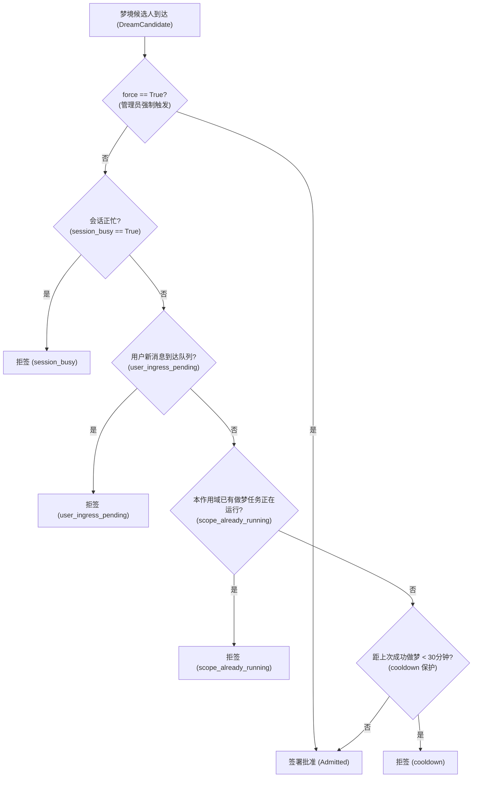
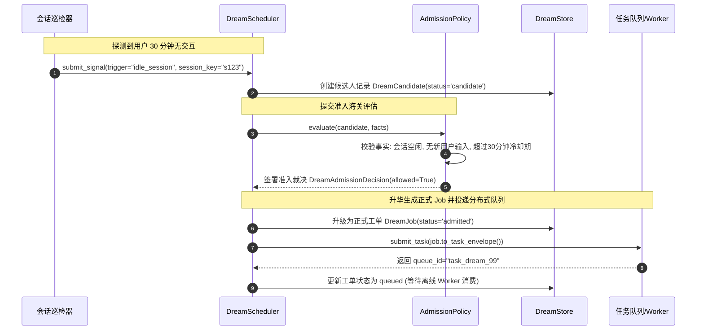
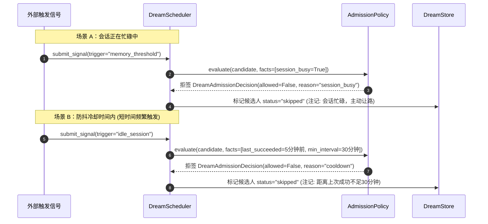
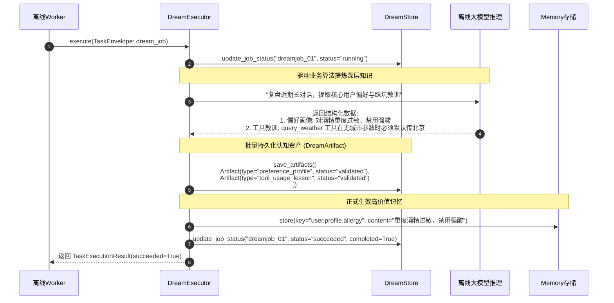
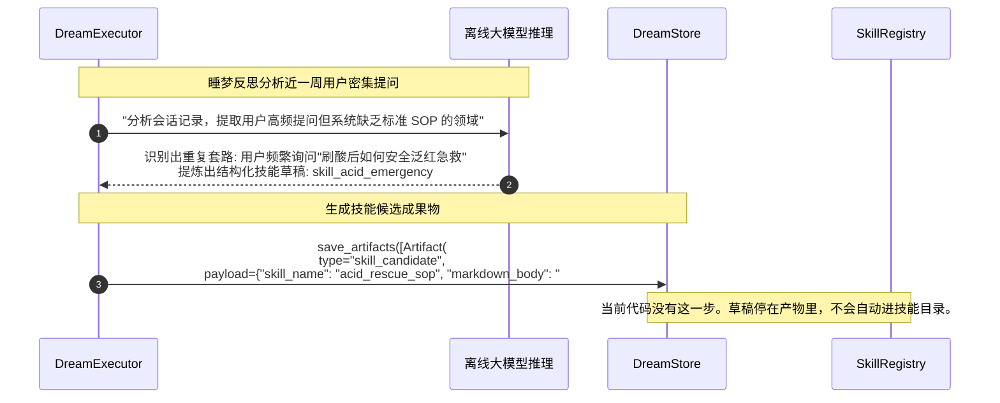
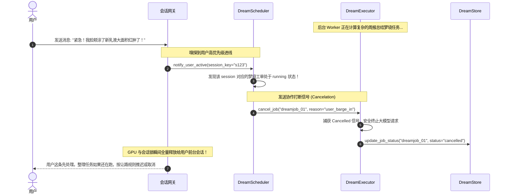

# 07_dream：空闲时的记忆整理

> **文件归属**：[`simpleclaw/dream/protocol.py`](file:///home/yang/mojing/mojing_agent/simpleclaw/dream/protocol.py)、[`scheduler.py`](file:///home/yang/mojing/mojing_agent/simpleclaw/dream/scheduler.py)、[`executor.py`](file:///home/yang/mojing/mojing_agent/simpleclaw/dream/executor.py)、[`policy.py`](file:///home/yang/mojing/mojing_agent/simpleclaw/dream/policy.py)、[`signal.py`](file:///home/yang/mojing/mojing_agent/simpleclaw/dream/signal.py)、[`store.py`](file:///home/yang/mojing/mojing_agent/simpleclaw/dream/store.py)  
> **模块定位**：空闲时整理记忆。用户正在说话就推迟。产物类型写在协议里，包括偏好、教训和技能草稿。草稿不会自动变成已加载的 `SKILL.md`。  
> **推荐阅读顺序**：**第 7 篇**（记忆账本之后。这是后台整理，不是主回复的一部分。）

---

## 一、整理记忆要让着正在说话的用户

每轮都把原文塞进检索，时间一长会堆成流水账：今天用了 A，明天换了 B，后天觉得 B 油。模型看得到细节，归纳不出「这个人屏障弱，先不要强酸」。工具参数填错了，如果没有地方记下这次教训，下次还是靠模型临场发挥。

定时任务完全可以先问「会话忙不忙」再跑。我们把这个判断写成准入策略：用户在说话或会话忙，整理就推迟或取消。两次成功整理之间默认至少隔 30 分钟（`min_interval_ms = 30 * 60 * 1000`）。同一作用域不要重入。

产出是结构化结果，例如偏好、失败教训、工具纠错、技能草稿，不是只打一段总结日志。生产环境走任务队列；本地可以直接把已就绪的任务排空，方便调试。

| 要解决的事 | 我们的默认做法 |
| :--- | :--- |
| 整理不能打断用户正在进行的对话 | 会话忙或用户新消息到了，这次整理不跑，或者协作取消。 |
| 不要空闲时连着打模型 | 默认 30 分钟冷却，加上同一作用域互斥。 |
| 整理结果要能进后面的记忆和技能，而不是一段没法用的摘要 | 写成明确类型的产物，再决定写回记忆、纠正工具，或留下技能草稿。 |
| 线上和本地不要两套逻辑 | 同一套任务。线上进 Redis Streams，本地可以自己排空。 |

### 面试时可以怎么说

> 睡梦是空闲时的记忆整理，不是主回复的一部分。用户在说话就让路。默认 30 分钟内不重复跑。它要把流水账收成偏好、教训这种能写回的结果。Cron 也能先判断会话忙不忙，我们是把让路、冷却和产物类型写成这一条策略。

---

## 二、核心类与数据协议全景

### 1. 梦境实体流转契约（定义于 [`simpleclaw/dream/protocol.py`](file:///home/yang/mojing/mojing_agent/simpleclaw/dream/protocol.py)）

#### (1) 七大触发契机 (`DreamTrigger`)
- `"idle_session"`: 会话超时闲置（如用户 30 分钟未发言）。
- `"memory_threshold"`: 记忆因果账本积压超阈值，需深度合并。
- `"runtime_task_completed"`: 复杂长耗时任务执行完毕。
- `"subagent_completed"`: 垂直调研子智能体汇报完成。
- `"cron"`: 定时触发。源码注释里的「凌晨 3 点」是例子，不是已经排好的任务。
- `"manual"`: 管理员或专家显式触发。
- `"system_monitor"`: 系统巡检发现数据异常。

#### (2) `DreamCandidate`（候选人）
信号到达后的第一站实体。计算去重键 `dedupe_key = f"{scope_key}:{trigger}:{source}"`，交给准入海关审批。

#### (3) `DreamJob`（正式梦境任务工单）
准入放行后生成的正式工单，携带分布式全局追踪 `trace_id`。可通过 `to_task_envelope()` 无缝转化为底层 `TaskEnvelope`，投递至后台队列。

#### (4) 七大认知成果物 (`DreamArtifactType`)
```python
DreamArtifactType = Literal[
    "memory_summary",       # 全局长期记忆综合摘要 (消解矛盾后的纯净状态)
    "preference_profile",   # 提炼的用户长期偏好画像 (如：对酒精过敏、喜爱轻盈乳液)
    "task_lesson",          # 复杂长任务规划与分解经验
    "tool_usage_lesson",    # 工具调用失败复盘与参数修正指南
    "failure_lesson",       # 业务严重故障教训复盘
    "skill_candidate",      # 协议里的技能草稿类型。不会自动写入 SKILL.md
    "context_cleanup",      # 上下文冗余垃圾信息剔除指令
]
```

---

## 三、准入风控海关与执行器

### 1. `DreamAdmissionPolicy`（准入风控策略）
定义于 [`simpleclaw/dream/policy.py`](file:///home/yang/mojing/mojing_agent/simpleclaw/dream/policy.py)：
默认让着正在说话的用户。`force=True` 时策略直接放行，不再看会话忙不忙：



### 2. `DreamExecutor`（双轨执行协调器）
定义于 [`simpleclaw/dream/executor.py`](file:///home/yang/mojing/mojing_agent/simpleclaw/dream/executor.py)：
- **队列里的执行 (`execute`)**：消费 Redis Streams 上的 `TaskEnvelope`。业务异常记成 `failed` 并写下 `last_error`。接住异常不能避免进程被杀掉，OOM 或 SIGKILL 仍会中断这次执行。
- **本地自排空模式 (`drain_ready`)**：在单测或本地简易部署中，就地排空执行已准入工单，零外部 MQ 依赖。

---

## 四、全场景实战时序图（Mermaid 8.14.0+ 规范）

### 场景 1：会话空闲触发准入并生成正式工单流（空闲自整理）

展示用户离开 30 分钟后，系统自动触发整理并向分布式队列派发工单：



---

### 场景 2：准入海关拦截驳回流（会话忙碌 / 冷却时间内拒签）

展示当用户正在对话或刚做完梦不久时，准入海关如何严防算力浪费与打扰用户：



---

### 场景 3：双轨执行器与多类型成果物落盘流（认知提炼）

展示独立 Worker 如何消费工单，调用大模型提取用户偏好与工具教训并批量落盘：



---

### 场景 4：技能草稿类型（协议里有，没有自动装上）

`DreamArtifactType` 包含 `skill_candidate`。执行器没有把草稿写成 `SKILL.md`，也没有调用 `SkillRegistry` 注册。下面的图只说明这个类型长什么样，不是已上线的自进化。



---

### 场景 5：前台紧急用户消息打断与做梦任务协作式取消流

用户进线时，准入可以拒绝新的整理，运行中的任务可以协作取消。整理调用的是远程模型，取消的是这个任务，不是释放一块本机显卡。


