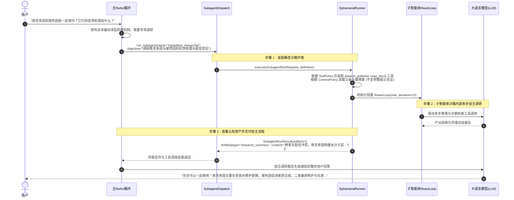
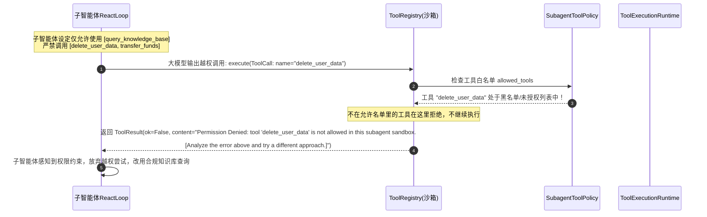
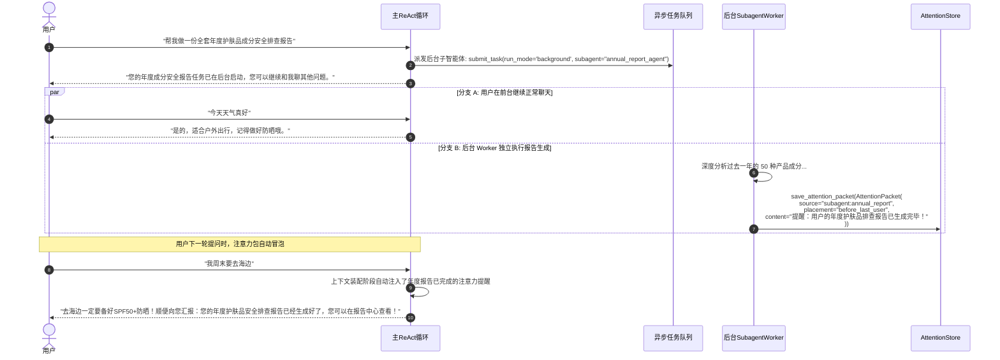
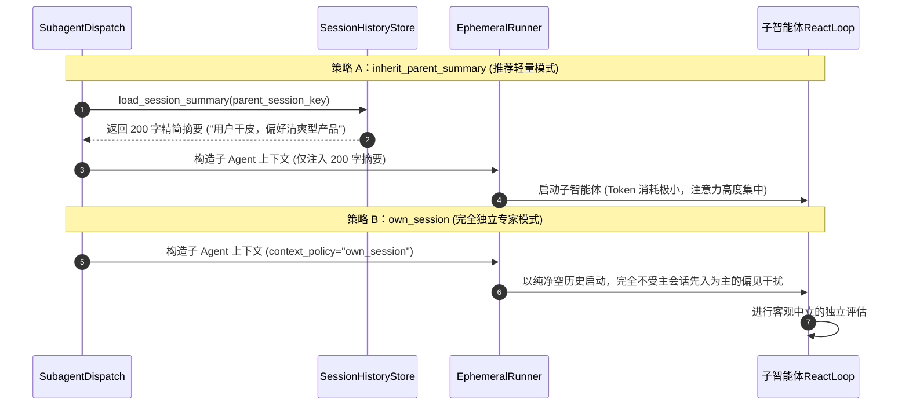
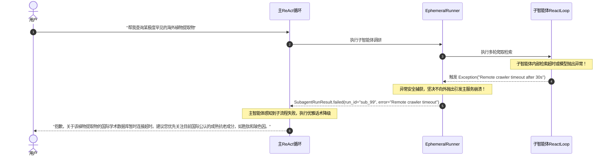

# 08_subagent：子智能体协同网格、权限沙箱与上下文隔离全景剖析

> **文件归属**：[`simpleclaw/subagent/definition.py`](file:///home/yang/mojing/mojing_agent/simpleclaw/subagent/definition.py)、[`runtime.py`](file:///home/yang/mojing/mojing_agent/simpleclaw/subagent/runtime.py)、[`ephemeral.py`](file:///home/yang/mojing/mojing_agent/simpleclaw/subagent/ephemeral.py)、[`runner.py`](file:///home/yang/mojing/mojing_agent/simpleclaw/subagent/runner.py)、[`executor.py`](file:///home/yang/mojing/mojing_agent/simpleclaw/subagent/executor.py)、[`dispatch.py`](file:///home/yang/mojing/mojing_agent/simpleclaw/subagent/dispatch.py)、[`store.py`](file:///home/yang/mojing/mojing_agent/simpleclaw/subagent/store.py)  
> **模块定位**：SimpleClaw 智能体内核的“多 Agent 协作调度中枢与权限沙箱”，负责主智能体对垂直领域子智能体的任务委派、上下文继承隔离、细粒度工具权限控制（RBAC）以及结构化认知资产收集。  
> **推荐阅读顺序**：**第 8 篇**（在理解单智能体推理、工具与并发后，剖析如何打破单一 Prompt 承载上限，构建分工明确的多智能体系统）

---

## 一、子任务分开跑，是为了少把主会话撑爆

护肤顾问、查成分、控设备如果全塞进一个提示词，工具一多，模型更容易选错。查资料的子任务如果也能看到删除、解绑，权限就过大。检索的长文和报错如果全写回主会话，主对话的窗口和历史都会脏。

### 核心范式差异：分布式异构网格 vs LangGraph 单进程图状态机

很多同学会问：*“既然 LangGraph 也支持 Multi-Agent，为什么还要自研 Subagent 框架？”*
口径以第 13 篇为准：
- **LangGraph 的多智能体**：属于**单进程/单图内部的拓扑状态机**。多个 Agent 作为图中的不同节点，依赖内存 State 字典或单数据库 Checkpointer 同步流转，适合秒级短会话内的协同。
- 实际注册的是 `skin_diary`、`deep_report`、`dream`。深度报告走发件箱再发 Kafka，不堵在主对话这一轮里。日记有自己的会话。做梦是空闲整理，默认成功间隔 30 分钟，不是凌晨 3 点。没有测过首字小于 500 毫秒。不用 LangGraph 是因为主路径已经是单轮 ReAct，不是因为图引擎做不到异步任务。

| 要解决的事 | 我们的默认做法 |
| :--- | :--- |
| 一个提示词装不下所有角色 | `persistent` 长期独立角色，`ephemeral` 瞬态沙箱，`external` 外部微服务异步长任务。 |
| 子任务不该看见主代理的全部工具 | `allowed_tools` / `disallowed_tools` RBAC 工具权限沙箱。 |
| 不该每次都复制整段父会话 | 可选：自己的独立会话、只要提炼摘要、继承历史或零上下文启动。 |
| 交回来的东西要能进记忆、提醒或任务，而不是再让模型猜 | 结果按约定结构交回（如摘要、注意力包、长任务完成通知）。 |
| 出问题要能查到是谁发起的 | 运行请求上携带全局业务链路标识 `owner_type`、`trace_id`、`scope_key`。 |

### 面试时可以怎么说

> 注册的是日记、深度报告和做梦。报告走发件箱和 Kafka。做梦默认 30 分钟间隔，不是凌晨 3 点。设备主路径没有接 WorkItem。LangGraph 适合长流程和人工暂停后续跑，这里主路径是单轮 ReAct。

---

## 二、核心类与数据协议全景

### 1. `SubagentDefinition`（声明式子智能体能力契约）
定义于 [`simpleclaw/subagent/definition.py`](file:///home/yang/mojing/mojing_agent/simpleclaw/subagent/definition.py)：
声明子智能体“用来做什么、允许用什么工具、如何继承上下文以及如何交付结果”：

```python
@dataclass(slots=True)
class SubagentDefinition:
    name: str                                             # 子智能体唯一标识名称 (如 "ingredient_researcher")
    description: str = ""                                 # 角色职责描述
    when_to_use: str = ""                                 # 供主模型研判的触发时机指南
    kind: SubagentKind = "persistent"                     # 形态: persistent | ephemeral | external
    default_run_mode: SubagentRunMode = "handoff"         # 默认运行模式: handoff | chat | background | dream
    context_policy: SubagentContextPolicy = "own_session" # 上下文继承策略
    result_contract: SubagentResultContract = "reply_text"# 交付协议
    tool_policy: SubagentToolPolicy = ...                 # 工具权限沙箱
    permission_profile: list[SubagentPermission] = ...   # RBAC 权限列表
    model: str | None = None                              # 可单独覆盖底层推理模型 (如换成更便宜的小模型)
    max_turns: int | None = None                          # 最大迭代轮次限制 (防子智能体跑飞)
```

#### (1) 三大形态 (`SubagentKind`)
- `persistent`: 拥有专属业务状态机与独立会话的持久化垂直专家（如护肤面诊专家）；
- `ephemeral`: 临时由主 Agent 分裂出的瞬态沙箱 Fork Worker（如深度检索某篇文献，跑完即焚）；
- `external`: 部署在独立微服务容器中的远程 Agent。

#### (2) 五大上下文策略 (`SubagentContextPolicy`)
- `"own_session"`: 完全独立上下文，不继承父级历史；
- `"inherit_parent_summary"`: 仅继承父级会话的提炼摘要，极低 Token 消耗；
- `"inherit_parent_history"`: 继承父级完整的消息历史；
- `"inherit_parent_system"`: 仅继承父级的 System Prompt；
- `"none"`: 纯净零上下文启动。

#### (3) 四大运行模式 (`SubagentRunMode`)
- `"handoff"`: 主 Agent 临时移交控制权，等待子 Agent 完成并拿回结果；
- `"chat"`: 交互式独立子会话；
- `"background"`: 异步后台非阻塞运行，结果作为任务完成通知回传；
- `"dream"`: 挂载在睡梦整理链路中运行。

---

### 2. `SubagentRunRequest`（受治理的运行请求）
定义于 [`simpleclaw/subagent/runtime.py`](file:///home/yang/mojing/mojing_agent/simpleclaw/subagent/runtime.py)：
记录一次子智能体运行事件的完整上下文元数据：
- `run_id`: 带 `subrun_` 前缀的全局唯一运行 ID。
- `owner_type`: 归属主体类型（`runtime_task`, `memory_ledger`, `dream_job`, `manual`）。
- `scope_key`: 隔离作用域键 `subagent:{tenant}:{session}:{agent}:{owner}`。
- `status`: 状态机流转（`candidate` -> `admitted` -> `running` -> `completed` / `failed` / `cancelled`）。

---

## 三、瞬态子智能体执行器 (`DefaultEphemeralSubagentRunner`)

定义于 [`simpleclaw/subagent/ephemeral.py`](file:///home/yang/mojing/mojing_agent/simpleclaw/subagent/ephemeral.py)：
专用于快速运行 `kind="ephemeral"` 的瞬态沙箱子智能体：
1. **上下文按需投影**：根据 `context_policy` 加载历史或摘要；
2. **工具沙箱动态装配**：根据 `definition.tool_policy` 从父级工具库中严格筛选出合法工具子集；
3. **独立 `ReactLoop` 实例化**：在当前进程中创建轻量级的独立推理循环，绑定专属的 `max_turns`；
4. **结构化资产提炼与回填**：捕获子智能体产出的 `SubagentArtifact`，安全回传给主调用方。

---

## 四、全场景实战时序图（Mermaid 8.14.0+ 规范）

### 场景 1：主智能体委派瞬态子智能体 (Ephemeral Fork) 调研与产物回传流

展示用户询问生僻护肤成分时，主 Agent 委派成分专家瞬态沙箱调研并拿回结论：



---

### 场景 2：工具权限沙箱隔离与越权拦截流（RBAC 防御）

白名单能拦住声明之外的工具名。图里的 `delete_user_data`、`transfer_funds` 不是魔镜注册的工具，只用来说明门禁形状。名单挡不住模型用允许的工具做错事。



---

### 场景 3：异步后台子智能体与注意力包注入流 (`background` 模式)

展示耗时报告生成子 Agent 在后台默默运行，完成后作为注意力包注入下轮提问：



---

### 场景 4：会话上下文继承模式对比流 (`inherit_parent_summary` vs `own_session`)

展示不同上下文策略如何平衡“信息共享”与“Token 节约”：



---

### 场景 5：子智能体执行异常熔断与主流程保底自愈流

展示当子智能体内部发生超时或崩溃时，异常如何被安全包裹，主流程平稳降级：


