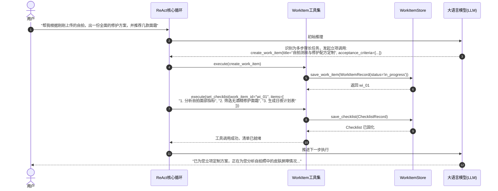
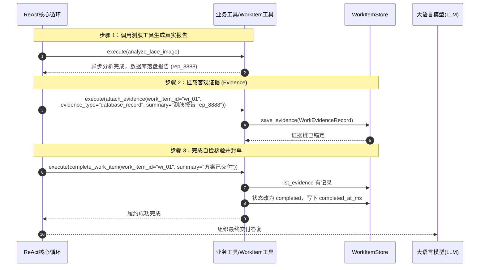
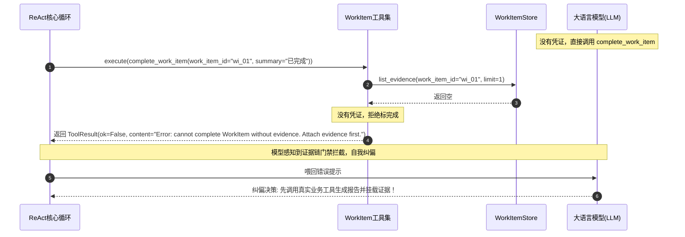
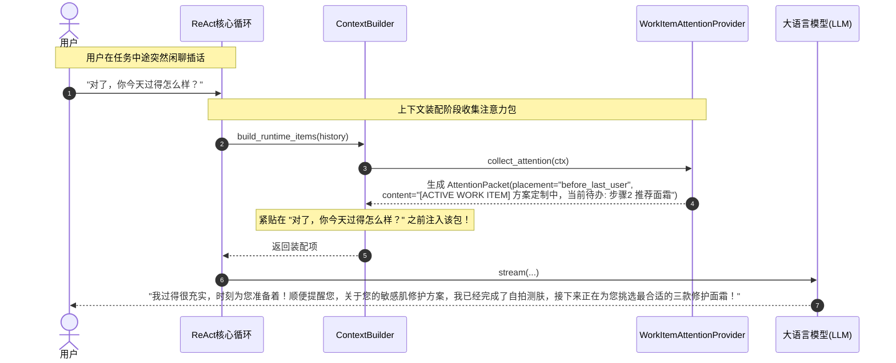
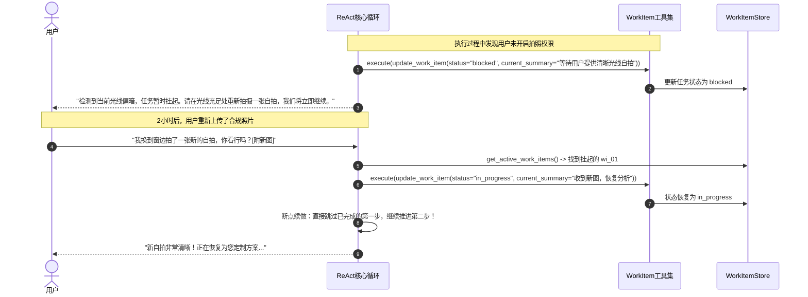

# 09_workitem：长任务工作项、动态检查单与证据链履约全景剖析

> **文件归属**：[`simpleclaw/workitem/protocol.py`](file:///home/yang/mojing/mojing_agent/simpleclaw/workitem/protocol.py)、[`store.py`](file:///home/yang/mojing/mojing_agent/simpleclaw/workitem/store.py)、[`prompt.py`](file:///home/yang/mojing/mojing_agent/simpleclaw/workitem/prompt.py)、[`attention.py`](file:///home/yang/mojing/mojing_agent/simpleclaw/workitem/attention.py)  
> **模块定位**：SimpleClaw 智能体内核的“任务履约保障与检查单引擎”，负责长周期多步骤任务立项、Checklist 步骤拆解、客观履约证据挂载（Evidence）以及“防大模型说大话/假完成”的证据链门禁。  
> **推荐阅读顺序**：**第 9 篇**（在理解多智能体协同后，搞懂复杂任务如何一步一个脚印稳健推进，每一步都有据可查）

---

## 一、长任务记清单和证据，不把路径写成死步骤

多步任务有两个真实问题。模型会说「已经做完了」，库里却没有订单号或报告 id。聊了十几轮，一开始拆的步骤容易被忘掉。

LangGraph 不是一条走错就死锁的固定流程图。它可以有循环、条件分支，也可以让模型自己选下一步工具。用户改主意，靠的是图里还能回到代理节点，不是图天生不能改。我们没有用图来规定「第一步必须查天气、第二步必须换城市」。工作项只记目标、清单和证据，下一步仍由模型选。

完成前会查有没有证据。`complete` 时如果 `list_evidence` 一条都没有，直接拒绝，提示先 `attach_evidence`。这挡住的是「没凭证还标完成」，不是保证模型永远不胡说。

未完成清单放在最新一条用户消息前面，比埋在系统提示词开头更不容易被长历史冲掉。这不能说成注意力 100%。通用规则留在稳定前缀里，具体任务用注意力包带上，避免每轮改前缀、把缓存打掉。前缀变了或缓存过期，仍然会重新算。

这套类型在 `simpleclaw/workitem`。魔镜的 `MojingAgentAssembler` 把传入的 `work_item_store` 丢掉了，设备主路径目前没有把检查单装进每一轮。不要把下面的时序说成镜子前已经在跑。

| 要解决的事 | 我们的默认做法 |
| :--- | :--- |
| 用户中途改主意，路径不要写死 | 只存目标、约束、清单、状态。模型自己决定下一步调什么。 |
| 嘴上说完成，库里没有凭据 | 没有 `attach_evidence` 留下的记录，不能把状态改成 `completed`。 |
| 清单不要埋进旧历史 | 未完成项贴在最新用户消息前面。 |
| 任务状态一变，不要把整段系统提示词改掉 | 通用规则放稳定前缀，这份任务的动态内容走注意力包。 |

### 面试时可以怎么说

> 工作项不是用来替代 LangGraph 的固定流程图。图可以有循环，也可以让模型自己选工具。我们担心的是模型口头说完成，但没有业务凭证。所以完成前必须先挂上证据，没有证据就拒绝改成完成。未完成清单贴在最新用户话前面，通用规则仍放稳定前缀，避免为了一份任务把前缀缓存打掉。贴得近，只是更不容易忘，不是保证模型一定照做。

---

## 二、核心类与数据协议全景

### 1. 五大数据实体（定义于 [`simpleclaw/workitem/protocol.py`](file:///home/yang/mojing/mojing_agent/simpleclaw/workitem/protocol.py)）

#### (1) `UserIntentRecord`（用户真实意图事实）
- `intent_id`: `intent_` 前缀主键。
- `goal`: 核心业务目标（如“定制7天敏感肌修护方案”）。
- `constraints`: 用户明确提出的硬性约束列表（如 `["严禁推荐酒精成分", "预算500元以内"]`）。
- `expected_output`: 交付物预期（如“包含日夜步骤的 Markdown 表格”）。

#### (2) `WorkItemRecord`（任务主记录实体）
- `work_item_id`: `wi_` 前缀主键。
- `status`: 生命周期状态机：
  - `"open"`: 已立项，尚未正式开始。
  - `"in_progress"`: 推进执行中。
  - `"blocked"`: 遇到阻塞（如缺少用户自拍照片或外部接口超时）。
  - `"completed"`: 验收准则全部达成，且证据挂载完毕，正式履约！
  - `"failed"`: 不可逆失败。
  - `"cancelled"`: 用户撤销或会话提前终结。
- `acceptance_criteria`: 明确的验收准则列表（如 `["包含T区油份分析", "产品不少于3款"]`）。
- `risk_level`: 风险等级（`low`, `medium`, `high`）。

#### (3) `ChecklistRecord` 与 `ChecklistItem`（步骤清单）
- `items`: 细分动作列表，支持动态追加与修改。
- `status`: `pending` -> `in_progress` -> `done` / `skipped` / `blocked`。

#### (4) `WorkEvidenceRecord`（完成凭证）
**防模型假完成的核心卡点**：
- `evidence_type`: 证据类别（`database_record`, `file_asset`, `api_receipt`）。
- `business_ref_type`: 外部业务实体（如 `skin_report`, `order_id`）。
- `business_ref_id`: 真实业务主键 ID（如 `rep_987654`）。
- `runtime_task_id`: 产生该证据的后台异步任务流水号。

#### (5) `ActionEventRecord`（执行动作审计流水）
记录全生命周期的工具调用与状态变更历史，供后期回放排障。

---

## 三、上下文工程融合与动态注意力包

### 1. 静态前缀注入治理规则 (`WorkItemPromptProvider`)
在 System Prompt 的稳定前缀中显式声明《WorkItem 治理规则》（位于 [`simpleclaw/workitem/prompt.py`](file:///home/yang/mojing/mojing_agent/simpleclaw/workitem/prompt.py)）：
- **什么时候不要建**：提示词里写明，普通闲聊、一次性问答、简单查天气不要建工作项。这是给模型的规则。代码里没有再拦一道「闲聊禁止创建」。
- **什么时候适合建**：多步骤、有外部副作用、要跨几轮、并且完成时需要凭证。

### 2. 动态注意力冒泡 (`WorkItemAttentionProvider`)
定义于 [`simpleclaw/workitem/attention.py`](file:///home/yang/mojing/mojing_agent/simpleclaw/workitem/attention.py)：
- **黄金注入点**：`placement="before_last_user"`。紧贴在最后一条用户消息的前方，处于大模型注意力权重最高的自回归解码区域；
- **增量防抖**：`lifetime="until_changed"`。步骤未变动时不产生无效 Prompt 抖动，一旦清单更新立即无缝刷新。

```markdown
<!-- 动态冒泡渲染示例 -->
[ACTIVE WORK ITEM: wi_89ab] 全流程面部测肤与护肤配方定制
Status: in_progress | Acceptance: [包含T区油份, 匹配过敏史]
Checklist:
  [x] 1. 调用 analyze_image 分析自拍面部皮肤指标 (done)
  [>] 2. 检索知识库匹配适合干敏屏障受损的成分 (in_progress)
  [ ] 3. 生成定制护肤早晚计划表 (pending)
Evidence:
  - database_record: 面部测肤报表已落盘 (ID: rep_10023)
```

---

## 四、全场景实战时序图（Mermaid 8.14.0+ 规范）

### 场景 1：长周期任务立项与多步骤清单动态拆解流

展示用户提出复杂要求时，大模型如何建立 WorkItem、拆解 Checklist 并开始推进：



---

### 场景 2：先挂凭证，没有凭证就不能标完成

模型每做完一步可以挂一条凭证。要标完成时，库里一条凭证都没有就拒绝：



---

### 场景 3：严禁假完成拦截自愈流（无证据强标完成被拦截）

展示模型在没有调用真实业务工具时试图“口嗨”完成，被底座门禁坚决拦截：



---

### 场景 4：动态注意力包冒泡防失焦流（长轮次指引）

展示在多轮闲聊中，注意力包如何浮动提醒模型当前未完结的任务进度：



---

### 场景 5：异常受阻与任务断点续做恢复流 (`blocked` 状态机)

展示外部依赖受阻时挂起任务，并在条件满足后断点恢复：


