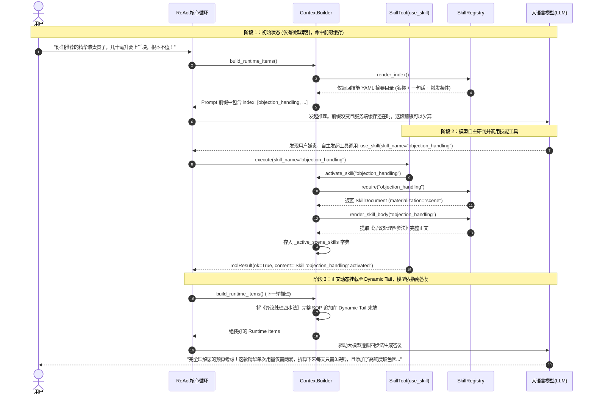
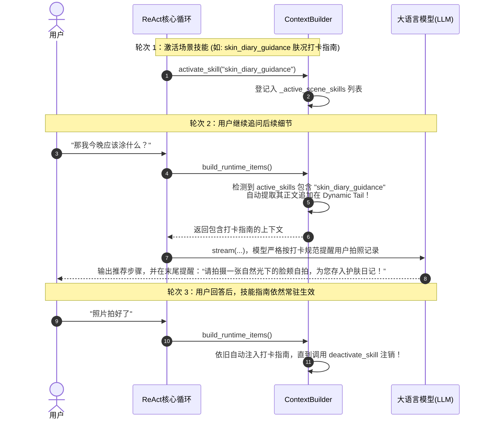
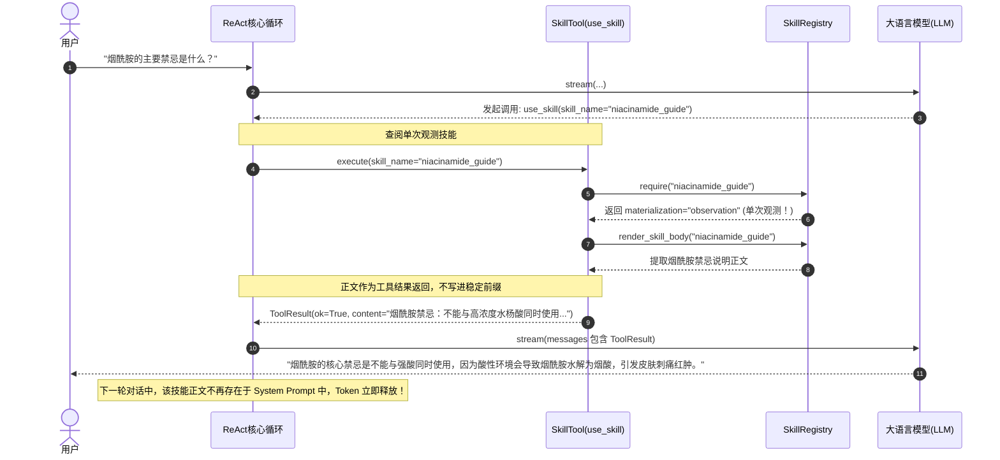
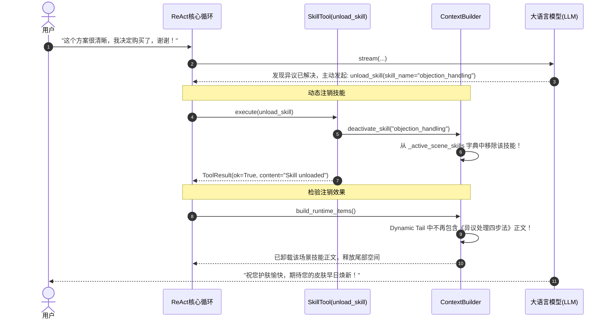
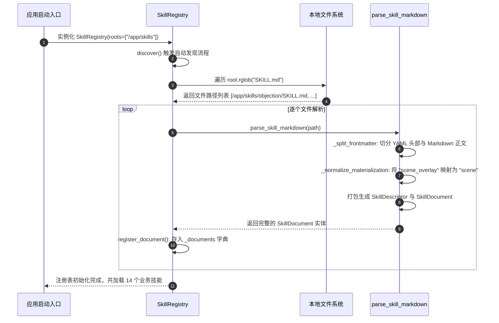

# 10_skills：动态技能插件、渐进式暴露与 SOP 物化全景剖析

> **文件归属**：[`simpleclaw/skills/base.py`](file:///home/yang/mojing/mojing_agent/simpleclaw/skills/base.py)、[`registry.py`](file:///home/yang/mojing/mojing_agent/simpleclaw/skills/registry.py)、[`tools/builtin/skill.py`](file:///home/yang/mojing/mojing_agent/simpleclaw/tools/builtin/skill.py)  
> **模块定位**：SimpleClaw 智能体内核的“动态技能插件与 SOP 挂载中枢”，负责基于文件即配置（`SKILL.md`）的规范解析、轻量索引常驻稳定前缀（Progressive Disclosure）、大模型自主按需激活以及正文场景化多轮物化。  
> **推荐阅读顺序**：**第 10 篇**。魔镜仓库里当前是 5 个 `SKILL.md`：护肤柜、深度报告场景、设备连接、日记场景、日记关注点回顾。目录变长会进稳定前缀，不要说成几十个或永远只有几十 token。

---

## 一、技能目录常驻，正文用到再加载

把十几篇长流程全写进系统提示词，token 和注意力都会差。只靠向量检索，用户说的是口语，标题对不上时会漏。

「目录很短、正文按需读」现在已经是常见做法，不少代码代理也用 `SKILL.md` 这一套。我们接进自己的上下文：目录放稳定前缀，正文放到动态尾巴。目录变了，前缀就变，缓存要重新算。不要说成目录一放进前缀就 100% 命中，也不要说成目录永远只有几十 token。技能一多，目录会变长。

`scene` 是进入一个场景后多轮都留着，结束时用 `unload_skill` 卸掉。`observation` 是这次看完就走。`unload_skill` 的 `needs_followup` 是 `False`，主循环不等它再开一轮。

| 要解决的事 | 我们的默认做法 |
| :--- | :--- |
| 流程正文太长，不能全塞进每轮提示词 | 文件是 `SKILL.md`：头上是名字、一句话、何时使用；正文用到再读。 |
| 模型得知道有哪些技能，又不能每次带全文 | 目录放稳定前缀。模型调用 `use_skill(name=...)` 再加载正文。 |
| 有的流程要跨几轮，有的看一眼就行 | `scene` 留到场景结束；`observation` 只在当次使用。 |
| 目录尽量稳定，好让前缀缓存还有机会命中 | 正文不进前缀。目录本身一改，哈希变了，缓存失效，这是正常的。 |

### 面试时可以怎么说

> 技能用 `SKILL.md`。系统提示词里只放目录：名字、一句话、什么时候用。模型决定要用时再把正文加载进来。场景类技能会留几轮，看完即走的只在当次出现。这和现在常见的渐进式技能是同一类做法。我们多接的是：目录放稳定前缀，正文放动态尾巴，并且和 `use_skill` / `unload_skill` 接在同一个循环里。目录变了，前缀缓存就会失效。

---

## 二、核心类与数据协议全景

### 1. 技能实体与描述符（定义于 [`simpleclaw/skills/base.py`](file:///home/yang/mojing/mojing_agent/simpleclaw/skills/base.py)）

#### (1) `SkillDescriptor`（轻量元数据描述符）
`SKILL.md` 头部 YAML Frontmatter 的内存投射，体积极小：
```python
@dataclass(slots=True)
class SkillDescriptor:
    name: str                                    # 唯一英文标识名 (如 "objection_handling")
    description: str                             # 一句话功能简介
    when_to_use: str                             # 触发时机明确界定 (模型研判的关键依据)
    path: Path                                   # 物理文件路径
    materialization: SkillMaterialization = "observation"  # 物化模式: "scene" | "observation"
    metadata: dict[str, Any] = ...               # 业务自定义扩展字段 (category, tags 等)
```

#### (2) `SkillDocument`（完整技能文档）
包含元数据 `descriptor` 与剥离了 YAML 头部后的纯 Markdown 正文 `body`。正文仅在技能被激活时才会被加载。

#### (3) 物理文件规范 (`SKILL.md` 示例)
```markdown
---
name: objection_handling
description: 处理用户对护肤品价格或繁琐流程的疑虑
when_to_use: 当用户表达嫌贵、担心刺激或怀疑效果时使用
materialization: scene
category: negotiation
---
## 异议处理四步法核心 SOP:
1. 【共情倾听】: 认同用户的预算担忧，切忌当场反驳；
2. 【价值拆解】: 将产品总价换算为每日单次使用成本 (如单日仅需 3 元)；
3. 【成分证明】: 强调高浓度活性成分与第三方人体功效报告；
4. 【阶梯替代】: 若用户依然犹豫，推荐平价备选方案。
```

---

## 三、`SkillRegistry` 注册表与渐进式物化

定义于 [`simpleclaw/skills/registry.py`](file:///home/yang/mojing/mojing_agent/simpleclaw/skills/registry.py)：

### 1. 核心方法列表
- `discover()`: 递归扫描 `self._roots` 目录下的所有 `SKILL.md`，自动解析并缓存至 `_documents` 字典。
- `render_index()`: 导出所有可用技能的精简 YAML 目录（仅含名称、简述与触发时机），例如：
  ```yaml
  skills:
    - name: objection_handling
      description: 处理用户对护肤品价格的疑虑
      when_to_use: 用户嫌贵或怀疑效果时
  ```
  该目录放进 `ContextBuilder` 的稳定前缀。目录内容不变、服务端缓存还在时，这段才有机会命中。目录一改，前缀就变。
- `render_skill_body(name)`: 提取技能完整 Markdown 正文，供动态挂载。

---

## 四、全场景实战时序图（Mermaid 8.14.0+ 规范）

### 场景 1：技能渐进式暴露全景时序流（目录常驻 -> 自主决策 -> 按需激活）

展示整个渐进式暴露的经典闭环流程：



---

### 场景 2：场景常驻技能 (`materialization="scene"`) 多轮挂载流

展示常驻技能一旦激活，如何在后续多轮对话中持续生效：



---

### 场景 3：单次观测技能 (`materialization="observation"`) 查阅流

展示单次查询类技能（如成分速查）如何用完即焚，不污染后续提示词：



---

### 场景 4：技能动态注销与上下文释放流 (`deactivate_skill`)

展示场景交互结束后，如何主动卸载技能释放 Token：



---

### 场景 5：本地磁盘递归扫描与容错标准化解析流

展示系统启动时，`SkillRegistry` 如何从磁盘递归发现技能并进行语法容错：


