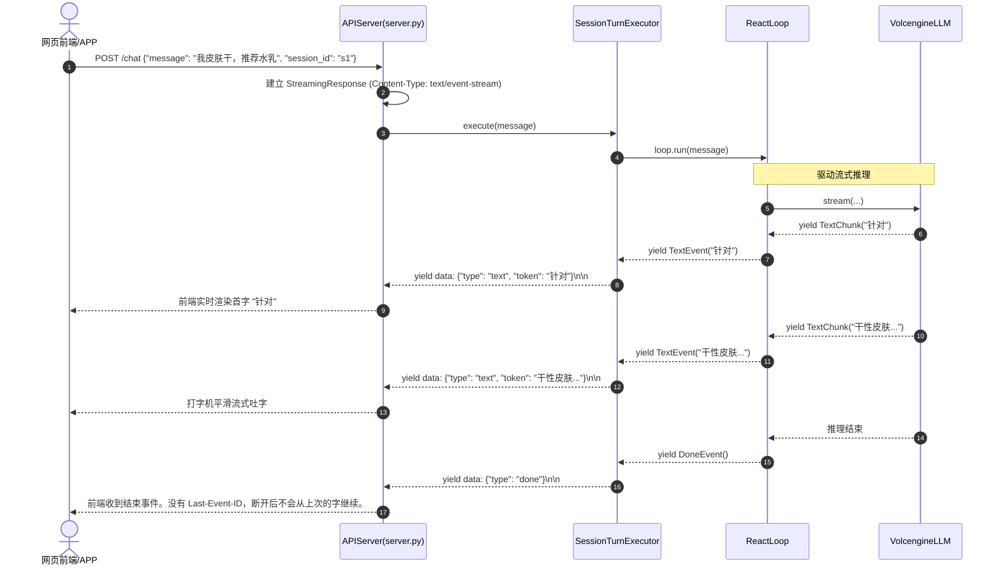
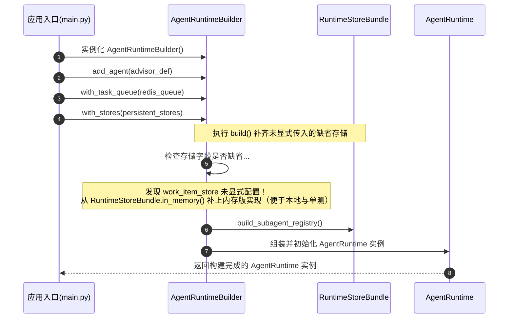
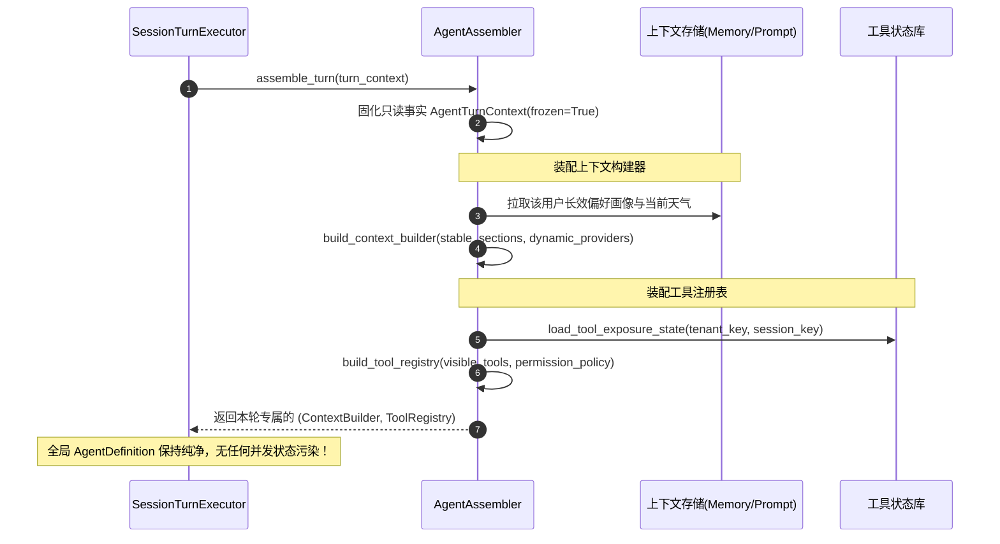
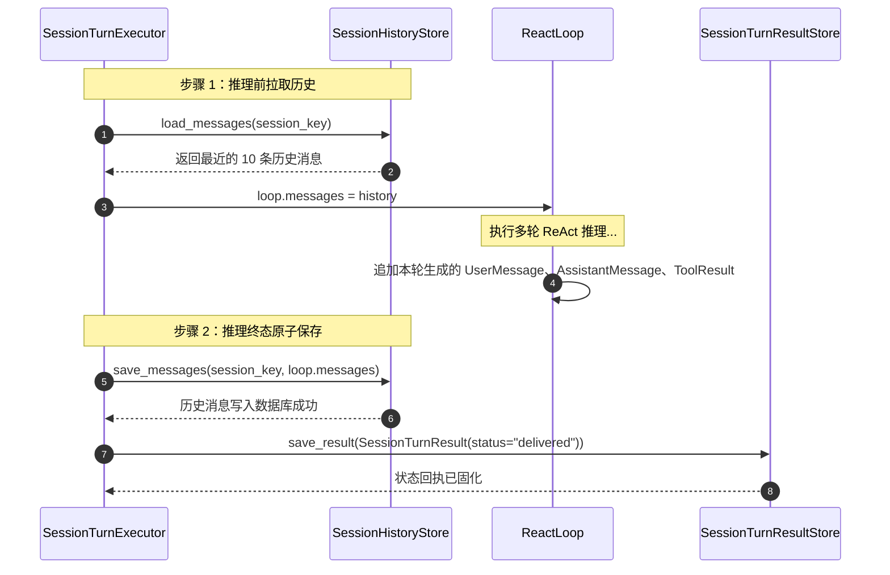
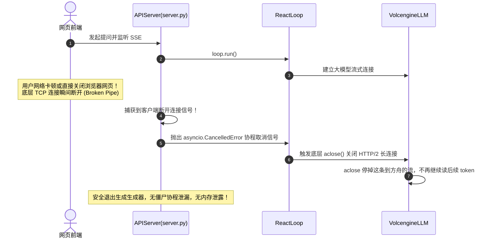

# 11_sdk_api：上层装配容器、依赖注入与 HTTP/SSE 网关全景剖析

> **文件归属**：[`simpleclaw/sdk/builder.py`](file:///home/yang/mojing/mojing_agent/simpleclaw/sdk/builder.py)、[`assembler.py`](file:///home/yang/mojing/mojing_agent/simpleclaw/sdk/assembler.py)、[`assembly.py`](file:///home/yang/mojing/mojing_agent/simpleclaw/sdk/assembly.py)、[`definition.py`](file:///home/yang/mojing/mojing_agent/simpleclaw/sdk/definition.py)、[`history.py`](file:///home/yang/mojing/mojing_agent/simpleclaw/sdk/history.py)、[`runtime.py`](file:///home/yang/mojing/mojing_agent/simpleclaw/sdk/runtime.py)、[`turn_executor.py`](file:///home/yang/mojing/mojing_agent/simpleclaw/sdk/turn_executor.py)、[`stores.py`](file:///home/yang/mojing/mojing_agent/simpleclaw/sdk/stores.py)、[`api/server.py`](file:///home/yang/mojing/mojing_agent/simpleclaw/api/server.py)  
> **模块定位**：SimpleClaw 智能体微内核的最顶层“系统装配底座与外部 HTTP 网关”，负责通过流式建造者模式（Fluent Builder）组织底层存储与模型驱动、按轮次动态装配隔离上下文与工具、以及通过 Server-Sent Events (SSE) 协议对外提供标准化流式推送能力。  
> **推荐阅读顺序**：**第 11 篇**（终篇：站在最高层上帝视角，纵览整个智能体从底层组件装配到最终暴露对外 API 的完整闭环）

---

## 一、装配和网页入口分开，是为了定时任务也能用同一套

如果 FastAPI 路由里直接 new 模型、直接写提示词，换成定时任务或命令行时，容易把同一套对象再抄一遍。分层本身很普通，框架项目也这么拆。我们具体做成两步：进程启动时用建造者把队列、存储、模型装好；每一轮再按这个回合的上下文挑工具和提示词，不改全局那份定义。

没传存储时，建造者可以用 `RuntimeStoreBundle.in_memory()` 补上内存实现，方便测试。这是缺了就用内存版，不是运行中自己把坏数据修好。

对外用 SSE，按循环里的事件推 `text`、`tool`、`done`、`error`。魔镜主路径在 `Mojing/api/ingress_delivery.py`：队列空闲 15 秒写 `: ping\n\n`。没有 `Last-Event-ID`，断线不能从上次的字续上。

`trace_id` 在任务信封和工具调用上有字段，有上下文时会带上。网关这段代码没有把「HTTP 头进来就一定打到模型请求」做成闭环。不要说 100% 贯穿。

| 要解决的事 | 我们的默认做法 |
| :--- | :--- |
| 网页、定时任务、测试要共用一套对象 | `AgentRuntimeBuilder` 在启动时装好。测试没传库，就用内存存储补上。 |
| 每一轮的工具和提示词不一样，但不能改坏全局配置 | `AgentAssembler` 按这一轮的 `AgentTurnContext` 现装。 |
| 前端要边生成边看到字和工具状态 | SSE 推文本、工具、结束、错误。打断走循环里的 `interrupt_event`。 |
| 查问题要能对上同一次调用 | 任务和工具记录里可以带 `trace_id`。从 HTTP 头到模型请求，还没有在网关里自动打通。 |

### 面试时可以怎么说

> SDK 把「进程里有哪些依赖」和「这一轮用什么提示词、哪些工具」分开。网页和后台任务共用建造好的运行时，每一轮再装配一次。对外是 SSE，事件和循环里的文本、工具、结束、错误对应。断线续传我没有做在这个网关里。trace 会记在任务和工具上，不要说成从 HTTP 头到模型已经全部自动带上。

---

## 二、核心类与数据协议全景

### 1. `AgentRuntimeBuilder`（流式建造者）
定义于 [`simpleclaw/sdk/builder.py`](file:///home/yang/mojing/mojing_agent/simpleclaw/sdk/builder.py)：
组织底层基础设施与角色蓝图的装配中枢：
```python
runtime = (
    AgentRuntimeBuilder()
    .add_agent(advisor_definition)          # 注册智能体角色定义
    .with_task_queue(redis_task_queue)      # 注入持久化任务队列
    .with_stores(persistent_stores)         # 批量注入数据库存储
    .with_runtime_services(services)        # 注入后台任务执行底座
    .build()                                # 构建出全局 AgentRuntime 实例
)
```
- **没传存储时用内存版**：`build()` 时如果没传某个存储，建造者可以用 `RuntimeStoreBundle.in_memory()` 补上，方便测试。这只补存储缺省，不保证别处不再抛 `AttributeError`。

---

### 2. `AgentAssembler` 与 `AgentTurnContext`
定义于 [`simpleclaw/sdk/assembler.py`](file:///home/yang/mojing/mojing_agent/simpleclaw/sdk/assembler.py)：
- **`AgentTurnContext`（不可变轮次事实容器）**：
  - 声明 `frozen=True, slots=True`，一旦从入口消息生成，在整轮 ReAct 推理中不可被外部篡改；
  - 包含 `tenant_key`, `session_key`, `ingress_id`, `trace_id`, `metadata`。
- **`AgentAssembler`（动态装配扩展点）**：
  - 为每一轮对话动态拉取专属长效记忆、组装 `ContextBuilder`；
  - 依据当前用户权限动态计算本轮可见工具，装配专属 `ToolRegistry`。

---

### 3. `DefaultSessionTurnExecutor`（单轮执行器流水线）
定义于 [`simpleclaw/sdk/turn_executor.py`](file:///home/yang/mojing/mojing_agent/simpleclaw/sdk/turn_executor.py)：
`SessionTurnScheduler` 驱动的真实执行流水线：
1. 从 `SessionHistoryStore` 加载历史消息；
2. 借调 `AgentAssembler` 编译当前轮次的专属 `ContextBuilder` 与 `ToolRegistry`；
3. 初始化 `ReactLoop`；
4. 流式消费 ReAct 事件并向外部回调广播；
5. 推理完结后将最新产生的增量消息持久化写回 `SessionHistoryStore`；
6. 提交执行结果回执（`SessionTurnResult`）。

---

### 4. HTTP / SSE 网关服务（`simpleclaw/api/server.py` 与 `Mojing/api/ingress_delivery.py`）
基于 FastAPI 构建的高性能非阻塞接入网关：
- **`POST /chat`**: 建立 `text/event-stream` SSE 长连接，流式推送事件：
  - `data: {"type": "text", "token": "..."}\n\n`
  - `data: {"type": "tool", "name": "...", "result": "..."}\n\n`
  - `data: {"type": "done"}\n\n`
  - `data: {"type": "error", "message": "..."}\n\n`
- **15 秒注释行心跳保活（Heartbeat Ping）**：
  在 `Mojing/api/ingress_delivery.py` 中，针对长耗时工具调用或深度推理增加 15 秒超时等待，持续向流中注入 `: ping\n\n`（SSE 注释行，客户端 EventSource 自动忽略但重置中间 Nginx/ALB 代理的空闲计时器），配合 `Cache-Control: no-cache` 与 `X-Accel-Buffering: no` 彻底杜绝生产代理层静默断连与逐字缓冲卡顿。
- **打断**：请求取消后停掉发往方舟的 HTTP 流。模型的显存在服务商侧，这里只是不再继续读这条流。

---

## 三、全景架构与数据流转拓扑

```mermaid
flowchart TD
    Client["前端 / Web / 客户端"] -->|HTTP POST /chat (SSE)| Gateway["API Gateway (server.py)"]
    Gateway --> IngressQueue["会话入口队列 (SessionIngressQueue)"]
    IngressQueue --> Scheduler["会话调度器 (SessionTurnScheduler)"]
    
    subgraph CoreRuntime ["SimpleClaw 核心运行时 (SDK Runtime)"]
        Scheduler --> TurnExec["单轮执行器 (DefaultSessionTurnExecutor)"]
        TurnExec --> Assembler["轮次装配器 (AgentAssembler)"]
        Assembler --> Builder["上下文构建器 (ContextBuilder)"]
        Assembler --> Registry["工具注册表 (ToolRegistry)"]
        TurnExec --> AgentLoopNode["ReAct 核心循环 (ReactLoop)"]
        AgentLoopNode --> LLM["火山引擎方舟驱动 (VolcengineLLM)"]
        AgentLoopNode --> Tools["工具执行运行时 (ToolExecutionRuntime)"]
    end
    
    subgraph StorageInfra ["底层三层持久化设施"]
        Builder -.-> DB_Mem["长期记忆与档案 (PostgreSQL)"]
        Registry -.-> DB_Tools["ToolInvocation 审计日志 (PostgreSQL)"]
        Scheduler -.-> DB_Tasks["任务总账本 & 事务性发件箱 Outbox (PostgreSQL)"]
        Scheduler -.-> Redis_Queue["Agent 内部工单队列 (Redis Streams) & 租户限流 (Lua)"]
        Scheduler -.-> Kafka_Bus["跨服务对外事件总线 (Kafka: *.requested / *.completed)"]
    end
    
    AgentLoopNode -->|流式 Event 事件| Gateway
    Gateway -->|SSE 打字机推送| Client
```

---

## 四、全场景实战时序图（Mermaid 8.14.0+ 规范）

### 场景 1：HTTP POST `/chat` 到 SSE 事件全链路流式交互流

展示用户在前端输入一句话，从 HTTP 网关到底层推理并打字机流式输出的完整链路：



---

### 场景 2：SDK 容器依赖注入组装流 (`AgentRuntimeBuilder`)

展示系统在初始化时，如何通过建造者模式完成组件依赖注入与缺省内存存储补齐：



---

### 场景 3：单轮动态上下文与工具装配流 (`AgentAssembler`)

展示每一次用户提问到来时，装配器如何无侵入地编译出本轮专属的上下文与工具：



---

### 场景 4：会话历史拉取与终态归盘提交流 (`SessionHistoryStore`)

展示对话轮次执行完毕后，最新消息如何原子持久化写回数据库并保存回执：



---

### 场景 5：HTTP 客户端意外断开与 SSE 取消流 (`CancelledError`)

展示用户在回答生成中途突然关闭网页标签页时，系统如何优雅协作断开并清理资源：


