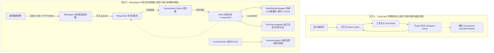

# 12_architecture_selection：技术选型深层辩析、自研得失复盘与秋招面试指南

> **文件归属**：系统全局架构设计总揽、选型白皮书与求职面试通关指南  
> 这篇是选型草稿。面试以第 13 篇为准。不要背「首字小于 500 毫秒」「凌晨 3 点」「前缀在显存或 Redis」「降低 60%」这些句子。和代码不符的地方下面还有残留，答的时候以第 13 篇为准。  
> **推荐阅读顺序**：**必读终篇 / 面试必背篇**（在通读前 11 篇技术细节后，站上架构师与技术评审视角，统领全局并形成清晰的工程认知）。

---

## 一、技术选型核心拷问：为什么死活不用 LangGraph？

在很多同学初读代码时，常常产生巨大的困惑与疑虑：
> *“LangGraph 现成支持有向图状态机、多 Agent 协作、检查点持久化、Human-in-the-loop 人机审批，生态繁荣插件无数。为什么 MojingAgent 明明有多个子 Agent（深度研报、肌肤日记、做梦演化），却还要下沉自研一套底层运行时（SimpleClaw），甚至自己写并发锁、状态机和单测？这不是典型的重复造轮子吗？”*

如果回答“因为 LangGraph 检查点会导致数据库幽灵写入”，**这在事实上是站不住脚的**——LangGraph 的 State 本身就是一个共享字典（TypedDict），在里面挂一个待写入列表并在确认节点统一落库，完全可以做到同样的事；检查点只持久化图状态，并不强迫每一步改写外部数据库。

真正驱动团队没有选择 LangGraph 的核心原因，**不是 LangGraph 做不到什么，而是四个深层次的物理约束与业务形态差异**：

```
┌────────────────────────────────────────────────────────────────────────────────────────┐
│                        为什么死活不用 LangGraph？四大核心工程现实                        │
├───────────────────────────┬────────────────────────────────────────────────────────────┤
│ 1. 业务形态与计算模型不匹配 │ 业务主路径是单轮 While 循环，而非有向图拓扑；强套图引擎属过度设计 │
├───────────────────────────┼────────────────────────────────────────────────────────────┤
│ 2. 多智能体架构范式完全异构 │ 跨进程/跨时间分布式异步网格（Kafka+Outbox+Cron），非单进程图状态机 │
├───────────────────────────┼────────────────────────────────────────────────────────────┤
│ 3. 厂商专有显存缓存深度绑定 │ 火山方舟 Responses API 显式前缀缓存要求动态物理剥离 Schema，通用框架难魔改 │
├───────────────────────────┼────────────────────────────────────────────────────────────┤
│ 4. 硬件端全双工与数据审计   │ 语音毫秒级打断即时 aclose 止损、滑动窗口裁剪对齐全局绝对序号 history_offset │
└───────────────────────────┴────────────────────────────────────────────────────────────┘
```

---

### 1. 抽象模型不匹配：业务本质是 While 循环，而非图（Graph）

LangGraph 核心解决的是**有向图（DAG 或有环图）**的编排：
- 节点 A 执行完，根据复杂条件分支路由到节点 B 或 C；
- 节点 C 和 D 并行扇出（Fan-out），再汇总汇聚（Fan-in）；
- 跨越数小时乃至数天的人工审批挂起与断点恢复。

**然而，Mojing 智能硬件的前台主交互链路根本不是一个“图”**。它的主路径从头到尾只有一个标准的单轮 ReAct（Reasoning + Acting）过程：
```python
while iteration < max_iterations:
    response = await call_llm(messages)
    if not response.tool_calls:
        break
    results = await execute_tools(response.tool_calls)
    messages.append(results)
```
这是一个**用 200~300 行干净的 Python 异步协程就能完全掌控的 While 循环**。

如果为了这个标准循环引入 LangGraph：
- 必须强行定义一个 `StateGraph`，定义 `agent` 节点、`tools` 节点、`should_continue` 条件边；
- 引入一套基于学术界 Pregel 理论的超级步（Superstep）调度引擎；
- **原本直接一竿子到底的异步协程，被硬生生拆散包装在图节点的字典传递中，调用栈深达几十层。在排查全双工打断或网络抖动时，调试成本成倍激增。**

---

### 2. 多智能体范式的根本差异：分布式异构网格 vs 内存单图

“mojing_agent 明明有多个子 Agent，为什么还不用 LangGraph？”这是最容易被误解的一点。

| 维度 | LangGraph 的多智能体形态 | MojingAgent 的多智能体形态 |
| :--- | :--- | :--- |
| **拓扑空间** | **单进程 / 单图内部紧耦合** | **分布式异构异步网格（Distributed Async Mesh）** |
| **协同方式** | 节点间共享 State 字典，互相返回消息跳转 | 跨进程消息通信、独立会话空间、异步解耦 |
| **耗时与边界** | 适合秒级/短轮次内的连续会话协同 | 前台秒级对话 vs 后台分钟级长计算 vs 凌晨离线做梦 |
| **通信介质** | 内存字典或单数据库 Checkpointer | **PostgreSQL 事务性发件箱（Outbox） + Kafka 总线** |

看 Mojing 中各个子 Agent 的真实运行机制：
1. **`MainAgent`（前台闺蜜主顾问）**：
   运行在镜子端侧，要求**毫秒级首字延迟（TTFT < 500ms）**，全双工流式吐字，随时接受用户语音打断。
2. **`DeepReportSubagent`（深度护肤研报专家）**：
   这是一个**重型长耗时任务**（在外部独立 GPU 集群或大模型集群上运行 5~10 分钟）。
   它**坚决不能阻塞在主对话图里等待**！在代码中，它是由工具写入 PostgreSQL 后，通过**事务性发件箱（Transactional Outbox）直发 Kafka**，外部 GPU 集群异步消费计算，完成后再回推 Kafka。
3. **`SkinDiarySubagent`（肌肤日记专家）**：
   拥有独立的会话隔离空间、独立的历史时间线画像以及专有约束。
4. **`Dream`（睡梦演化）**：
   是一个**凌晨 3:00 由定时任务（CronScheduler）在系统低谷期触发的离线后台子 Agent**，负责提炼白天对话中的矛盾与偏好。

> **架构结论**：  
> 你不可能把一个**“凌晨 3 点跑的离线做梦任务”**和一个**“耗时 10 分钟的外部 GPU 微服务”**，塞进 LangGraph 的同一个前台交互图里。强行塞进去，图的状态持久化（Checkpointer）会把数据库拖垮，前台交互也会被后台长任务死死卡住。  
> **Mojing 需要的是分布式微服务间的异步解耦网格，而不是单体应用内的拓扑状态机。**



---

### 3. 厂商私有特性的深层入侵：火山方舟 Responses API 显式显存前缀缓存

这是任何开源通用框架都无法直接优雅支持的硬核底层机制：
- 项目采用字节跳动火山方舟（豆包）的 **Responses API 显存前缀缓存（Prefix KV Caching）**（源码位于 [`simpleclaw/llm/volcengine.py`](file:///home/yang/mojing_agent/simpleclaw/llm/volcengine.py)）；
- **工作机制**：
  1. 第一次请求时，将数千 Token 的静态人设和 10 几个工具的完整 JSON Schema 发给火山，火山在 GPU 显存池固化前缀，并返回显存锚点 `previous_response_id`；
  2. 从第二轮请求开始，客户端在组装发往火山的 HTTP 请求体时，**必须在物理上彻底剥离 `stable_prefix` 和全部工具的 Schema**，只传 `dynamic_tail` 和最新滑窗，并在请求头带上 `previous_response_id` 和会话亲和标签（`x-session-affinity`）；
  3. 服务端直接从显存挂载点续接计算，实现首字延迟从 1.5s 骤降至 300ms，且大幅节省 Token 费用。
- **与通用框架的冲突**：
  - LangChain / LangGraph 的封装是通用化的（`BaseChatModel` 输入 `list[BaseMessage]`，输出 `AIMessage`）；
  - LangChain 的设计假设每次都发送绑定好的工具与整段上下文。如果你要在通用管道里动态地把工具摘掉、把 System 拆开成两半、把历史多模态图片剥离成文字占位符，你必须深度 Hack LangChain 的私有序列化方法。
  - **结果是：为了迁就通用框架的抽象，写的 Adapter 和 Hack 代码，比直接写一个 `aiohttp` 请求还要臃肿。**

---

### 4. 硬件端全双工与数据审计对齐

1. **流式 TCP 断连与算力物理止损**：
   智能镜子是硬件设备。用户拔掉电源、关闭屏幕或网络断开时，底座必须能在毫秒级捕获到 `asyncio.CancelledError`，并立刻主动触发 `stream.aclose()` 关闭与火山方舟云端的 HTTP 连接。**云端网关立刻掐断后续 Token 产生，按断开前的实际 Token 计费，物理级止损**。
2. **全局绝对偏移量（`history_offset`）与因果账本（`MemoryLedger`）**：
   当对话超过 2200 Token 时，底座在 `UserMessage` 边界保护性切除旧消息，切除条数累加进 `history_offset`。因果记忆账本记录提取来源时，必须严格引用 `message_seq_start` 和 `message_seq_end`。通用框架提供的切除函数只返回截断后的列表，不维护全局绝对序号，直接破坏了上层因果审计。

---

## 二、客观复盘：自研造轮子的代价与工程反思

在技术评审或面试中，如果一味狂吹“自研有多好”，会给面试官留下“盲目自大、缺乏工程全局观”的负面印象。**能够客观剖析自研带来的代价，才是高级工程师的标志。**

### 1. 自研付出的真实代价
1. **开源生态严重脱节**：
   开源社区拥有成千上万现成的 LangChain Tools、RAG 数据切分器、向量数据库连接器，由于接口不兼容，一个都不能直接 `import` 开箱即用，必须自己编写适配器包装成 `simpleclaw.tools.Tool`。
2. **底层维护与填坑成本高昂**：
   并发锁竞争、网络超时重试、状态机流转等基础链路，通用框架在开源社区数万个项目里已经被千锤百炼验证过。而自研底座就必须团队自己写 50 多个单测去覆盖各种边角 Bug（如多 Pod 锁竞争、僵尸任务超时自愈等）。
3. **团队新人上手门槛**：
   新员工进组，业界通用的 LangGraph 经验无法直接套用，必须花几天时间通读并熟悉 `SimpleClaw` 内部的 `ContextBuilder`、`ScopeLock`、`SideEffectBuffer` 等专有概念。

### 2. 总结：什么时候该用 LangGraph？什么时候该自研？

```
┌────────────────────────────────────────────────────────────────────────┐
│                      技术选型的黄金权衡矩阵                             │
├────────────────────────────────────────────────────────────────────────┤
│ 【坚决选择 LangGraph 的场景】：                                         │
│ • 业务是复杂的有向图流程（如：法律文书多轮审核、跨部门层级审批 DAG）；    │
│ • 纯软件 Web / SaaS 场景，无需与端侧物理硬件交互；                     │
│ • 依赖社区海量工具与第三方 RAG / 向量库快速出原型；                     │
│ • 团队需要行业通用经验，降低人员协作与维护成本。                       │
├────────────────────────────────────────────────────────────────────────┤
│ 【必须自研轻量微内核（如 SimpleClaw）的场景】：                         │
│ • 运行在物联网端侧硬件（音箱、魔镜、车机），对全双工低延迟有极致要求；    │
│ • 交互主路径本质是单轮 ReAct While 循环，无复杂图分支；                 │
│ • 深度绑定特定模型厂商的专有显存缓存优化（如火山方舟显式前缀剥离）；    │
│ • 多智能体形态是跨微服务的异构异步网格（Kafka + 发件箱），非单图状态机。│
└────────────────────────────────────────────────────────────────────────┘
```

---

## 三、秋招项目定位与简历包装指南

**彻底告别“四不像”！** 将项目包装为具备工业级深度的**两层架构**：

### 1. 项目名称与定位建议
- **项目名称**：面向智能硬件的高可用 Agent 运行时内核（SimpleClaw）与多智能体系统（MojingAgent）
- **项目角色**：核心研发 / 架构设计
- **一句话介绍**：针对端侧智能硬件（美妆镜）低延迟、全双工交互与跨微服务长任务的严苛要求，自研了高性能 Agent 运行时微内核（SimpleClaw），并基于该内核构建了包含主对话、深度研报、肌肤日记与离线睡梦的分布式多智能体系统（MojingAgent）。

---

### 2. 简历 STAR 法则核心亮点拆解（可直接参考使用）

#### 亮点 1：轻量级 Agent 运行时微内核自研与全双工优化（SimpleClaw）
- **背景/挑战**：通用图框架（如 LangGraph）由于抽象层级深，在物联网硬件全双工场景下存在调用栈冗长、首字延迟（TTFT）不可控、模型在复杂轮次原地打转死循环、以及语音打断时显存连接泄漏等问题。
- **方案/行动**：
  - 自研轻量级协程驱动引擎 `ReactLoop`，支持纯文本直出、耦合工具等待与解耦工具（Fire-and-Forget）异步并发分流；
  - **工具调用指纹去重与防死循环断路器**：同一轮内对 `tool_name + canonical_args` 计算 SHA-256 指纹；第 1 次重复调用时拦截执行并向模型注入“状态未变”显式回执，第 2 次仍重复则立即熔断退出；
  - **网络瞬时抖动分类治理与大输出截断**：只读工具在超时/网络抖动时指数退避重试 1 次，写操作工具严格 0 重试；送入模型上下文的工具超长输出截断至 2000 字符，数据库与持久化历史保留 100% 完整原文；
  - 针对全双工打断设计协作式取消机制，在端侧发生打断（TCP RST）时毫秒级触发云端连接 `aclose()`，实现物理级 Token 止损；
  - 结合滑动窗口设计轮次边界保护性丢弃算法，在裁剪旧轮次的同时精准累加 `history_offset` 全局绝对偏移量，保障长期因果账本（`MemoryLedger`）的追溯一致性。

#### 亮点 2：大模型显存前缀缓存（KV Cache）深度适配与极限瘦身
- **方案/行动**：
  - 针对字节跳动火山方舟（豆包）Responses API 专有显存前缀缓存机制进行深度定制；
  - 首轮对话通过预热获取服务端显存挂载锚点（`previous_response_id`），后续对话在运行时动态物理剥离静态人设与全部工具的 JSON Schema，仅下发增量动态上下文与最新滑窗；
  - 设计 L1 进程内存字典 + L2 数据库双重检查锁（Double-Checked Locking）缓存寻址架构，有效防范缓存击穿与并发重复预热；
- **成果**：后续轮可以少带静态前缀。命中看 `cached_tokens > 0`。全量设备提示词命中后的重复测量，中位数大约 3 秒，不是固定降 60%。

#### 亮点 3：多 Pod 队列二分治理、分布式混合锁与事务发件箱（Transactional Outbox）
- **背景/挑战**：系统包含前台秒级交互、后台分钟级 GPU 深度研报、以及凌晨离线睡梦提纯等异构任务。传统将所有任务堆叠进同一个队列或先推 Redis 再转 Kafka 的做法，存在链路跳板冗余、多 Pod 竞争双发以及外部超时无法兜底的问题。
- **方案/行动**：
  - 实现**队列二分治理体系**：内部自治工单留存 Redis Stream（消费者组抢单 + 60s `xautoclaim` 崩溃自愈）；跨微服务外部长任务走 **PostgreSQL 事务性发件箱模式（Transactional Outbox）**；
  - **作用域锁**：会话入口只用进程内 `asyncio.Lock`。后台工单用 `python-redis-lock` 续期，拿不到锁不跑任务。不要背成 120 秒手写 `SET NX`。
  - 利用 PostgreSQL 行级排他锁 `FOR UPDATE SKIP LOCKED` 实现多 Pod 互斥原子抢占直发 Kafka，彻底消除 Redis 中间跳板；
  - 针对外部服务未启动或卡死超时，设计 `fail_stale_tasks` 后台周期性收割器（15分钟静默判定）与工具调用动态感知去重门禁（`time_window_dedupe`），实现双重死信自动兜底熔断。

#### 亮点 4：基于分布式网格的异构多智能体协同、记忆防投毒与生产保活
- **方案/行动**：
  - 摒弃单进程内存图状态机的局限，构建基于业务总线的异构多智能体网格（主顾问 Agent、深度研报 Subagent、肌肤日记 Subagent、夜间离线做梦 Agent）；
  - **长期记忆防投毒机制**：提取记忆时严格剥离 `ToolResultMessage` 原文与检索正文，候选动作拦截越狱指令，用户当轮原话享有最高绝对权威；
  - **预算与保活防护**：引入 `TurnTokenBudget` 单轮总预算池（16384 Tokens），超额时熔断拦截新子任务派发且不影响外部 Kafka 事务；SSE 流引入 15 秒注释行心跳保活（`: ping\n\n`）防止代理静默断连；
  - 制定标准任务信封（`TaskEnvelope`）与 WorkItem 检查单客观凭证（Evidence）门禁，建立包含工具准召、间接注入防御与 RAG 忠实度的三项独立评测基准体系。

---

## 四、面试杀手级问题对线模版（面试实战脚本）

### Q1：为什么你们要自己写 SimpleClaw，而不直接用成熟的 LangGraph？

> **答题思路**：肯定开源成熟度 -> 讲硬件场景物理限制（While循环 vs 图、分布式解耦 vs 内存图） -> 讲厂商前缀缓存深度绑定 -> 主动复盘自研代价（体现工程成熟度）。

**高分回答话术**：
> “我们在选型初期深度评估过 LangGraph。LangGraph 在长流程 DAG 图编排和跨天人机协同（Human-in-the-loop）场景下非常优秀。但面对我们的智能硬件场景，通用框架存在严重的‘水土不服’：
> 
> 首先是**计算模型与多 Agent 范式不匹配**：我们的主交互本质是一个高频低延迟的单轮 ReAct While 循环，并非复杂分支图，强套图引擎属于过度设计；更关键的是，我们的多智能体属于**分布式异构网格**——前台 MainAgent 要求 <500ms 首字响应，而深度分析报告是发往外部独立 GPU 集群跑 10 分钟的长任务，夜间做梦甚至是凌晨离线运行的。这种跨微服务异步任务天然需要通过 Kafka 和事务发件箱解耦，强塞进 LangGraph 单图状态机反而破坏了微服务边界。
> 
> 其次是**厂商私有缓存特性的深度入侵**：为了极致压缩首字延迟与成本，我们深度适配了火山方舟（豆包）的显存前缀缓存（Responses API）。客户端在拿到显存锚点后，后续每轮必须动态在物理上剔除静态 Prompt 和全部工具 Schema。通用框架高度封装的消息管道把请求结构焊死了，在中间魔改剥离的代价远大于自己用 300 行协程写一个透明纯粹的循环。
> 
> 当然，自研也带来了工具生态脱节和单测维护成本。我们的经验结论是：**标准流程图和 SaaS 业务坚决复用 LangGraph；但对于强依赖厂商专有显存优化、高频全双工打断且交互为单轮 ReAct 的垂直硬件场景，自研微内核在性能和排障掌控力上收益最高。**”

---

### Q2：既然你的深度报告和面诊任务是发往 Kafka 跑在外部微服务，那如果外部服务根本没启动，或者外部服务卡死了，系统怎么处理？

> **答题思路**：区分三种场景（Kafka挂了、外部服务没开机、外部服务中途卡死） -> 摆出具体代码机制（Kafka磁盘持久化、Postgres行锁重试、fail_stale_tasks、time_window_dedupe）。

**高分回答话术**：
> “这个我们在底座中设计了四道防御防线，绝不只依赖单一组件：
> 
> 1. **发送期 Kafka 宕机**：Outbox 发送时配置了 10 秒 Flush 超时。若 Kafka 挂了，捕获异常后调用 `revert_to_queued()` 回滚数据库状态，由后台扫描器重试 3 次，耗尽则触发失败安抚卡片。
> 2. **外部微服务根本未启动**：由于 Kafka 是磁盘日志持久化系统，请求消息会安全保存在 Topic 分区中。若外部服务稍后重启，其 Consumer Group 会自动从上次提交的 Offset 处继续消费，全链路自动自愈。
> 3. **外部服务彻底死透或中途 OOM 崩溃**：任务会在数据库停留在 `wait_external`。我们设计了**双重死信收割机制**：
>    - **主动定期收割**：后台 `CronScheduler` 定期调用 `fail_stale_tasks(max_age_s=900)`，扫描静默超过 15 分钟未更新的僵尸任务，强制标记为 `failed`（`EXTERNAL_TIMEOUT`）并记录审计流水；
>    - **动态感知去重**：用户下次提问时，工具层的 `time_window_dedupe` 门禁检测到旧任务超过 10 分钟阈值，会自动将老任务置为 `failed` 并解除去重拦截，允许用户或模型重新发起新请求，彻底杜绝死任务永久占坑。”

---

### Q3：你的并发锁是怎么设计的？如果多个 Pod 同时扫表发 Kafka，怎么保证不重复发送？

> **答题思路**：分清锁的两个层级：作用域锁（ScopeLock 两级混合锁） vs 跨 Pod 数据库行锁（Outbox FOR UPDATE SKIP LOCKED）。

**高分回答话术**：
> “我们的并发控制遵循职责分离原则，明确划分为两个维度：
> 
> 1. **会话与工单作用域锁（ScopeLockRegistry 两级混合架构）**：
>    - **本地级**：采用 `asyncio.Lock` 快速拦截本 Pod 内部同 `scope_key`（如 `tenant_key:session_key`）的并发冲突；
>    - **工单**：后台 TaskWorker 用 `python-redis-lock`（默认 30 秒过期、自动续期）。拿不到锁把同一 attempt 重新入队。会话入口默认不配这把 Redis 锁。
>    - **对话 HTTP 长连接入口**：由于 SSE 响应流和内存队列绑定在建立长连接的具体 Pod 进程内，优先通过网关层会话黏性（Session Affinity）路由到同一 Pod 串行排队；若无黏性则不能称多 Pod 下同一会话已经全链路串行。
> 2. **跨 Pod 的发件箱防撞（Transactional Outbox）**：各个 Pod 的扫描器在认领待发任务时，执行原子的 SQL 语句：
>    `UPDATE agent_runtime_tasks SET status='sending', claimed_by=$pod ... WHERE task_id = (SELECT task_id ... FOR UPDATE SKIP LOCKED LIMIT 1)`。
>    `SKIP LOCKED` 让别的事务跳过已经锁住的行，所以两个事务不会同时把同一行改成 `sending`。发送失败重试或进程在发出之后崩溃，Kafka 里仍可能出现两条 `requested`。下游要认 `idempotency_key`，行锁本身消不掉重复投递。”
