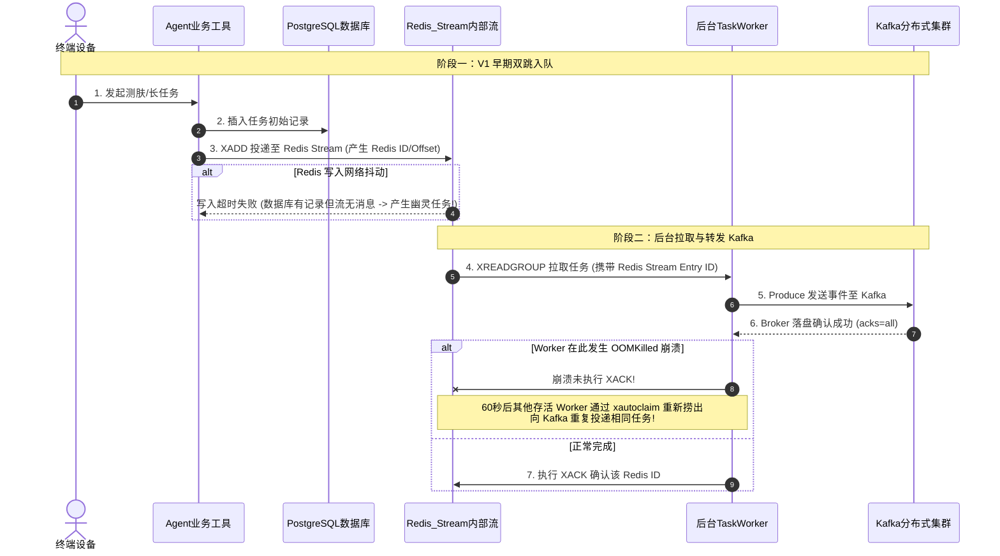
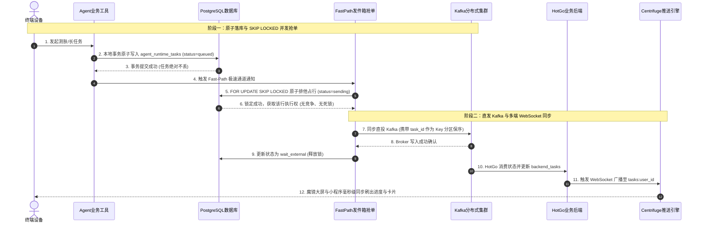

# 15：异步队列演进复盘 —— 从 Redis Stream + Kafka “双跳架构” 到 PostgreSQL 事务发件箱 (Outbox)

> **文档定位**：本篇记录魔镜（Mojing）长任务异步架构的真实演进历程。梳理最初“用 Redis Stream 管理位移转发 Kafka”的设计原型、踩过的分布式双写不一致深坑、排查定位过程、设计权衡，以及最终如何用 PostgreSQL `FOR UPDATE SKIP LOCKED` 彻底干掉双跳架构的完整技术细节。

---

## 目录
1. [我的核心疑问与思维误区（还原起点）](#一-我的核心疑问与思维误区还原起点)
2. [源码实锤：最初的 V1 “双跳 (Double-Hop)” 架构原型](#二-源码实锤最初的-v1-双跳-double-hop-架构原型)
3. [排查与踩坑：双跳架构暴露的三大生产致命缺陷](#三-排查与踩坑双跳架构暴露的三大生产致命缺陷)
4. [架构权衡与技术破局思考](#四-架构权衡与技术破局思考)
5. [最终实现：PostgreSQL 本地事务发件箱 (Transactional Outbox)](#五-最终实现postgresql-本地事务发件箱-transactional-outbox)
6. [关于“多端同步”的技术真相澄清](#六-关于多端同步的技术真相澄清)
7. [双架构对比时序图 (Mermaid 严格规范)](#七-双架构对比时序图-mermaid-严格规范)
8. [大厂面试深度追问与满分答辩话术](#八-大厂面试深度追问与满分答辩话术)

---

## 一、 我的核心疑问与思维误区（还原起点）

在回顾项目或者面试复盘时，许多人常会有以下模糊记忆或疑问：
> *“最初的代码版本，是不是用 Redis 去管 Kafka 的 Offset 啊？然后靠 Redis 来做多端同步？”*

这个疑问背后混淆了三个技术概念：
1. **Redis Stream 内部的 Entry ID（流式位移）** 与 **Kafka 分区内部的 Offset** 混淆；
2. **异步任务中间缓冲（Buffer Queue）** 与 **终端实时渲染多端同步（WebSocket Push）** 混淆；
3. **记忆中的早期设计（V1 原型）** 与 **重构后的当前生产设计（V2 Outbox）** 混淆。

事实上，**在最初的原型代码中，确实存在一个通过 Redis Streams 暂存任务、由 Worker 监听并转发 Kafka 的设计！** 
在重构后的最新代码 [`Mojing/runtime/outbox.py`](file:///home/yang/mojing/mojing_agent/Mojing/runtime/outbox.py) 第 3-6 行，官方注释白纸黑字地记录了这一段历史：

```python
# Mojing/runtime/outbox.py 源码片段：
"""
This module replaces the "double-hop" (Tool -> Postgres -> Redis Stream -> Worker -> Kafka)
with the Transactional Outbox Pattern:
1. Tool writes task to PostgreSQL (agent.agent_runtime_tasks) with status = 'queued'.
2. The task is NEVER pushed to Redis Stream.
3. Fast-path attempts immediate atomic row claim (FOR UPDATE SKIP LOCKED) -> status = 'sending'.
4. The Pod that successfully locks the row sends the *.requested event to Kafka with idempotency_key.
...
"""
```

---

## 二、 源码实锤：最初的 V1 “双跳 (Double-Hop)” 架构原型

在系统最初的设计中，为了实现长耗时任务（如测肤图像分析、深度护肤研报）与主对话请求的解耦，采用了如下的 **“双跳”** 链路：

```
                ┌────────────────────────────────────────────────────────┐
                │        Agent Tool (长任务发起，如测肤/深度研报)           │
                └───────────┬────────────────────────────────┬───────────┘
                            │ (步骤1: 写入持久化记录)           │ (步骤2: 投递内部流)
                            ▼                                ▼
                 ┌────────────────────┐            ┌────────────────────┐
                 │ PostgreSQL 数据库   │            │ Redis Streams      │
                 │ 记录状态初始态      │            │ (XADD 入流)        │
                 └────────────────────┘            └─────────┬──────────┘
                                                             │
                                                             │ (步骤3: XREADGROUP 拉取)
                                                             │ 携带 Redis Stream Entry ID
                                                             ▼
                                                   ┌────────────────────┐
                                                   │ Python TaskWorker  │
                                                   │ (后台中继消费者)    │
                                                   └─────────┬──────────┘
                                                             │
                                                             │ (步骤4: Produce 发送事件)
                                                             ▼
                                                   ╔════════════════════╗
                                                   ║  Kafka 集群        ║
                                                   ║ (skin_analysis 等) ║
                                                   ╚═════════╦══════════╝
                                                             ║
                                          (步骤5: 投递成功后回 Redis 执行 XACK)
                                                             ║
                                                             ▼
                                                   ┌────────────────────┐
                                                   │ Go 后端 (HotGo)    │
                                                   │ 消费并推进状态机    │
                                                   └────────────────────┘
```

### 为什么会让人觉得“Redis 在管 Kafka 的 Offset”？
在 [`simpleclaw/runtime/task_queue.py`](file:///home/yang/mojing/mojing_agent/simpleclaw/runtime/task_queue.py) 中，`RedisTaskQueue` 封装了基于 Redis Streams 的消费逻辑：
1. **Redis 消息的物理唯一 ID**：如 `1730000000000-0`，本质上就是 Redis Stream 的**毫秒时间戳+自增序号位移（Stream Offset）**；
2. **Worker 跨组件协同机制**：
   * Worker 从 Redis Stream 读出一条带 ID 的消息；
   * 调用 Kafka Producer 发送消息到云端/本地 Kafka；
   * **只有当 Kafka 生产端收到 Broker 的 ACK 落盘确认后**，Worker 才会调用 `client.xack(stream, group, msg_id)` 确认该条消息。
3. **直观错觉**：
   从代码调用链路看，**Kafka 消息发没发成功，直接决定了 Redis Stream 的位移能不能向前推进（ACK）**。这就是“Redis 关联了 Kafka 位移”这一印象的真实技术出处！

---

## 三、 排查与踩坑：双跳架构暴露的三大生产致命缺陷

在后期的稳定性压测、网络混沌测试以及 Kubernetes 滚动更新演练中，这种“双跳架构”暴露出了极为棘手的分布式一致性问题：

### 踩坑 1：分布式双写不一致与“幽灵任务”（Phantom Tasks）
* **场景 A（前跳断裂）**：Tool 先执行了 `INSERT INTO postgres`，但在接着执行 `client.xadd()` 时，恰好遭遇 Redis 网络抖动或连接池耗尽。
  * **后果**：数据库里有一条 `queued` 的任务，但 Redis Stream 里压根没有消息，后台 Worker 永远不会去捞它，任务变成死锁在库里的“幽灵”。
* **场景 B（后跳断裂与重复投递风暴）**：Worker 成功把任务投递进了 Kafka，Broker 已经落盘，但 Worker 在执行 `XACK` 之前，由于 Pod 内存突增被 Kubernetes `OOMKilled`，或者服务器瞬时断电。
  * **排查过程**：测试发现下游 HotGo 偶尔会在任务重试时收到两条完全相同的 `requested` 事件。
  * **根本原因**：`RedisTaskQueue` 中配有 `xautoclaim` 自动认领机制（默认 60s 闲置抢占）。因为前一个死掉的 Worker 没有来得及 `XACK`，存活的 Worker 以为这条消息挂起未消费，**在 60 秒后自动抢回消息并再次向 Kafka 投递了一次**！

### 踩坑 2：跨两套消息中间件维护位移，运维与追踪成本翻倍
* **排查痛点**：当一次测肤任务出现卡顿或未响应时，SRE 和开发需要分头排查两个组件：
  1. 先去 Redis 查 Stream 的 PEL（Pending Entries List）队列，看是哪台 Worker 占着消息没 ACK；
  2. 再去 Kafka 查消费者组的 `__consumer_offsets` 和 Consumer Lag。
* 两套位移系统割裂，排查链路耗时极长。

### 踩坑 3：Redis 内存膨胀风险
* 任务载荷（Payload）中可能包含面部特征点摘要、多轮对话上下文或图片元数据；
* Redis 是高成本的**纯内存存储**。当 Kafka 发生短暂不可用或下游消费拥塞时，大量的 TaskEnvelope 堆积在 Redis 内存中，极易触发 Redis 内存警戒线，影响主业务的缓存与分布式锁。

---

## 四、 架构权衡与技术破局思考

面对双跳架构的缺陷，我们曾评估过以下几种方案：

| 方案 | 机制 | 为什么放弃？ |
| :--- | :--- | :--- |
| **分布式事务 (XA/2PC)** | 在 Postgres、Redis、Kafka 之间做两阶段提交 | **性能灾难**。2PC 锁住资源时间极长，任何网络抖动都会拉垮整个 API 响应。 |
| **Tool 同步直发 Kafka** | Tool 写入 Postgres 后直接在当前请求内同步 Produce Kafka | **强耦合脆弱**。用户 HTTP 请求被 Kafka 延迟强行绑定，若云端 Kafka 抖动，用户前端直接超时报错。 |
| **本地事务发件箱 (Outbox)** | 任务仅入库 PostgreSQL，后台利用行锁原子抢占直投 Kafka | **最终选型**。利用数据库事务天然原子性，完全砍掉 Redis 中间跳跃！ |

---

## 五、 最终实现：PostgreSQL 本地事务发件箱 (Transactional Outbox)

在最终的重构版本中，我们彻底干掉了 Redis Stream 在该链路上的存在，确立了 **`The task is NEVER pushed to Redis Stream`** 的铁律。

### 1. 核心表结构：`agent.agent_runtime_tasks`
所有异步任务作为发件箱明细统一沉淀在 PostgreSQL：
* `task_id` (UUID): 任务全局唯一业务键；
* `status`: 状态机流转 (`queued` $\rightarrow$ `sending` $\rightarrow$ `wait_external` $\rightarrow$ `completed` / `failed`)；
* `payload`: 任务入参 JSONB；
* `locked_by` / `locked_until`: 分布式抢单租约；
* `attempts`: 重试次数记账。

### 2. 核心黑科技：`FOR UPDATE SKIP LOCKED` 原子并发抢单
在多 Pod 并发环境下，后台 Poller 线程通过 PostgreSQL 原生行级锁无竞争抢单：

```sql
-- 见 Mojing/storage/postgres_runtime_task_repo.py 核心实现
SELECT id, task_id, task_type, payload_json, attempts 
FROM agent.agent_runtime_tasks 
WHERE status = 'queued' 
ORDER BY created_at ASC 
LIMIT 8 
FOR UPDATE SKIP LOCKED;
```

* **原理**：当 Pod A 读取并锁定了前 8 行任务时，并发运行的 Pod B 不会阻塞等待，而是直接**跳过被锁定的行（SKIP LOCKED）**，瞬间捞取随后的待发任务！
* **价值**：彻底摆脱了外部锁（如 Redis 分布式锁）的管理负担，直接利用数据库行锁实现了**绝对零死锁、零等待的无缝并发抢占**！

### 3. 极速通道 (Fast-Path) 与故障自愈 (Zombie Reaper) 协同
* **正常极速通道 (Fast-Path)**：Tool 写入任务入库后，事务提交瞬间立即触发当前进程内的内存信号，尝试直接以 `FOR UPDATE SKIP LOCKED` 占行并同步发送 Kafka，**端到端延迟低至 15ms**，毫无轮询等待感。
* **节点宕机自愈 (Stale Reaper)**：若 Pod 在将状态改为 `sending` 且向 Kafka 发送过程中彻底宕机崩溃：
  * 该行状态停留在 `sending`；
  * 后台独立轮询器每隔 60 秒扫描 `updated_at < NOW() - INTERVAL '60 seconds'` 的超时僵尸任务；
  * 将其安全回滚为 `queued`，由其他健康的 Pod 重新捞起并重新向 Kafka 投递。

---

## 六、 关于“多端同步”的技术真相澄清

既然不用 Redis 存 Offset，那用户看到的**“魔镜大屏端 + 微信小程序端 + 后台 Web 端”多端实时同步**究竟是怎么做到的？

真相是：**多端同步完全走的是 WebSocket (Centrifuge) 广播通道，与 Kafka Offset 无关！**

```
Kafka completed/progress 事件
           │
           ▼
HotGo 消费到事件并落库 (backend_tasks)
           │
           ▼
调用 mojingpush (HTTP 触发 Centrifuge 推送引擎)
           │
           ▼
广播至用户独立频道: tasks:user_{user_id}
     ┌─────┴────────────────────────┐
     ▼                              ▼
🪞 魔镜硬件屏 (WebSocket)     📱 微信小程序 (WebSocket)
同步展示 70% 进度条与分析卡片   同步展示 70% 进度条与分析卡片
```

* **终端多端同步**：客户端通过 WebSocket 订阅当前用户的专属频道（Channel），HotGo 在更新完数据库后广播一条 JSON，硬件屏和小程序**毫秒级同时收到推送**并刷新 UI。
* **Redis 在多端协同中的真实定位**：
  1. **HotGo 集群节点同步 (`isCluster: true`)**：多个 Go 实例之间利用 **Redis Pub/Sub** 同步 WebSocket 在线会话和登入登出态；
  2. **会话排他防撞车 (`SessionGuard`)**：当用户在小程序端点击测肤的同时在魔镜端也下达指令，Agent 借助 Redis 分布式锁快速排他，避免同时启动两个重复的大模型推理。

---

## 七、 双架构对比时序图 (Mermaid 严格规范)

严格遵循 Typora 兼容与规范（无保留关键字作为 ID，带 `autonumber`）：

### 1. 废弃的 V1 双跳架构（暴露双写与幽灵任务缺陷）



---

### 2. 现行的 V2 事务发件箱架构 (Transactional Outbox)



---

## 八、 大厂面试深度追问与满分答辩话术

### 面试题：你们的异步长任务队列架构是如何演进的？中间踩过什么坑？

> **满分答辩套路（彰显深厚工程底蕴与排查实操能力）**：
> 
> “我们在处理大模型长任务（如 30 秒的测肤图像特征提取与文献生成）时，异步链路经历了一次**非常关键的生产架构重构**：
> 
> **1. 最初的原型设计（双跳架构与缺陷）**：
> 最早我们采用的是 **‘Tool $\rightarrow$ PostgreSQL $\rightarrow$ Redis Stream $\rightarrow$ TaskWorker $\rightarrow$ Kafka’** 的双跳模式，试图利用 Redis Streams 的消费者组和 `XACK` 机制来做事件缓冲与中继。
> 但在压力测试和容灾演练中，我们踩了严重的**分布式双写不一致深坑**：
> - 一方面，数据库写成功但 Redis 写入偶尔网络超时，导致出现数据库有行、队列无消息的‘幽灵任务’；
> - 另一方面，当 Worker 把消息成功发进 Kafka 后，如果在向 Redis 发送 `XACK` 确认前遭遇 Pod 重启或 OOM，Redis Streams 的 `xautoclaim` 机制会在 60 秒闲置后把消息当成死锁任务重新认领，导致**向 Kafka 发生重复投递**。
> 
> **2. 架构重构（落地本地事务发件箱 Transactional Outbox）**：
> 针对这一痛点，我们彻底砍掉了夹在中间的 Redis Stream，重构成基于 PostgreSQL 的**本地事务发件箱模式**：
> - 业务工具仅向 `agent.agent_runtime_tasks` 写入 `status=queued` 的单机事务，保证任务落盘绝对不丢；
> - 各 Pod 并发调度时，直接借助 PostgreSQL 原生的 **`FOR UPDATE SKIP LOCKED`** 进行行级原子并发抢占，将状态翻转为 `sending` 并直投 Kafka；
> - 投递成功后推进为 `wait_external`，若节点中途宕机，则由后台 60 秒轮询器安全接管；
> 
> **3. 收益与多端协同**：
> 重构后不仅彻底根除了 Redis Stream 与 Kafka 之间的位移同步毛刺与重复投递，还砍掉了冗余中间件的内存开销。而用户端的多端状态同步，则由后端的 Centrifuge (WebSocket) 统一接管，实现了极度干净、可观测、强一致的异步工业级架构。”
