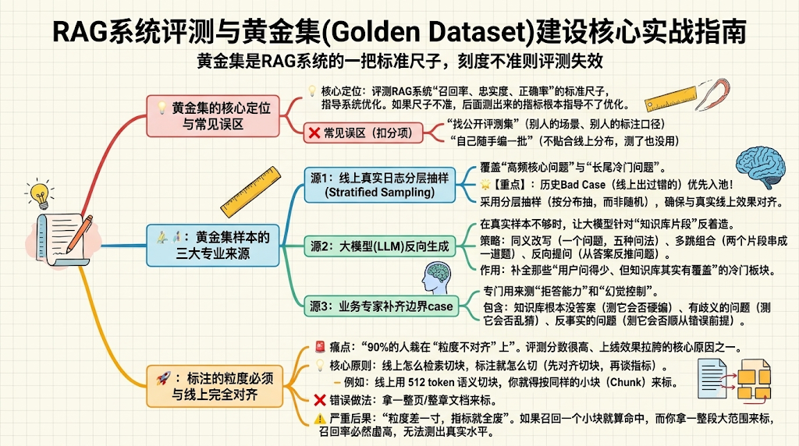

### 一、 核心定位：黄金集是 RAG 系统的一把“标准尺”

- **本质作用**：评测 RAG 的核心指标（召回率 Recall、忠实度 Faithfulness、正确率 Accuracy）。如果黄金集这把尺子刻度不准，后序测出的指标完全无法指导线上调优。   
- **两大典型误区（面试/落地大扣分项）**：   
  1. **套用公开评测集**：别人业务场景和标注口径与自己不符。   
  2. **自己随手编造一批**：脱离线上真实分布，测了等于白测。   

### 二、 样本来源：三大互补渠道（覆盖真实、冷门与边界）

构建专业黄金集需三方结合，避免数据单一偏倚：

1. **线上真实提问日志（分层抽样 Stratified Sampling）**：   
   - **高频核心问题**：覆盖线上主流业务流量。   
   - **长尾冷门问题**：覆盖业务长尾分布。   
   - **历史 Bad Case**：线上出过错的 case **必须优先入池**。   
2. **大模型反向生成（冷门与多样性补充）**：   
   - 在真实日志不足时，针对知识库文档让 LLM 反向出题：   
     - **同义改写**：一个问题生成多种不同问法。   
     - **多跳组合**：将分散的知识片段串联成一道复杂题。   
     - **反向提问**：从答案片段倒推问题。   
3. **业务专家补充边界 Case（针对性评测）**：   
   - **知识库无答案的问题**：测大模型的拒答能力与防幻觉控制。   
   - **有歧义的问题**：测大模型是否会乱猜。   
   - **反事实假设问题**：测系统是否会顺从错误前提。   

### 三、 粒度与标注对齐：检索侧与生成侧的“双对齐原则”

#### 1. 检索侧：标注粒度必须与线上检索 Chunk 完全一致

- **避坑核心**：90% 的人踩在“粒度不对齐”的大坑里。   
- **对齐要求**：线上若按 **512 token 语义切块**，标注的最小单位就必须按同样的切块粒度（Chunk）进行标注。   
- **错误警示**：千万不能拿整页或整章大文档去标注；否则线上只命中一个小片段算召回，标注却按整页算，**召回率必然严重虚高**，导致“评测分数奇高，上线效果拉胯”。   

#### 2. 生成侧：标准答案只能从标注文档里“长出来”

- **核心原则**：标准答案**只依据标注的切片内容生成**，严禁引入外部通用知识或常识拓展。   

- **底层逻辑**：

  $$\text{RAG 的增益} \neq \text{模型的先验记忆知识}$$

  哪怕知识库内容与常识不符，也必须以知识库为准。如果允许模型混入自备知识，测试的就变成模型自身参数记忆力，而不再是 RAG 的检索增强效果，评测彻底失去意义。   

### 四、 防泄漏与公平性：三大实操方法

面试中回答出这三点，能直接体现真实工业界项目落地经验：   

1. **时间隔离（Time-based Isolation）**：   
   - 知识库与问题样本必须在特定时间点做**快照冻结**。   
   - 黄金集快照时间点必须**严格早于**所有用于微调（SFT）和向量库（Embedding）更新的数据。后续新增内容一律不许混入黄金集。   
2. **语义去重（Semantic De-duplication）**：   
   - 将黄金集问题与模型微调（SFT）训练集进行向量余弦相似度比对。   
   - 设定阈值（如 $\text{Cosine Similarity} > 0.9$），超过阈值的样本必须直接从黄金集剔除，杜绝模型靠记忆刷分。   
3. **避免原文照搬（Rephrasing）**：   
   - 黄金集的问题描述**严禁直接照抄知识库原句**。   
   - 必须进行同义改写（搭辞不同、语义相同），否则评测的只是“精确字符串匹配 / 关键词命中”，无法评估真实的“语义检索”泛化能力。   

### 五、 进阶加分项：分层设计与质量管控

#### 1. 结构化分层设计

不要把所有测试样本混成大杂烩，需按两个维度拆解并分别统计指标：   

- **按题型类型分**：
  - **事实型**：验证基础查找命中能力。   
  - **多跳推理型**：验证两段及以上内容的串联推理能力。   
  - **总结归纳型**：验证多点信息的聚合概括能力。   
  - **否定型（拒答）**：验证本就不该回答的识别能力。   
- **按难度梯度分（推荐比例 3 : 5 : 2）**：   
  - **简单（30%）**：验证基础兜底能力。   
  - **中等（50%）**：区分不同方案/参数的优劣。   
  - **困难（20%）**：极限压力测试与探索瓶颈。   

#### 2. 双人盲标与一致性校验

- 抽取 $\ge 20\%$ 的黄金集样本，由两位标注员互不见结果地独立标注。   
- 计算一致性指标（如 **Cohen's Kappa 系数**）：   
  - **$\text{Kappa} \ge 0.7$**：标注标准统一，判定合格。   
  - **$\text{Kappa} < 0.7$**：标注口径存在分歧，不一致处交由**业务专家仲裁**，重标并修正标注规范。   

### 六、 行业通用工程规程：拆分验证集与测试集

标注好的黄金数据集绝不能混在一起反复使用，否则会发生“把测试集用成训练集”的过拟合风险，导致“指标虚高、上线无提升”：   

- **验证集（Validation Set）**：作为日常消耗品，用于参数调优、Prompt/Chunk 策略迭代及方案选型横评。   
- **测试集（Test Set）**：严格封存，只在最终发版上线前运行一次；用一次价值损耗一次，保障最终上线效果真实客观。   

### 结构逻辑总览图（ASCII 架构闭环）

```
               ┌──────────────────────────────────────────────┐
               │         RAG 评测标准尺：黄金集 (Golden Dataset)│
               └──────────────────────┬───────────────────────┘
                                      │
       ┌──────────────────────────────┼──────────────────────────────┐
       ▼                              ▼                              ▼
【 1. 样本三维来源 】           【 2. 双侧粒度对齐 】           【 3. 防泄漏与公平性 】
 ├─ 真实日志分层抽样             ├─ 检索侧切块对齐               ├─ 时间隔离 (冻结快照)
 │   (高频 / 长尾 / BadCase优先) │   (线上 512，标注也 512)      ├─ 语义去重 (对撞SFT去重)
 ├─ 大模型反向生成               └─ 生成侧封闭增益               └─ 避免原句照搬 (改写提问)
 │   (同义改写/多跳/反推)            (答案仅限标注块，禁带外援常识)
 └─ 专家边界 Case
     (无解/歧义/反事实拒答)
       │                              │                              │
       └──────────────────────────────┼──────────────────────────────┘
                                      │
       ┌──────────────────────────────┴──────────────────────────────┐
       ▼                                                             ▼
【 4. 深度分层与质控 (加分项) 】                              【 5. 数据集工程治理 】
 ├─ 题型拆分：事实 / 多跳 / 总结 / 否定                       ├─ 验证集 (日常迭代消耗品)
 ├─ 难度配比：简单 30% : 中等 50% : 困难 20%                  └─ 测试集 (上线前封存严开)
 └─ 双人盲标质检：抽样 20%，Cohen's Kappa ≥ 0.7
```

   


