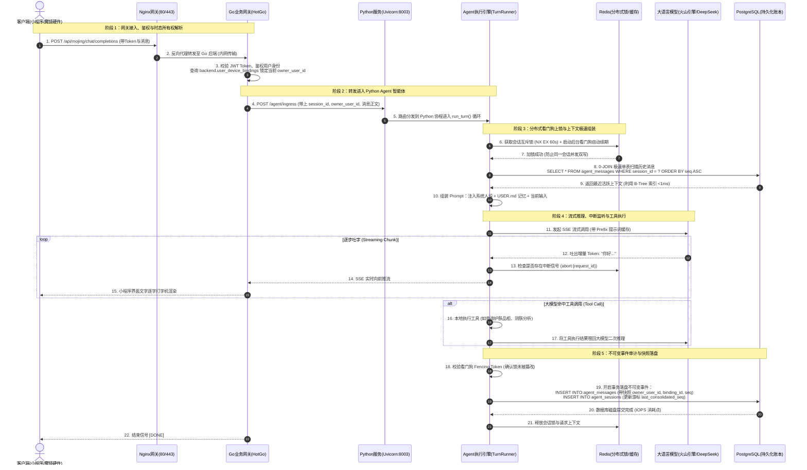

### 一、 名词对齐：在你的这套系统里，到底谁是谁？

结合你给的名词解释，先把你当前的架构角色对号入座，消除所有迷茫：

| 业界概念                            | 你的系统里对应的组件                    | 实际运行形态                                          | 核心职责                                                     |
| :---------------------------------- | :-------------------------------------- | :---------------------------------------------------- | :----------------------------------------------------------- |
| **最外层网关 (Nginx)**              | **Nginx**（生产环境）/ Docker 反向代理  | `nginx:alpine` 监听 80/443                            | 负责公网 HTTPS 证书解析、静态页面托管、按路由把请求分发给 HotGo 或前端。 |
| **业务应用服务器 (Go Server)**      | **HotGo**                               | 纯 Go 编译的独立二进制可执行程序                      | **业务中台 / 网关（BFF）**：负责用户登录、微信小程序鉴权、设备绑定状态、WebSocket / WebRTC 媒体流转发。 |
| **Python 应用服务器 (类似 Tomcat)** | **Uvicorn** (ASGI 服务器)               | `python -m uvicorn Mojing.api.server:app --port 8003` | **Uvicorn 就是 Python 世界里的 Tomcat！** 它负责监听 8003 端口并解析 HTTP/SSE 请求，把事件交给 FastAPI 和 Agent 智能体。 |
| **Agent 核心大脑**                  | **FastAPI + SimpleClaw (Mojing Agent)** | 运行在 Uvicorn 内部的 Python 业务代码                 | **AI 认知大脑**：负责 Prompt 组装、ReAct 循环、Tool 工具调用、记忆沉淀与上下文管理。 |
| **高速缓存与状态锁**                | **Redis**                               | `redis:7.2` (端口 6379 / 16379)                       | 会话互斥锁（避免并发双写）、流式中断标记、WAL 暂存、工具幂等缓存。 |
| **底层持久化存储**                  | **PostgreSQL**                          | `pgvector/pgvector:pg16` (端口 15432)                 | 负责不可变消息账本、审计流水、长期画像、向量知识库的最终落盘（考量 IOPS）。 |

---

### 二、 你的架构为什么要“Go (HotGo) + Python (Uvicorn)”双层设计？

很多初学者会疑惑：“**为什么不直接让小程序调 Python？为什么要中间插一个 Go (HotGo)？**”

这是极其经典且成熟的**中台架构分工（BFF + AI Core）**：
1. **Go 擅长做高并发 IO 守门员**：
   - 微信小程序高频登录、鉴权校验、硬件魔镜心跳、WebRTC 实时语音推拉流、设备解绑/换绑，都是微秒级高并发高吞吐的 IO 操作。Go 语言单机轻量协程（Goroutine）能极其轻松地抗住数万长连接。
2. **Python 擅长做 AI 算力与生态对接**：
   - 大模型调用、LangChain/LlamaIndex、提示词工程、复杂的工具分支判定（ReAct）、多模态诊断，Python 生态无可替代。但 Python 的 GIL 锁和运行时不适合直接裸露在外抗公网海量网络连接。
3. **职责划分**：
   - **HotGo（Go）**：把关业务合法性（“你是谁？这台魔镜是不是你绑定的？你还有没有调用额度？”）。
   - **Mojing Agent（Python）**：专注智能推理（“用户说了什么？我该调哪个工具？回复什么？”）。

---

### 三、 全链路消息处理时序流（从入口到数据库）

下面为你画出**从用户在小程序/魔镜上发一句话，到最终大模型流式吐字并落盘的完整物理流向图**：



---

### 四、 核心阶段与模块精细解剖

#### 1. 为什么你的本地开发环境感觉“看不到 Nginx”？
* **本地开发**：
  你在本地跑测试时，通常直接发请求到 `http://127.0.0.1:8000`（HotGo）或直接 `http://127.0.0.1:8003`（Python Uvicorn）。因为在内网调试时，没有跨域、SSL、限流等需求，所以可以跳过 Nginx 直连。
* **线上生产**：
  在云服务器或 K8s 集群中，前端（小程序/Web）绝不可能直接访问后端的具体端口。公网 IP 绑在 Nginx 上（80/443），Nginx 根据路径做路由分发：
  - `/api/v1/user/...`、`/api/mojing/chat/...` $\to$ 转发给 **HotGo (Go)**；
  - `/static/...` $\to$ Nginx 直接读本地磁盘返回；
  - 外部黑客打流、DDoS 攻击 $\to$ Nginx 的 `limit_req` 模块直接掐断，保护后端 Go 和 Python 不被打死。

#### 2. Uvicorn 在 Python 里的不可替代性
* 你写的 Python 代码（[`Mojing/api/server.py`](file:///home/yang/mojing/mojing_agent/Mojing/api/server.py)）只是一个基于 FastAPI 定义的“路由逻辑表”。
* Python 解释器自己是不能直接监听 TCP 端口接收网络报文的。
* **Uvicorn 就是 Python 的网络底座**：
  - 它基于 C 语言编写的高性能事件循环库 `uvloop` 和 `httptools`；
  - 它接管 8003 端口，把 TCP 字节流解析成 Python 异步协程能处理的 `Request` 对象；
  - 它支撑了 SSE（Server-Sent Events）长连接，使得大模型流式吐字能一跳一跳地推给 HotGo。

#### 3. 为什么最后落在 PostgreSQL 的瞬间是“IOPS 消耗点”？
* 在大模型吐字的过程中，所有的文字都在 **内存（RAM）** 和 **网络缓冲区（Socket Buffer）** 之间流转，此时磁盘是静止的，零 IOPS 开销。
* 只有当一整轮对话结束、或者异步长任务（Outbox）状态改变时，[`session_repo.py`](file:///home/yang/mojing/mojing_agent/Mojing/storage/session_repo.py) 才会执行 `INSERT INTO agent.agent_messages`。
* 此时 PostgreSQL 需要执行 WAL（Write-Ahead Logging）持久化，将数据强制刷到磁盘（`fsync`）。**这就是为什么我们在前面的架构中坚持单表 0-JOIN 写入的原因——在 IOPS 消耗的关键路径上，做到最干净、最直接的顺序写入。**

```json
[ 用户端浏览器 / App / 小程序 ]
       │
       ▼ (1. 静态资源请求：HTML/CSS/JS/图片)
┌────────────────────────────────────────────────────────┐
│ ① CDN 边缘节点集群 (全国各地运营商机房)                  │
│    - 命中直接返回静态资源，90% 静态流量在此结束，不碰源站    │
└────────────────────────────────────────────────────────┘
       │
       ▼ (2. 动态接口请求：如登录、下单、调大模型 Agent)
┌────────────────────────────────────────────────────────┐
│ ② DNS 解析 / SLB (云厂商四层负载均衡，如 LVS / F5)      │
│    - 支撑百万级并发 TCP 连接，分发流量给 Nginx 集群      │
└────────────────────────────────────────────────────────┘
       │
       ▼ (HTTPS 流量到达)
┌────────────────────────────────────────────────────────┐
│ ③ Nginx / API Gateway (最外层反向代理)                 │
│    - 功能：SSL 卸载(解密)、WAF 防火墙拦截黑客、限流防刷   │
│    - 将请求转发进内网 VPC                               │
└────────────────────────────────────────────────────────┘
       │ (明文 HTTP / gRPC 快速内网传输)
       ▼
┌────────────────────────────────────────────────────────┐
│ ④ 业务应用层 (Tomcat / Go Server 集群)                  │
│    - 运行业务代码，处理业务逻辑                         │
│    - 本地一级缓存 (L1 内存 / Python 字典) 先查一圈       │
└────────────────────────────────────────────────────────┘
       │
       ├────────────────────────┬────────────────────────┐
       ▼                        ▼                        ▼
┌──────────────┐         ┌──────────────┐         ┌──────────────┐
│ ⑤ 分布式缓存  │         │ ⑥ 异步消息队列│         │ ⑦ 关系型/向量 │
│    Redis     │         │ Kafka/RabbitMQ│         │  数据库集群  │
│ (L2 共享缓存,│         │ (解耦异步削峰,│         │ (MySQL/Pg/   │
│ 存前缀指纹/  │         │ 承接耗时任务) │         │  Milvus 等)  │
│ 会话工作记忆)│         │              │         │ (持久化底座) │
└──────────────┘         └──────────────┘         └──────────────┘
```

先给你吃一颗定心丸：**完全不用焦虑，你不需要把所有底层细节都当成螺丝钉去从头拧一遍。**

后端架构的知识体系就像金字塔：**最底层的骨架（网络链路、分布式 ID、缓存原则）重在“形成全局认知”，而写业务、做工程重在“关键点选型与避坑”。**

针对你的疑问，按“你需要学什么、知道多少合适”，以及“雪花算法是什么、DNS 到底要懂到什么程度”一次性厘清：

### 一、后端到底需要对 DNS 了解到什么程度？

**结论：你不需要去配置 Bind9 搭建根域名服务器，但必须知道 DNS 在系统架构里的两个核心作用。**

你只需掌握以下两点即可：

1. **DNS 轮询（粗粒度分流与跨地域调度）**：
   - 面试或架构设计时，当被问到“全国用户访问我们系统，怎么让北京用户访问北京机房，广州用户访问广州机房？”
   - 答案就是 **智能 DNS 解析（GeoDNS）**。它根据用户的请求来源 IP，直接把域名解析成最近机房的公网 IP。
2. **生产避坑：DNS 客户端缓存抖动**：
   - 程序（如 Go/Java/Python）请求第三方大模型 API（如火山方舟、OpenAI）时，如果每次请求都走一次公网 DNS 解析，会多出几十毫秒网络延迟；
   - 后端应用通常会在进程内开启 DNS 缓存或长连接池（HTTP Keep-Alive），避免频繁向外查询 DNS。

**到此为止即可**，至于域名解析的递归查询、根服务器、CNAME 配置等运维层面的活，通常有专门的运维（SRE）或云厂商托管，开发人员懂其链路逻辑即可。

### 二、雪花算法（Snowflake）是什么？

#### 1. 核心定义

**雪花算法（Snowflake）** 是 Twitter（现 X）开源的一种**分布式唯一 ID 生成算法**。它能做到在**不依赖任何集中式数据库或 Redis 的情况下**，在分布式机器上每秒并发生成百万个**全局唯一、趋势递增的 64 位整数（Long 型，8 字节）**。

#### 2. 底层构成（为什么它天生有序？）

它把一个 64 位的二进制整数组装成了 4 个部分：

```
 0 - 0000000000 0000000000 0000000000 0000000000 0 - 00000 00000 - 000000000000
 ▲   └──────────────────┬──────────────────┘   └───┬───┘   └─────┬──────┘
 │                      │                          │             │
1位符号位           41位时间戳(毫秒级)            10位机器工作ID    12位序列号计数器
(固定为0)           可支撑约 69 年使用            支撑 1024 台机器   单机每毫秒支持 4096 个
```

- **1 位符号位**：固定为 0，保证生成的 ID 都是正数。
- **41 位时间戳**：精确到毫秒。**这就是它“趋势递增”的秘密**——只要时间在往前走，后面生成的 ID 数值必然比前面大。
- **10 位机器节点 ID（WorkerID）**：代表是哪一台服务器/容器生成的，最多支持 $2^{10} = 1024$ 个实例并发独立发号，互相绝不打架。
- **12 位毫秒内自增序列号**：单台机器如果同一毫秒并发很高，从 0 累加到 4095。即单机一毫秒能产生 4096 个 ID，单机每秒可达到 **400 万 QPS** 的发号性能。

#### 3. 它适用于什么场景？

- **数据库分库分表的主键 ID（核心场景）**：
  - 单机 MySQL 可以靠 `AUTO_INCREMENT` 自增 ID。但如果分了 16 个库、64 张表，每个库如果都从 1 开始自增，主键就会严重冲突。雪花算法生成的 ID 全局唯一。
  - 相比于 `UUID`（36 位的随机无序字符串），雪花算法生成的 ID 是**纯数字且趋势递增**的，非常契合 MySQL InnoDB 的 **B+ 树聚簇索引**，插入效率极高，不会导致 B+ 树叶子节点频繁分裂和页面碎片。
- **分布式业务流水号**：
  - 电商订单号（`Order_ID`）、支付流水号、消息追踪链路中的 `Trace_ID`、大模型会话中的全局 `Session_ID` / `Message_ID`。

#### 4. 面试/生产唯一的大坑：时钟回拨（Clock Move Backwards）

- **问题原因**：算法极度依赖本地操作系统的物理时钟。如果服务器的 NTP 时间校准服务突然把时间往前拨了（比如调慢了 2 秒），算法就会用刚才已经用过的时间戳再次发号，导致**生成重复 ID**。
- **解决方案**：发现当前时间小于上次发号时间时，直接拒绝发号抛异常、或者短暂休眠等待几毫秒时钟追平；大厂开源实现（如美团的 Leaf、百度 UidGenerator）通过记录上一次时钟或利用动态 Buffer 彻底解决了回拨问题。

### 三、你到底需要掌握多少？后端该如何划分学习边界？

学习后端和系统设计，切忌把所有的组件当成代码去逐行死磕，要把知识分为 **3 个清晰的层级**：

#### 级别 1：必须精通、深入底层细节（核心竞争力）

- **语言与运行时**：Go/Python 的并发机制、协程调度原理（GMP 或 asyncio 事件循环）、锁与通道（Channel/Lock）。
- **数据库与索引原理**：MySQL/PostgreSQL 的 B+Tree 索引工作方式、最左匹配原则、事务隔离级别（MVCC）、慢 SQL 调优与 EXPLAIN。
- **高频中间件核心实战**：Redis 5 大数据结构的使用场景、双写一致性基本逻辑、大 Key 防范。

#### 级别 2：懂设计思想与选型优缺点，知其然知其所以然（高并发与架构设计）

- **雪花算法 vs UUID**：知道为什么分库分表用雪花（递增、保护 B+ 树索引），知道时钟回拨问题即可；代码直接调开源库（如 Go 的 `bwmarrin/snowflake`），不需要自己从头位运算手写。
- **多级缓存（L1 内存 + L2 Redis）**：知道为何要挡在 DB 前面、知道本地字典与远端 Redis 的配合（就像你在 Agent 里复用 Prompt 前缀一样）。
- **消息队列（Kafka/RabbitMQ）**：知道异步削峰、解耦、发布订阅机制即可。

#### 级别 3：理解网络与全链路定位，不用管底层运维（拓扑认知）

- **DNS / SLB / Nginx / CDN**：脑海中有一张从客户端到后端的流量拓扑图即可。
  - 知道客户端先过 CDN（拿图片/JS），动态请求过 SLB（四层抗海量连接分流），进入 Nginx（七层拆包解密路由），打到你的服务进程；
  - 出了生产线上 Bug（比如 502/504、跨域、HTTPS 证书过期），能在 10 秒内判断出这是 Nginx 层的问题，还是你的服务进程崩溃导致的，不抓瞎就行。

按照这个节奏构建知识树，你的后端与架构理解就会非常清晰，既不会被零碎的概念淹没，面对真实业务系统与面试深挖时又能游刃有余。